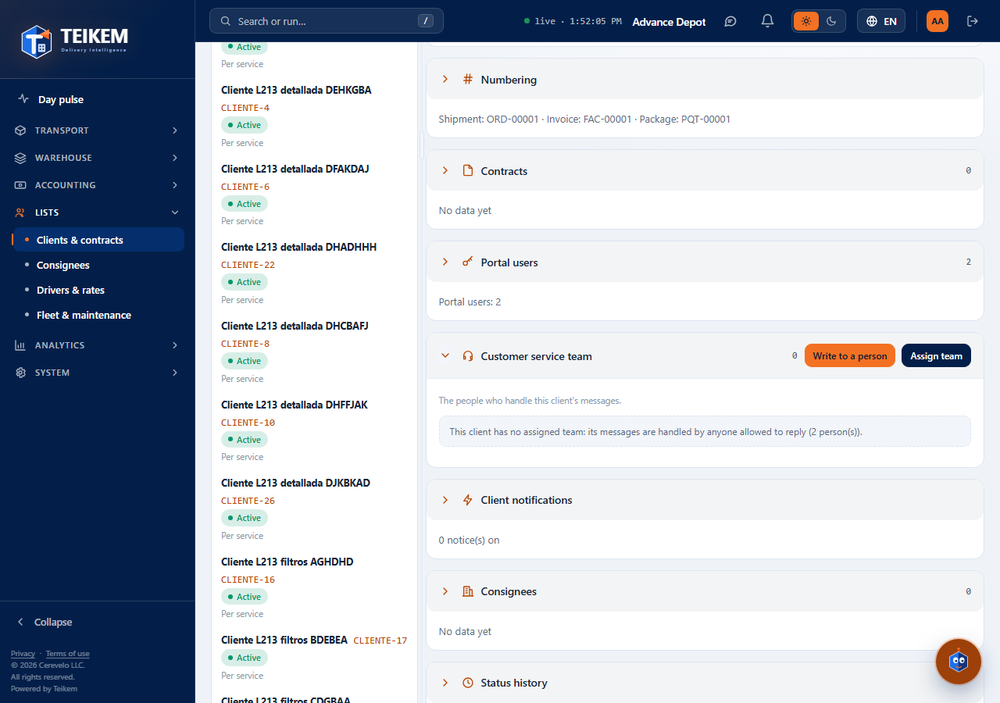
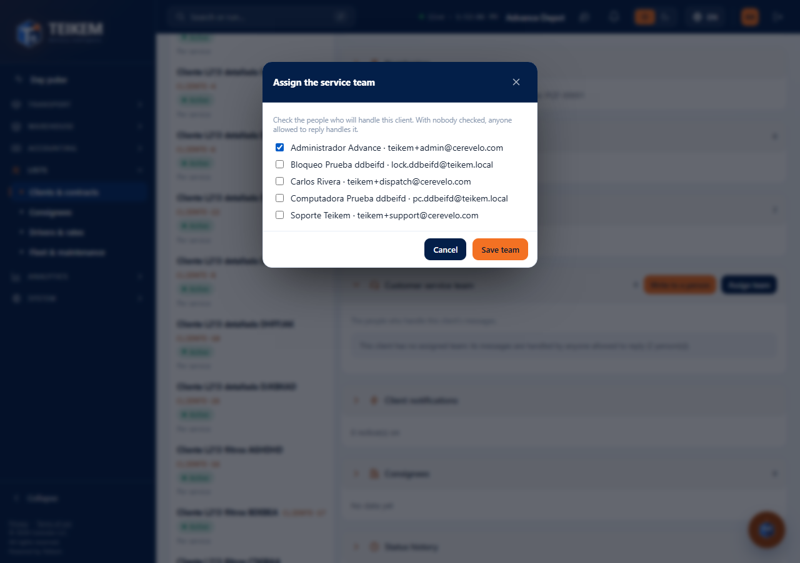
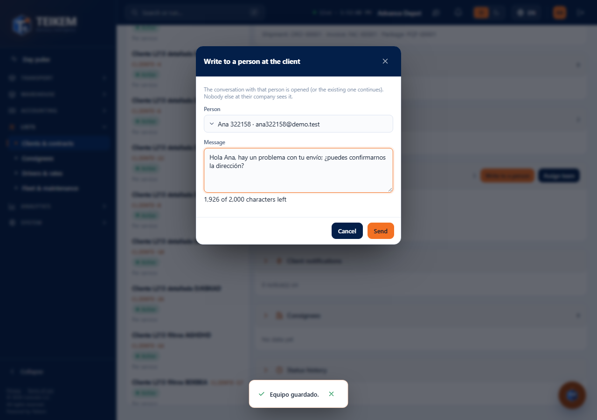
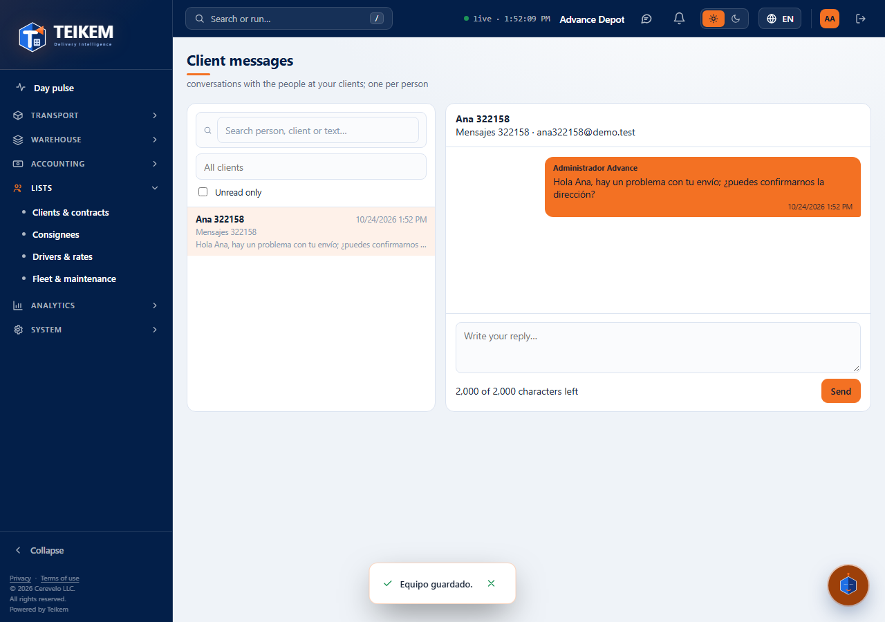
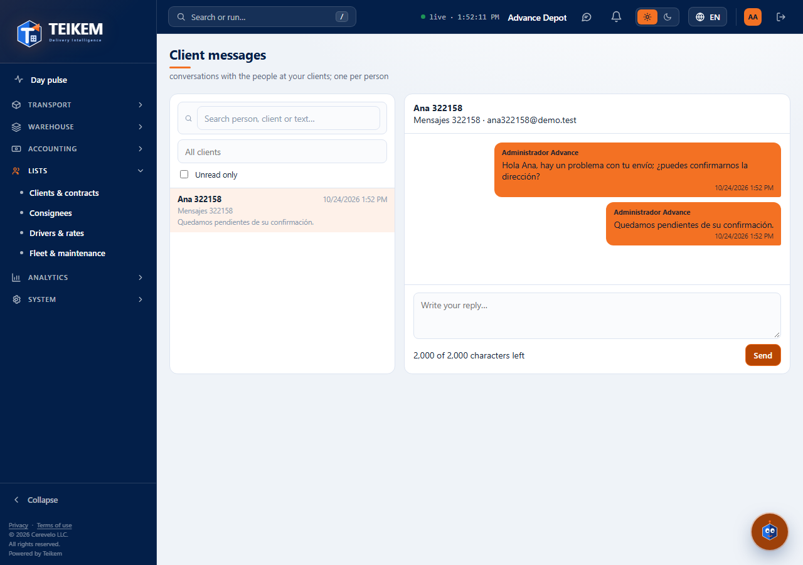
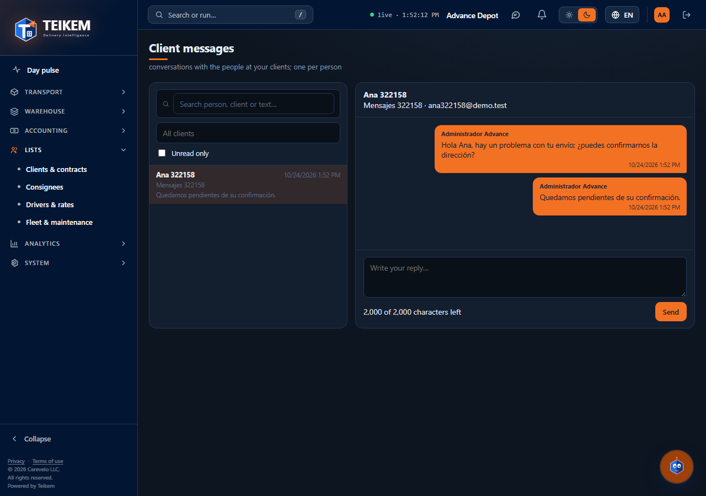

# L104 — Messages with the customer service team (screens)

Batch 104 (client portal). Rules and error messages in [chapter 29](../29-mensajes-con-el-cliente.md). Everything with **light and dark** theme and **Spanish / English**.

## Company web app
1. **Client record → Customer service team** (CLIENT_PORTAL module, `clientmessages.reply`): without a team, the note warns that anyone with permission to reply handles the client.
   
2. **Assign team** (`clientmessages.manage`): the people of the company who handle the client are checked and saved.
   
3. **Write to a person**: the client's person is chosen and the first message is written; it opens the inbox in that conversation.
   
4. **Client portal → Client messages** (`/portal/messages`): list on the left (search, client, “Unread only”, unread) and conversation on the right; the team's messages go on the right in blue. On mobile one or the other is shown, with “Back”.
   
5. **Reply**: empty → “Write the message.”; the counter shows the characters available (2000).
   
6. **Dark theme**: 

The “Client messages” menu shows the badge of unread conversations (it refreshes every 30 s).

## Client app
**Messages** tab (bubbles, “Load earlier messages”, character counter, unread badge on the tab). Covered by jest tests (the full client walkthrough requires the second security step and is in the server tests and the verification against real SQL).
