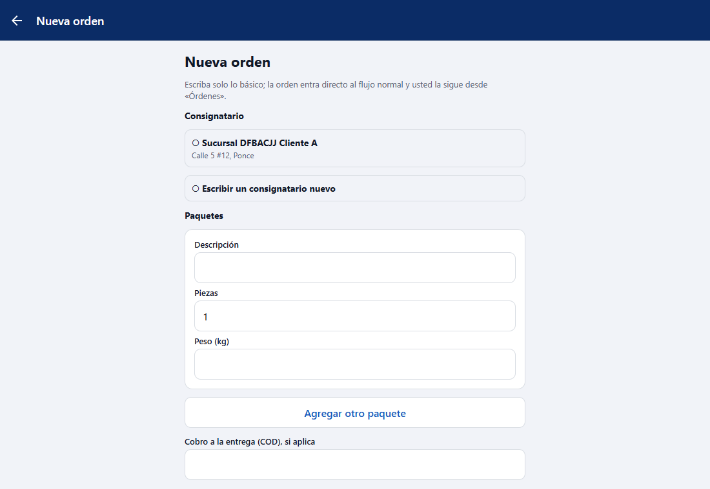
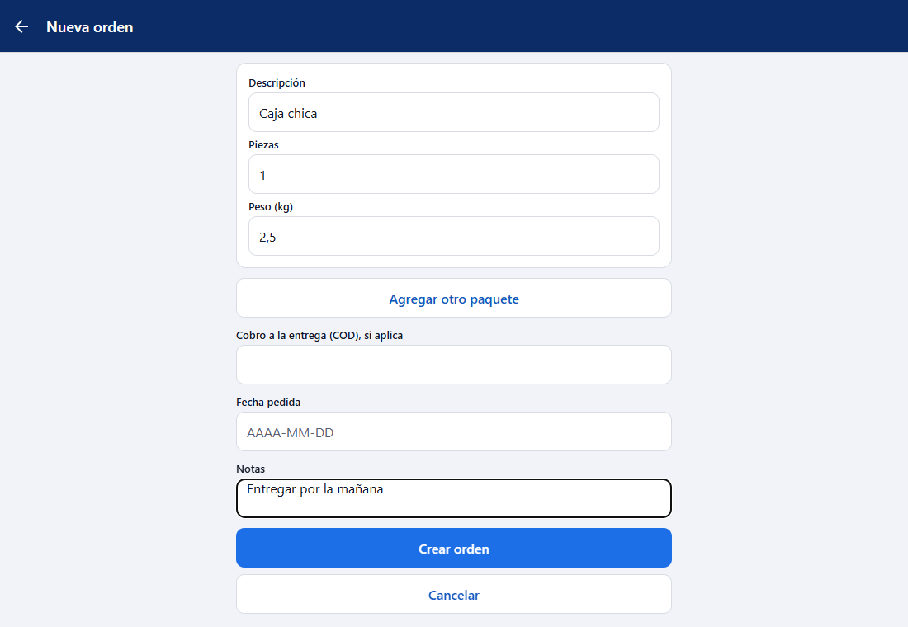
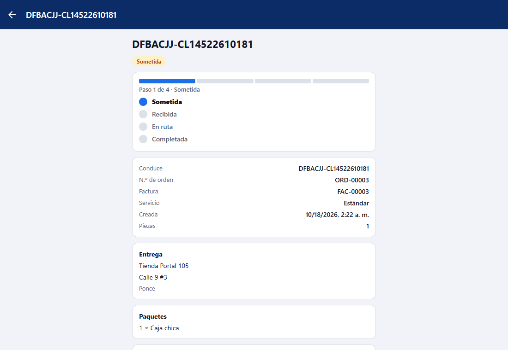

# L105 — New order in the client app (screens)

Rules and errors in [chapter 30](../30-nueva-orden-del-cliente.md). **Orders → New order** tab (only the client's administrators and operators). Light/dark theme and Spanish/English.

1. **The form:** consignee (one of their own or “Enter a new consignee”), pickup, packages, COD, date and notes. 
2. **Filled in:** 
3. **Created:** the order file opens with its tracking. 

Submitting empty warns “Choose the consignee or enter a new one…” without sending anything.
