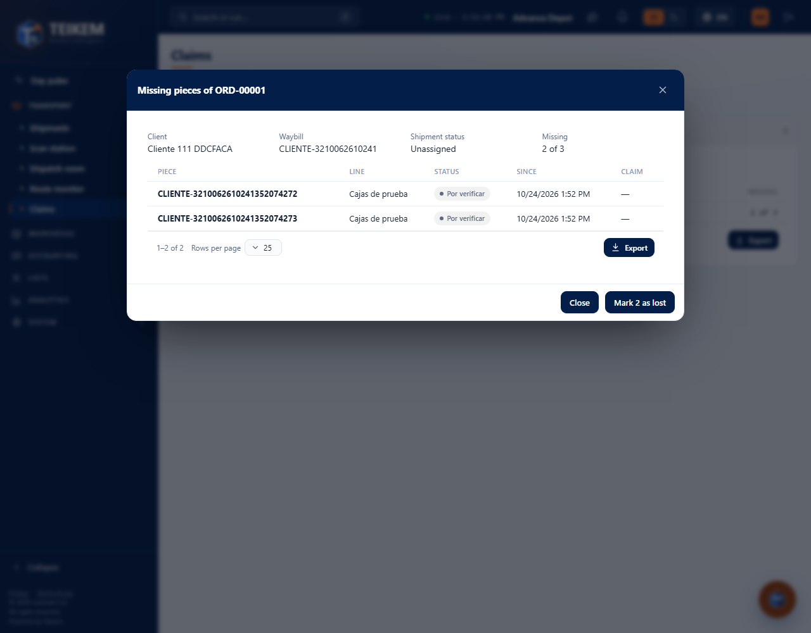
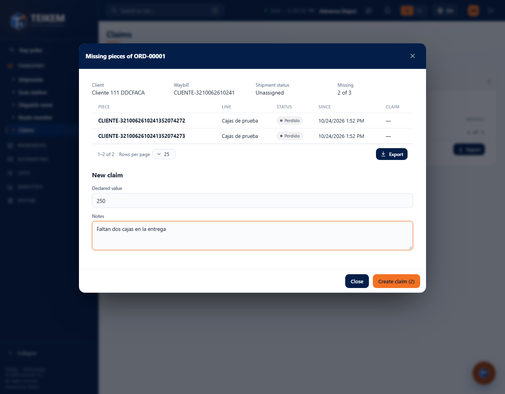
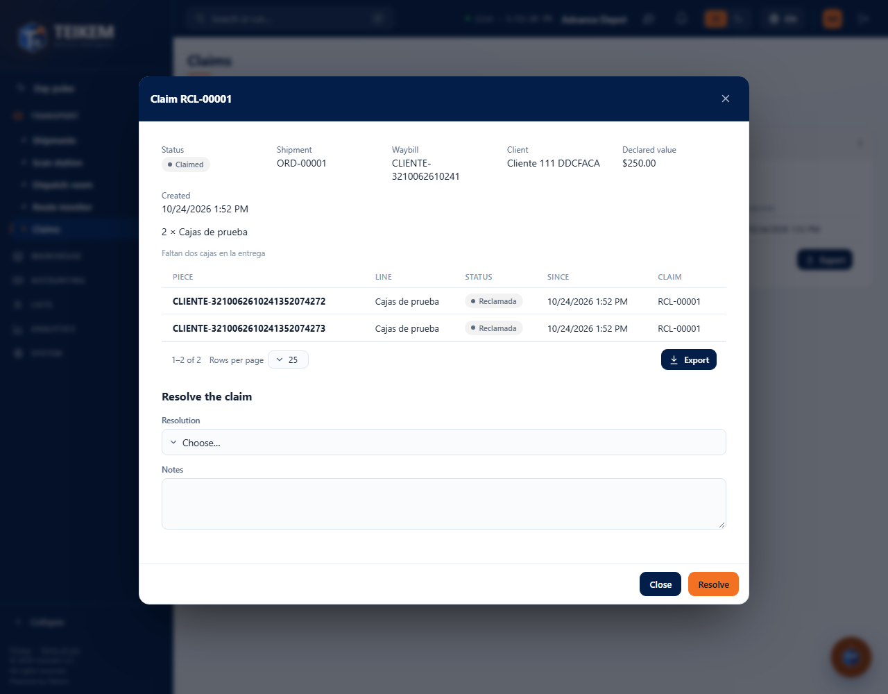
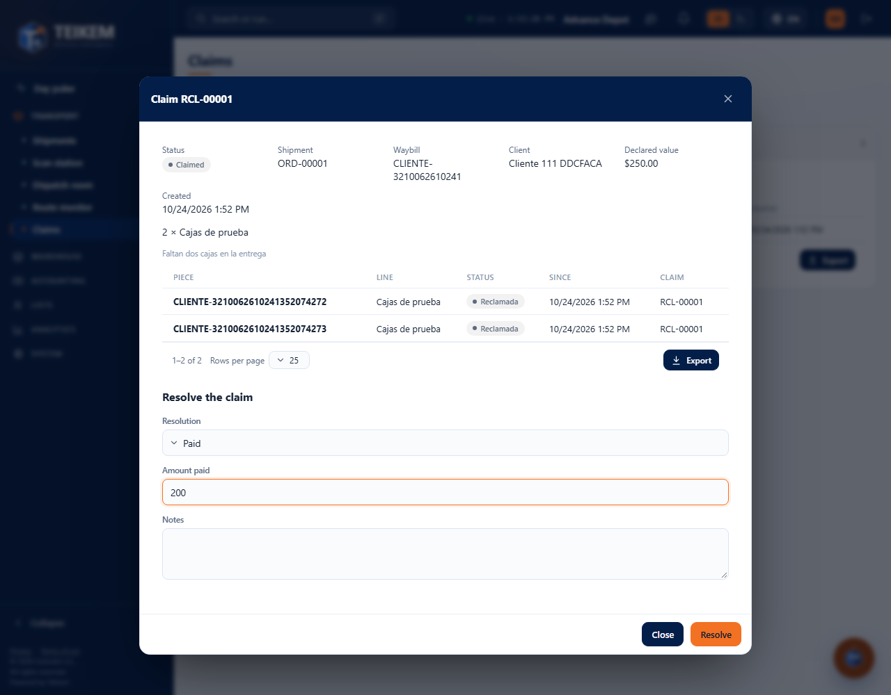
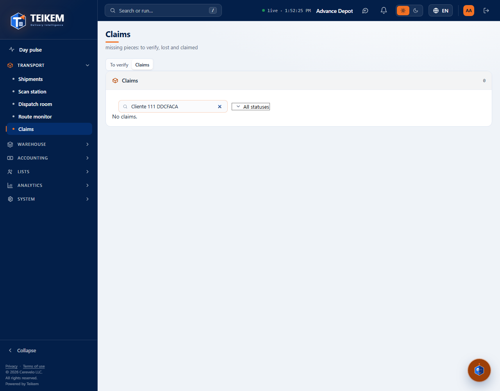
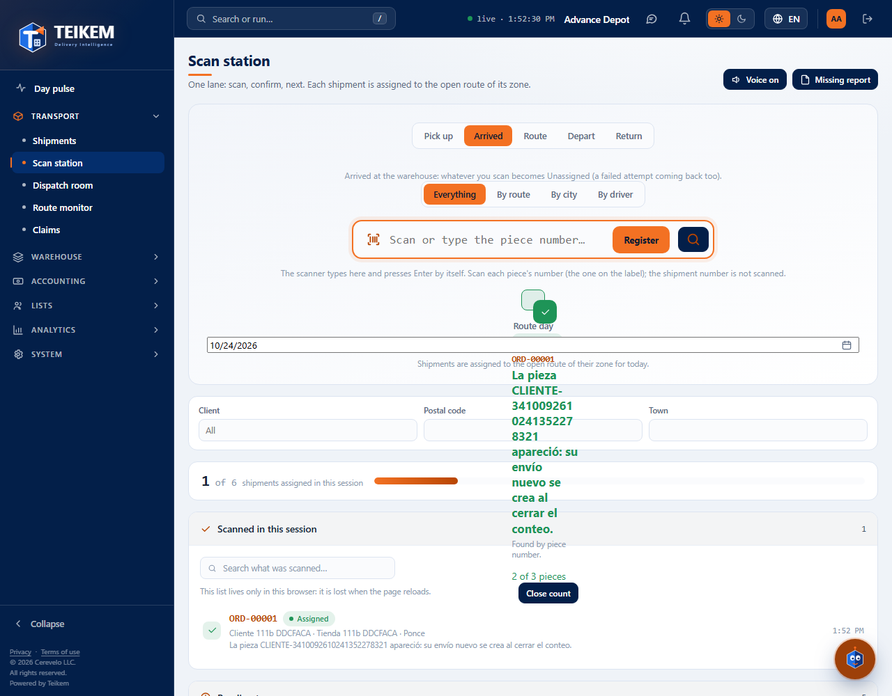
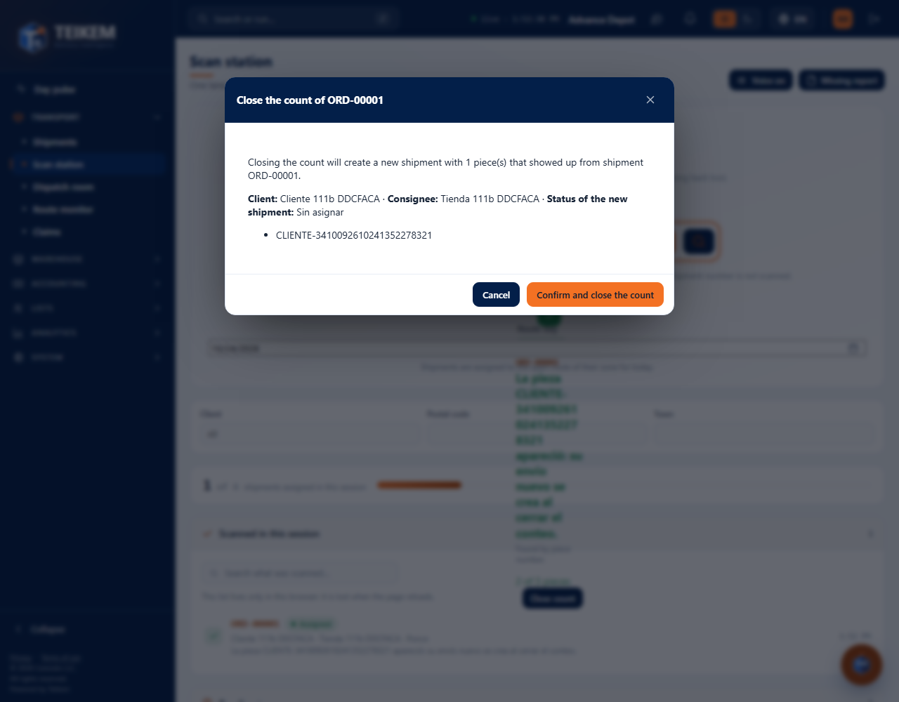
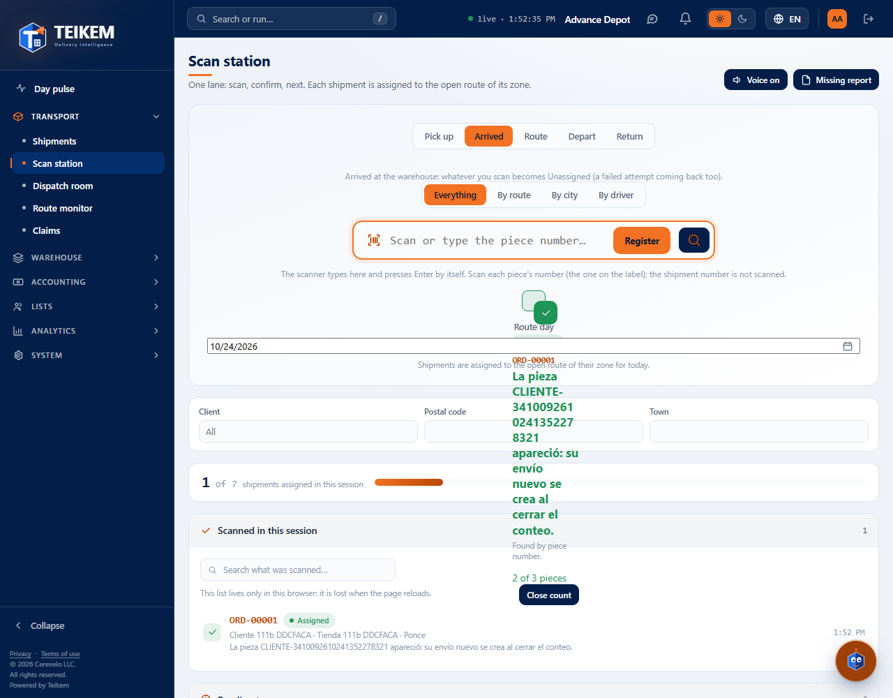

# L111 — Claims (staff web)

Batch 111 screens on the web (**Operations → Claims**, permissions `claims.view` and `claims.manage`). Screenshots taken by the `web-app/e2e/lote111-reclamaciones.spec.ts` walkthrough against the real API (desktop; the same walkthrough passes on mobile at 360 px with no horizontal scroll). Rules and messages: [chapter 31](../31-reclamaciones.md).

## To verify
The orders with missing pieces (those not scanned in an action the order went through, or on “Close count”): how many are missing out of how many, with a search box.

When opening an order you see its missing pieces with their status.

**Mark N as lost** moves the “To verify” pieces to “Lost”; then **Create claim (N)** appears with the declared value and the notes.

## The claim
When created (RCL-#####) its record opens: order, waybill, client, declared value, the pieces and their history. It is **resolved** as Paid (with the amount), Rejected or Closed.

## Claims
The Claims tab lists them with their status (Claimed, Resolved), with search and a status filter.

## Closing the count when a lost piece shows up (Batch 111b)
At the **Scan station**, when a piece that was lost or claimed is scanned (it shows up), the result offers **Close count**.

Closing the count **is not done in one step**: first it shows what is going to happen (a new order is created with the pieces that showed up, with the same Submitted and Pickup dates, and the pieces that were not scanned are listed) and you have to **Confirm and close the count**.

When you confirm, the new order is born (new waybill, same pieces with their same numbers).

