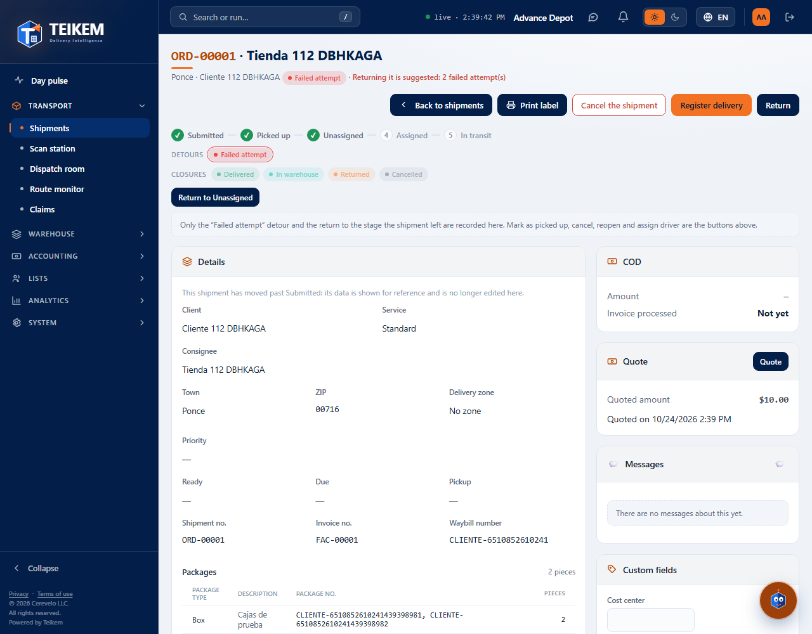
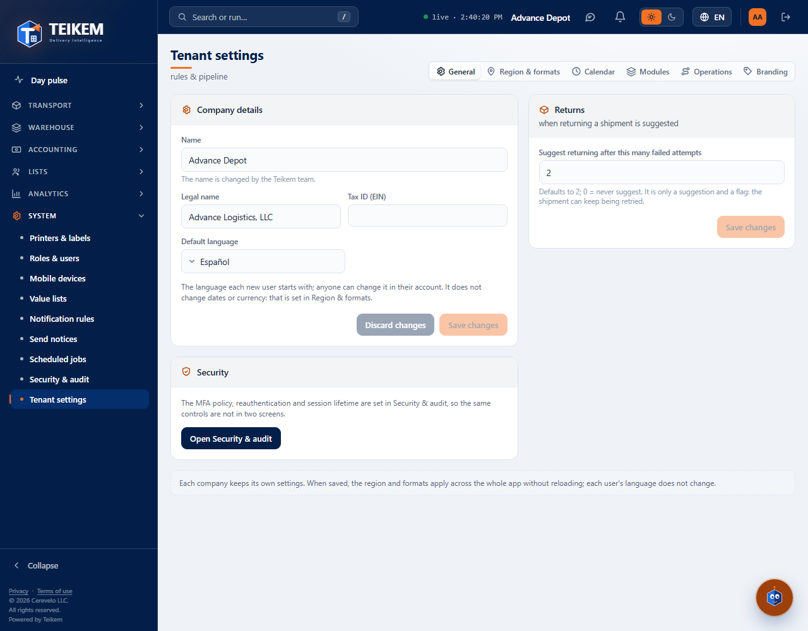
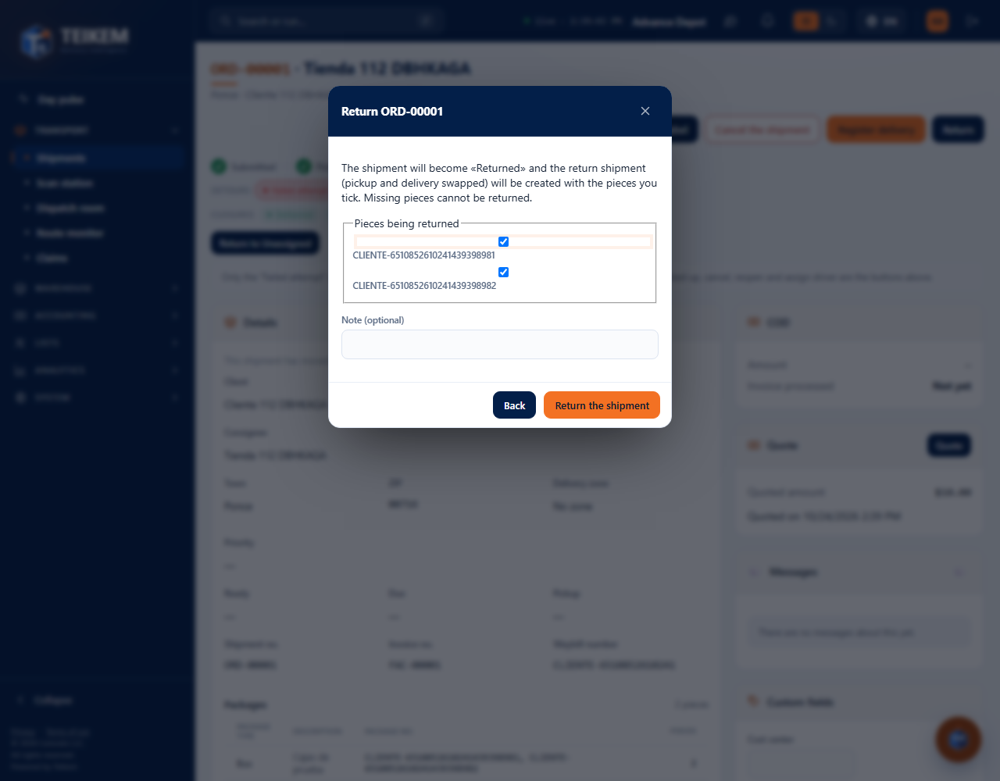
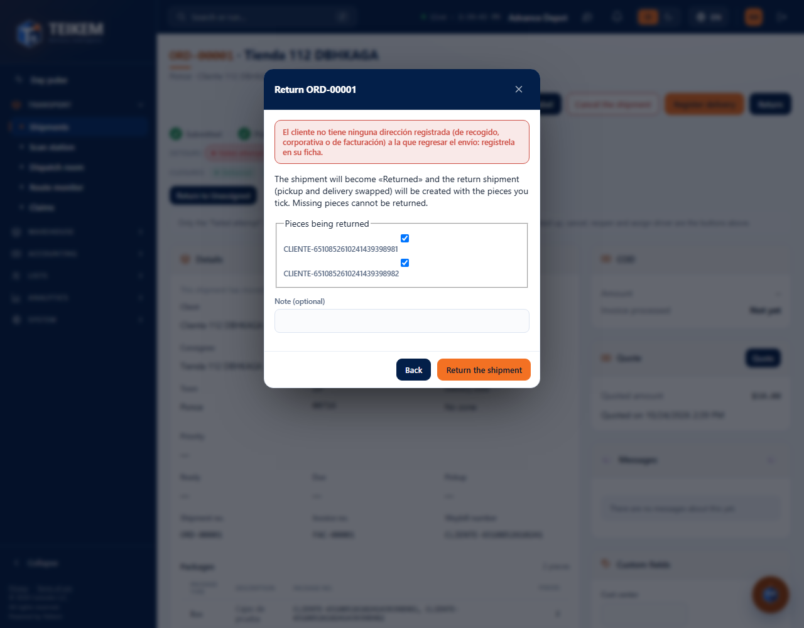
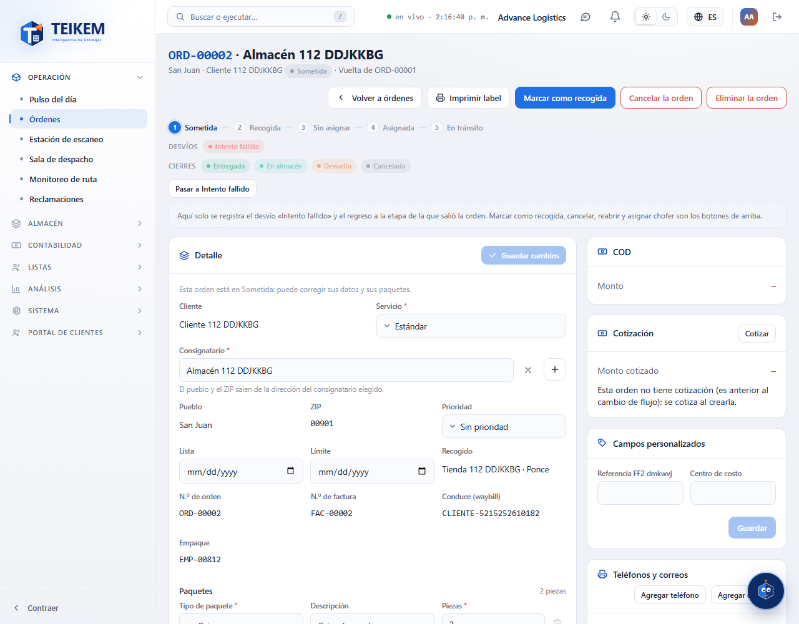

# L112 and L113 — Return and “return after N attempts” (staff web)

Batch 112 and 113 screens on the web (**Operations → Orders**, order file; **System → Settings → General → Return**). Screenshots taken by the `web-app/e2e/lote112-devolucion.spec.ts` walkthrough against the real API (desktop; the same walkthrough passes on mobile at 360 px with no horizontal scroll). Rules and messages: [chapter 32](../32-devolucion.md).

## The order file suggests returning (Batch 113)
When an order reaches the number of failed attempts the company sets (2 by default), the order file warns about it. It is only a **suggestion**: the order can keep being retried.

The number is changed in **System → Settings → General → Return** (0 = never suggest; outside 0 to 20 it is not sent).

## Return (Batch 112)
The **Return** button of the order file (permission `orders.return`; on an order already picked up and not yet final) opens the dialog with the pieces being returned (the missing ones cannot be returned) and a note.

The return order goes back **to the client that placed the order**. If the client has no registered address, it is explained and nothing is returned:

With a registered address, the order becomes **Returned** (final) and can no longer be returned again.

## The return order
It is born with the returned pieces (same numbers), pickup and delivery reversed and no freight; its file says which order it is the return of.

