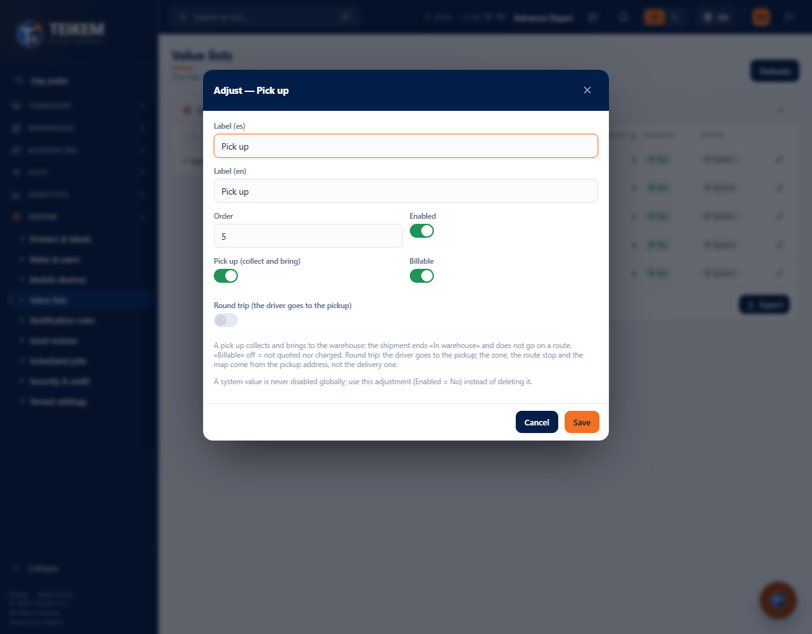
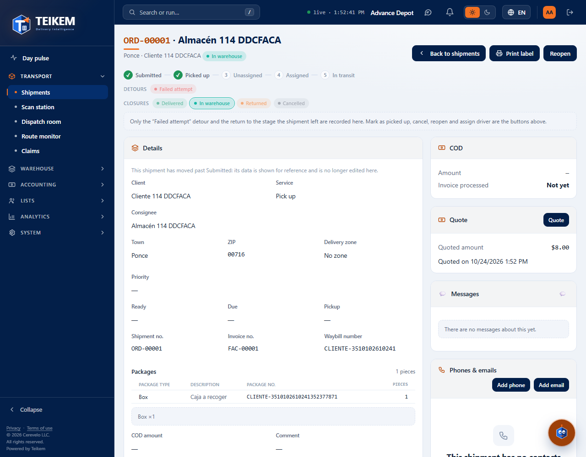

# L114 — “Pick up” service type (staff web)

Batch 114 screens on the web (**System → Lists → Service types**, and the order file). Screenshots taken by the `web-app/e2e/lote114-pick-up.spec.ts` walkthrough against the real API (desktop and mobile at 360 px with no horizontal scroll). Rules and messages: [chapter 33](../33-pick-up.md).

## The service type's flags
In **System → Lists → Service types**, the **Pick up** value → **Adjust** shows two flags per company: **Pick up (collect and bring)** (the order ends “In warehouse” and does not go out on a route) and **Billable** (off = it is neither quoted nor charged).

## A Pick up order
It is born Submitted; when picked up it goes to Pickup and on arrival it becomes **In warehouse** (final status): it is not routed and does not go out on a route, and it has no driver. If it is billable, it is charged on reaching In warehouse.

