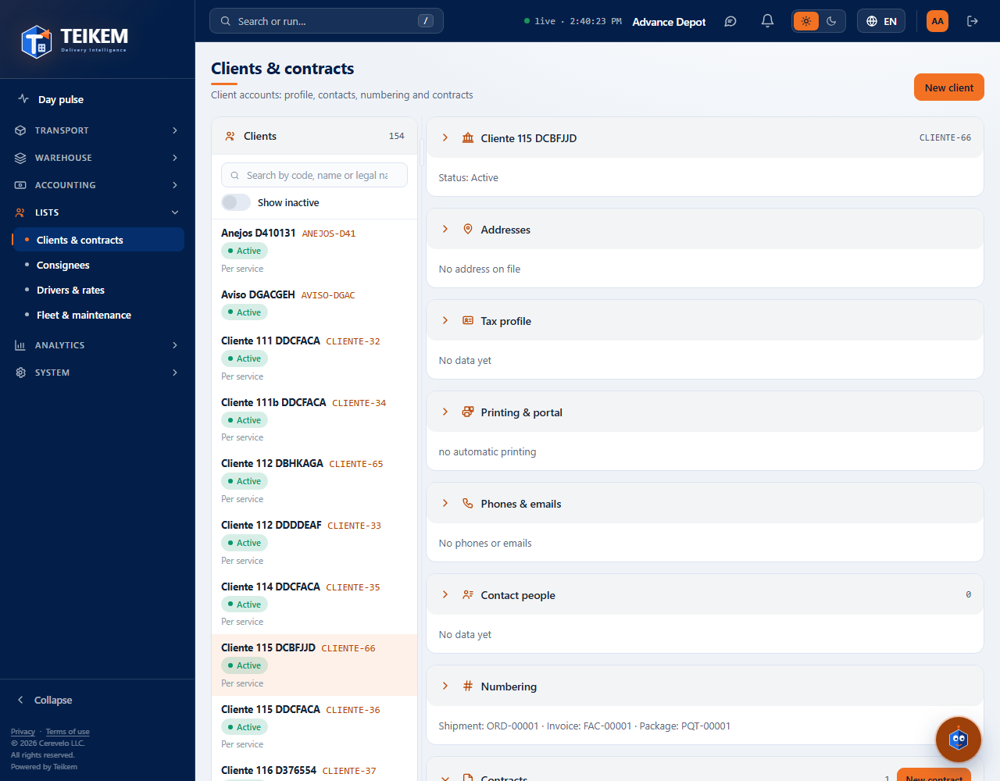
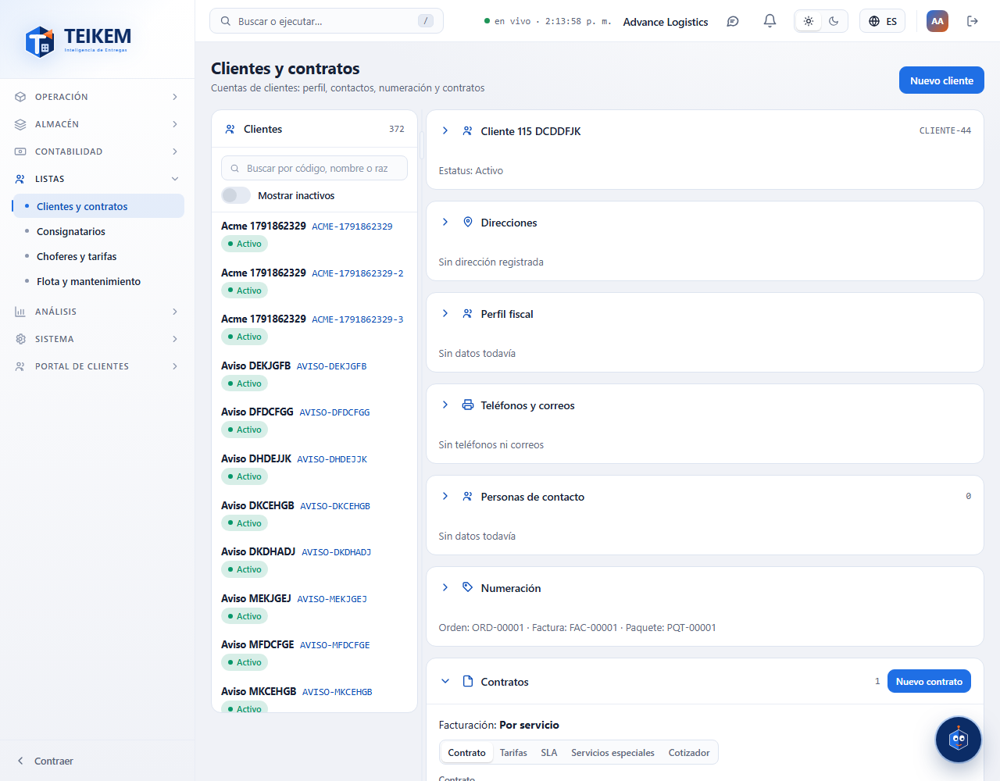

# L115 — Return fee (staff web)

Batch 115 screen on the web (**Lists → Clients and contracts → client record → Contracts → Contract tab → “Return fee”**). Screenshots taken by the `web-app/e2e/lote115-cargo-devolucion.spec.ts` walkthrough against the real API (desktop and mobile at 360 px with no horizontal scroll). Rules and messages: [chapter 32](../32-devolucion.md).

## In the contract
The fee is **optional**: by default, **No return fee**.

Three modes: **Per order** (one amount for all package types), **Per package type** (one amount for each type; added with “Add package type”) and **Per returned piece**. Without an amount it is not saved (“Enter the return fee amount.”).

## When returning
When the order becomes **Returned** the fee is added to it (here 2 pieces × 3.50 = 7.00) and it is billed separately from the freight as “Return fee”.

