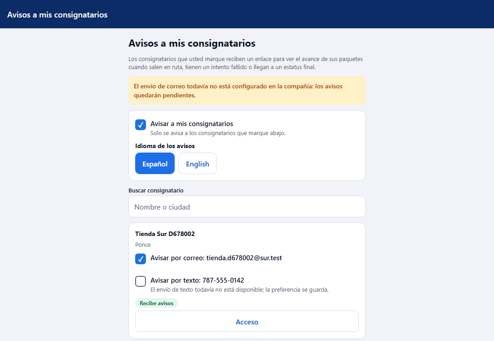
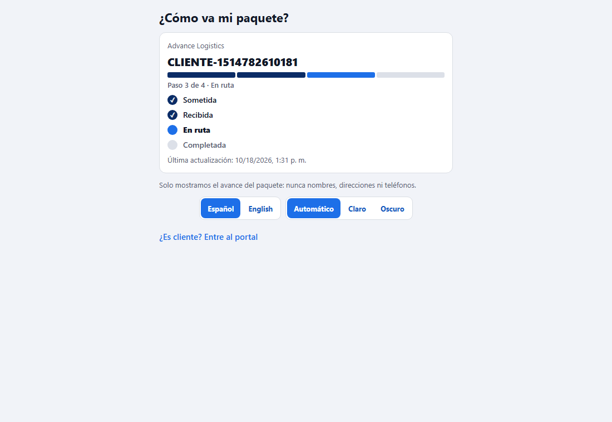
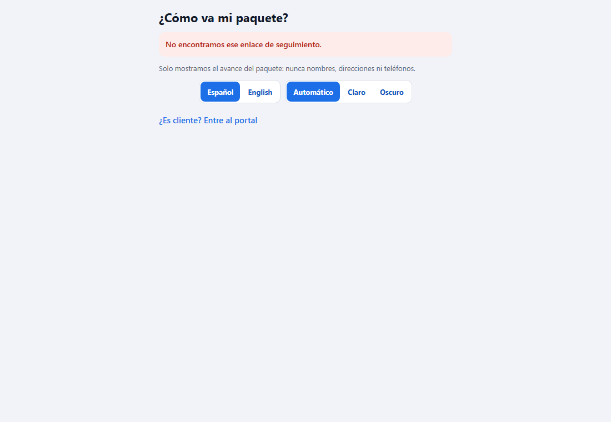
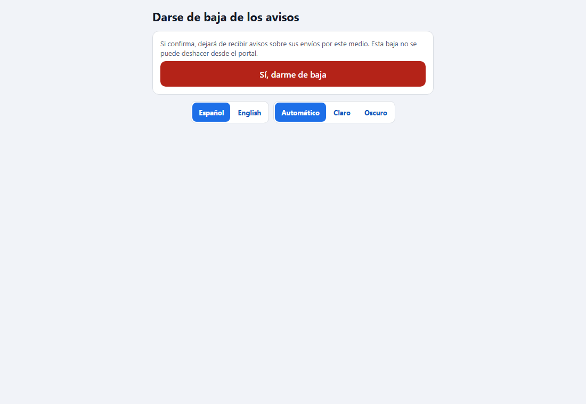

# L116 — Consignee notices (client app)

Batch 116 screens in the client app (`app-cliente`, web and mobile). Screenshots taken by the `web-app/e2e/lote116-avisos-consignatario.spec.ts` walkthrough against the real API (desktop; the same walkthrough passes on mobile at 412 px with no horizontal scroll). Rules and messages: [chapter 34](../34-avisos-al-consignatario.md) and [chapter 28](../28-como-va-mi-orden.md).

## The client turns the notice on and marks each consignee
**Settings → Notices to my consignees → Set up notices**: **Notify my consignees** checkbox, **Language of the notices** and the list of consignees with one checkbox for e-mail and another for text (they can only be checked if the consignee has that channel registered).

When checking a channel the privacy **warning** appears, with the consignee and the e-mail or phone that is about to be marked. **Cancel** marks nothing; **Continue** marks it, it is recorded in the log and the consignee is notified.

Once marked, the consignee shows “Receives notices”.

## The consignee: tracking by link (without an account)
The notice they receive when the order goes On route carries a **link with a token specific to the order**. It opens the public page “How is my package doing?”: only the progress (never names, addresses or phone numbers) and the last update.

A link that does not exist always answers the same thing, without revealing anything.

## Unsubscribing
Opening the unsubscribe link does **not** unsubscribe: you have to confirm with the button. A link that does not work is explained (“The unsubscribe link is not valid.”).

