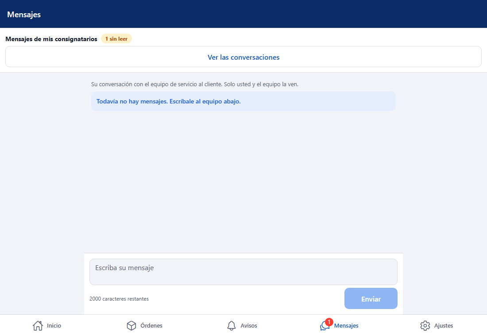
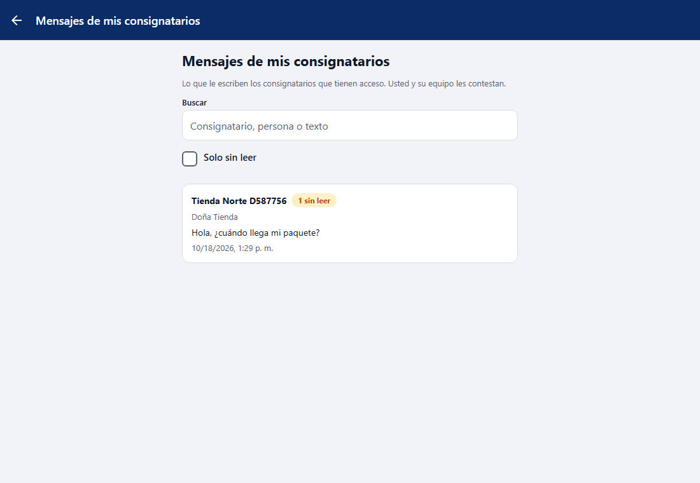
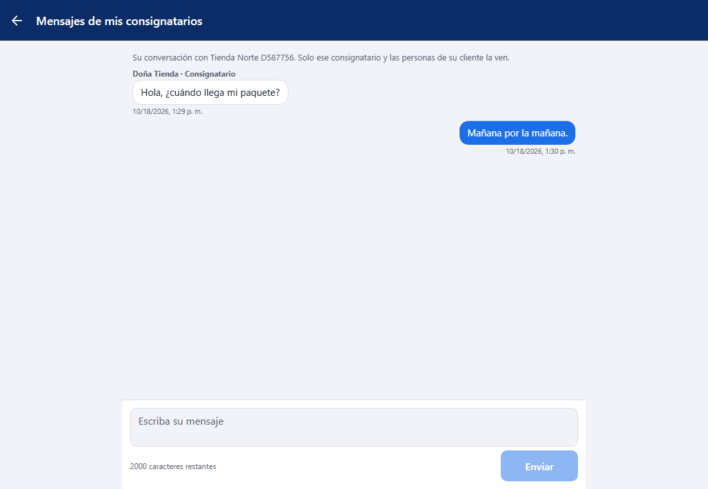
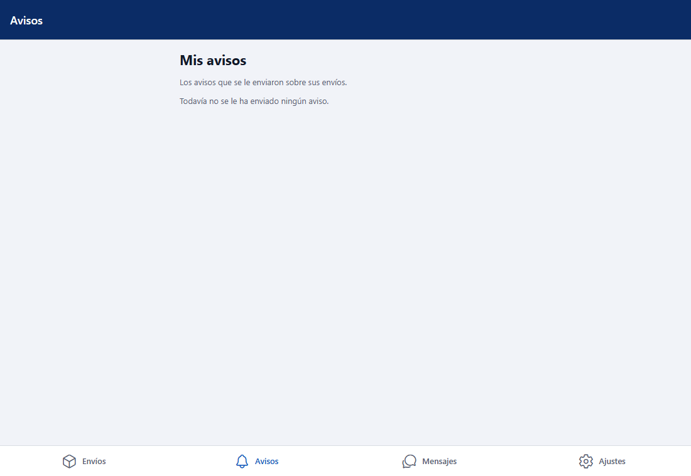
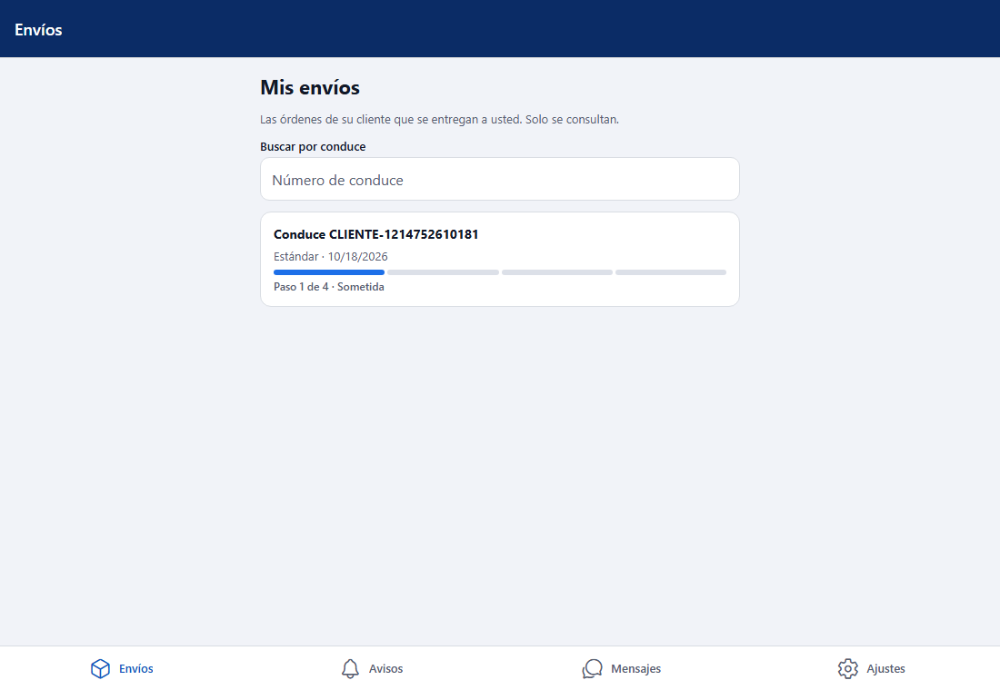
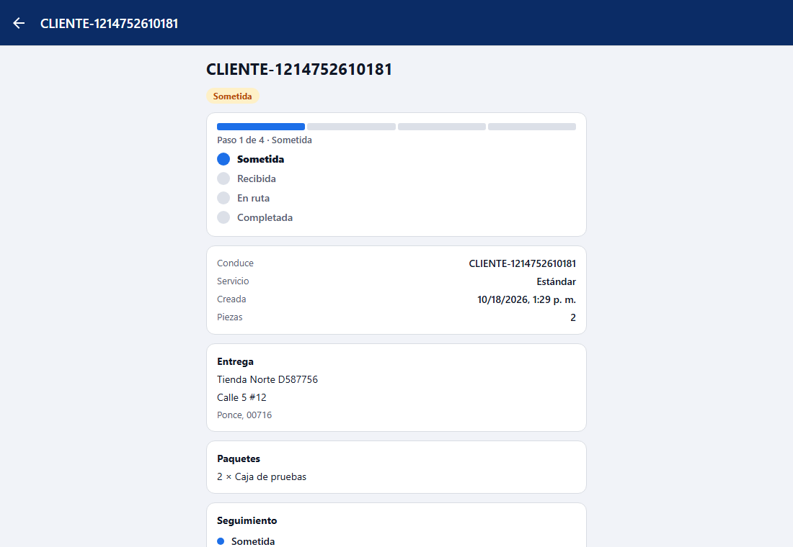
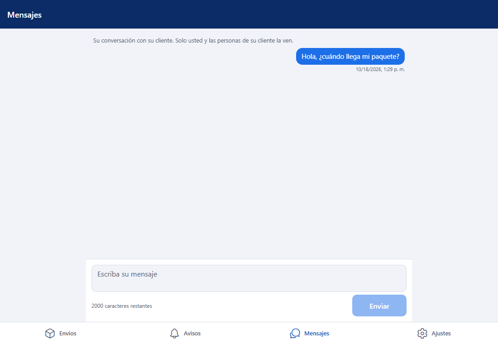
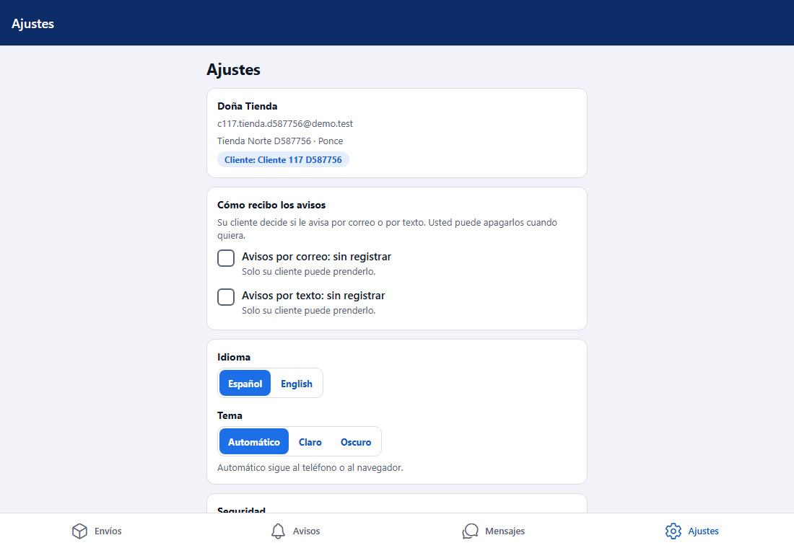
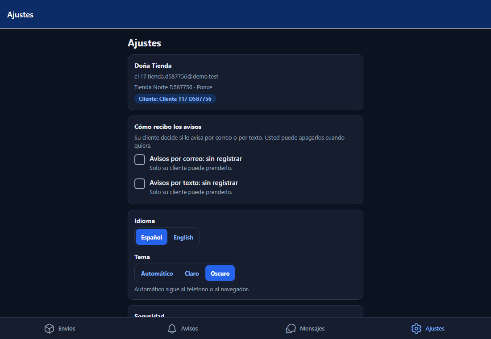

# L117 — Consignee access (client app)

Batch 117 screens in the client app (`app-cliente`, web and mobile). Screenshots taken by the `web-app/e2e/lote117-consignatario.spec.ts` walkthrough against the real API (desktop; the same walkthrough passes on mobile at 412 px with no horizontal scroll). Rules and messages: [chapter 35](../35-acceso-del-consignatario.md).

## On the client's side (administrator or operator)

### Giving access to a consignee
**Settings → Notices to my consignees → Set up notices**, on the consignee's card: **Access** button. You type the invitation e-mail (empty = the consignee's main one) and the name.

When inviting, “Invitation sent to …” appears and the person becomes **Invitation pending**, with **Resend invitation** and **Remove access**.

### Messages from my consignees
In the **Messages** tab, at the top, the access to the conversations with how many are **unread** (it also adds to the tab's badge).

The list (most recent first, with search and “Unread only”) and, when tapping one, the thread where you reply.

## On the consignee's side
They sign in with their e-mail and password (without two-step verification) and only have **four tabs**: Shipments, Notices, Messages and Settings. There is no Home and no way to create orders.

### Notices (the inbox)

### Shipments (read-only)
Their shipments with the progress bar and search by waybill; when tapping one, its file (address, packages, timeline), without prices.

### Messages with their client

### Settings
Their account and **How I receive notices**: they can turn off e-mail or text and turn back on only what they themselves turned off.

