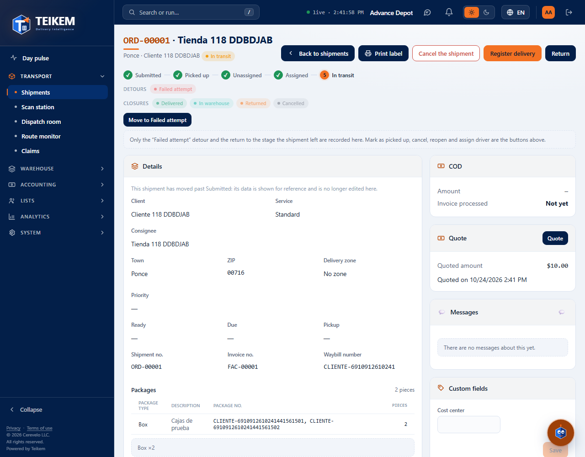
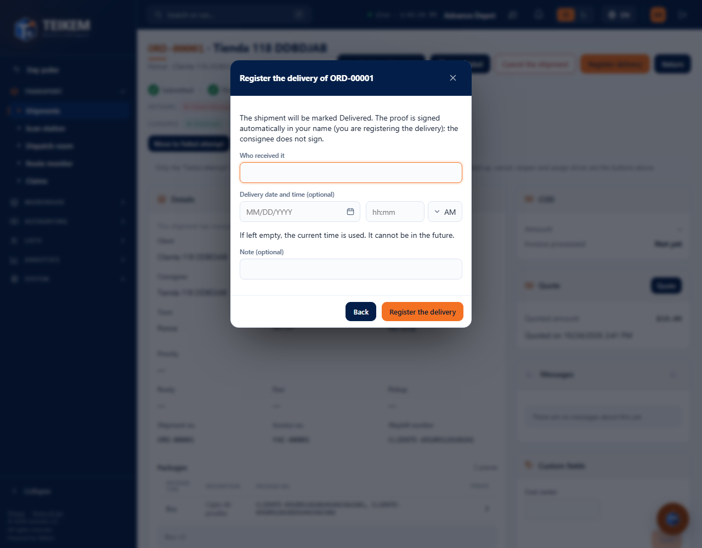
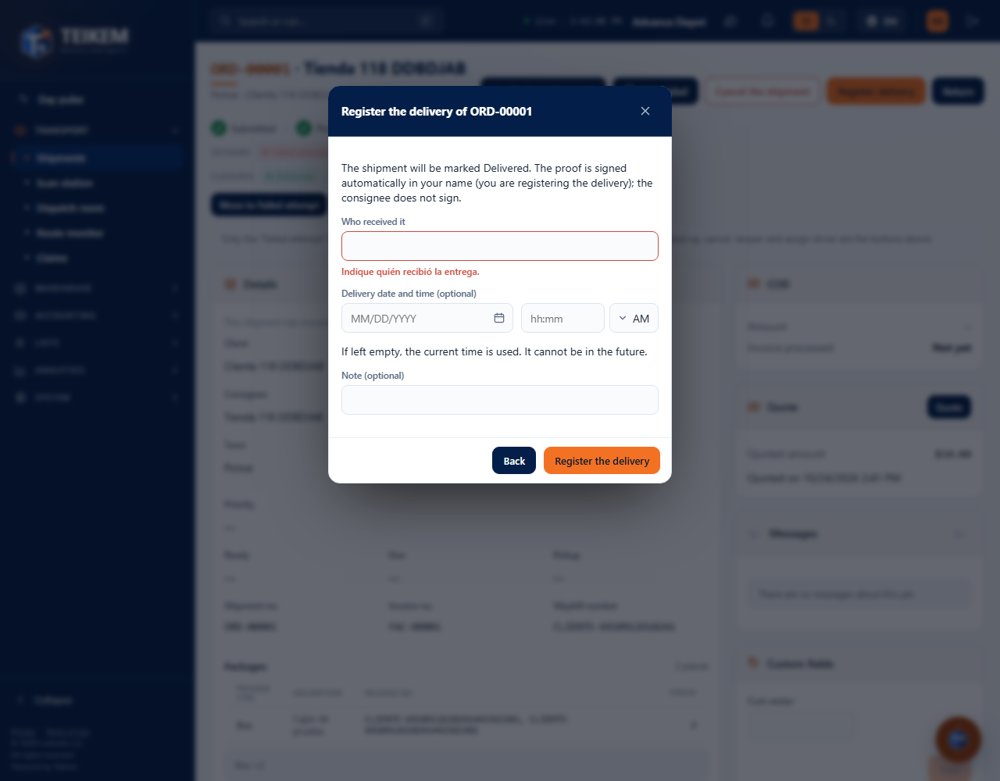

# L118 — Recording the delivery from the web (staff web)

Batch 118 screens in **Operations → Orders → order file**. Screenshots taken by the `web-app/e2e/lote118-entrega-web.spec.ts` walkthrough against the real API (desktop and mobile at 360 px with no horizontal scroll). Rules, API and messages: [chapter 36](../36-registrar-entrega-web.md).

## The file of an order in transit
With the `orders.deliver` permission and the order in progress, the **Register delivery** button appears.

## The dialog
It warns that **the proof of delivery is signed automatically in your name** and that the consignee does not sign. **Who received it** is required; the date and time and the note are optional.

Without who received it, nothing is sent:

## The delivered order and its proof of delivery
The order becomes **Delivered** (the statuses that were missing are left “skipped” in the history) and the right column shows the **Proof of delivery**: who received it, when, who recorded it, “Signed automatically by [user]”, the location and the notice “The consignee did not sign”.

