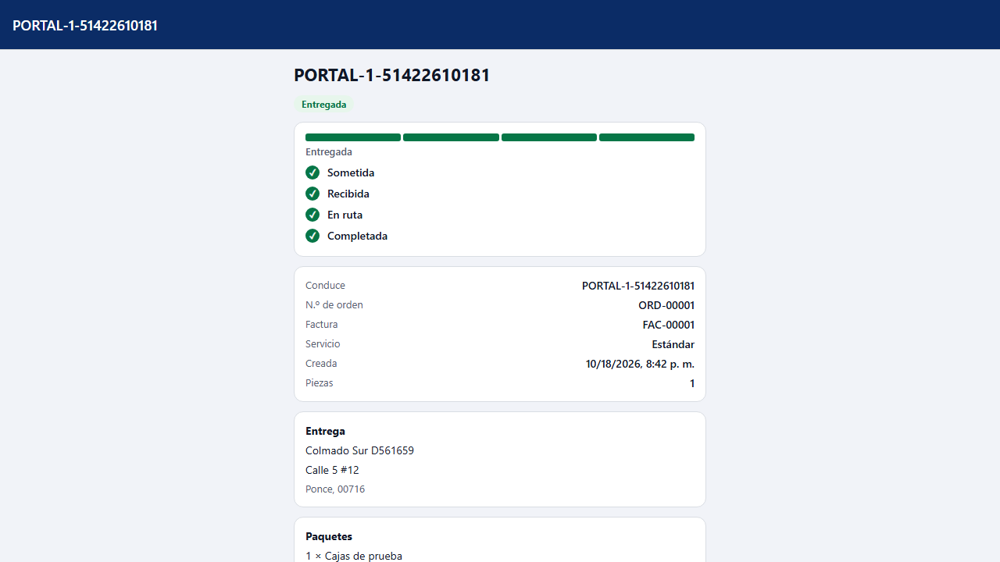
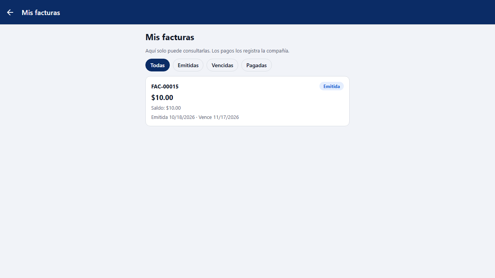
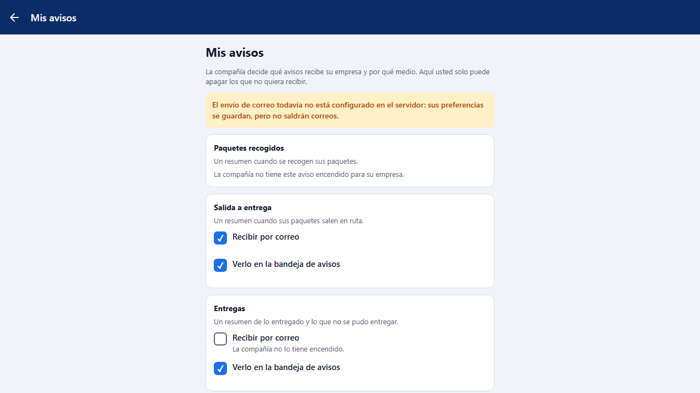
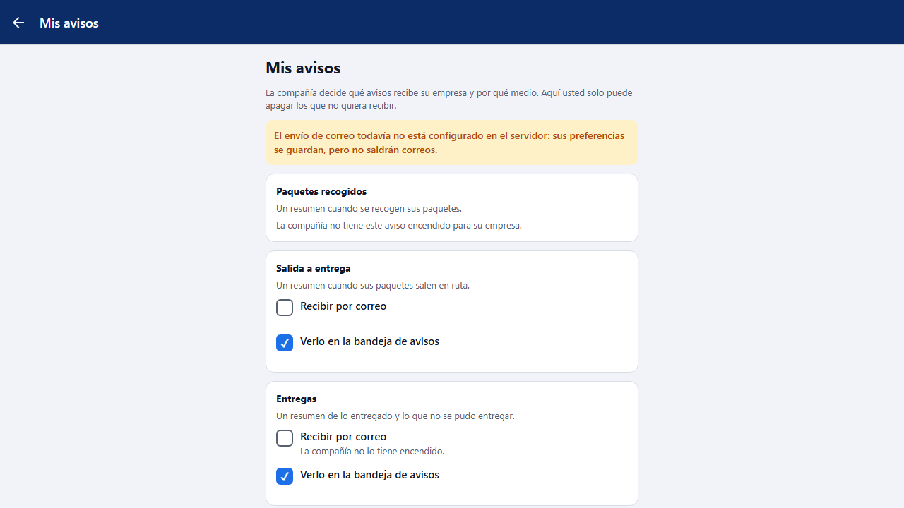
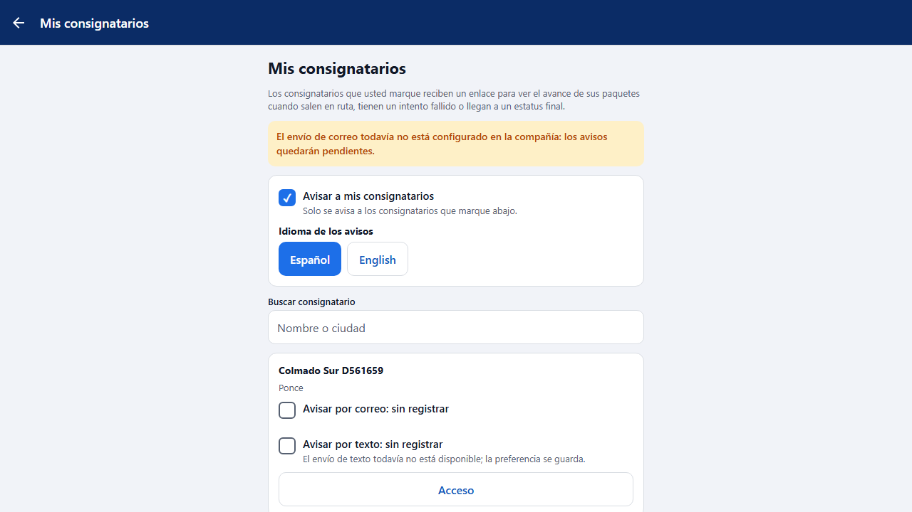

# L119 — Client portal: proof of delivery, invoices, my notices and consignees (client app)

Batch 119 screens in the **client app** (web and phone). Screenshots taken by the `web-app/e2e/lote119-portal.spec.ts` walkthrough against the real API (desktop and mobile at 360 px with no horizontal scroll). Rules and API: [chapter 37](../37-portal-facturas-avisos-comprobante.md).

## Proof of delivery in the order file
Who received it and when, and that the delivery was recorded by the company's staff (the consignee did not sign). Without the user's name or internal notes.

## My invoices
Home has the **My invoices** button. A read-only list, with a status filter.

The file of an invoice: detail, totals, balance and payments received. There is no payment action.

## My notices
The company sends: what it did not turn on is shown as “unavailable”; the person turns off what they do not want.

## My consignees
The list of the client's consignees, with their notices and their access.

