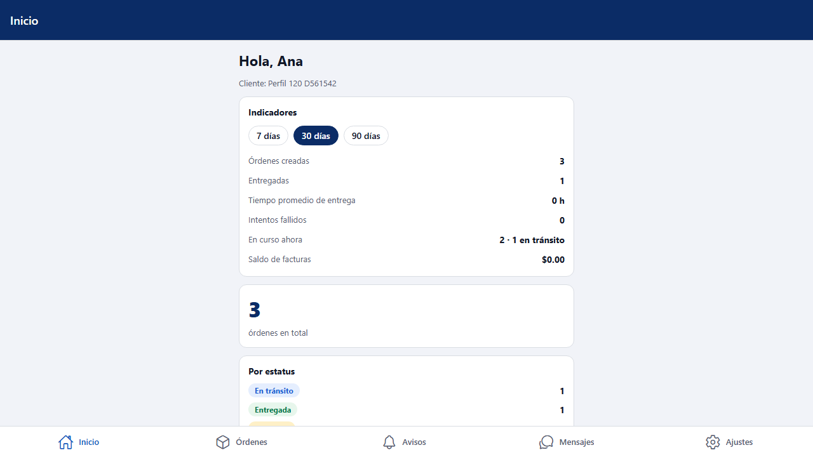
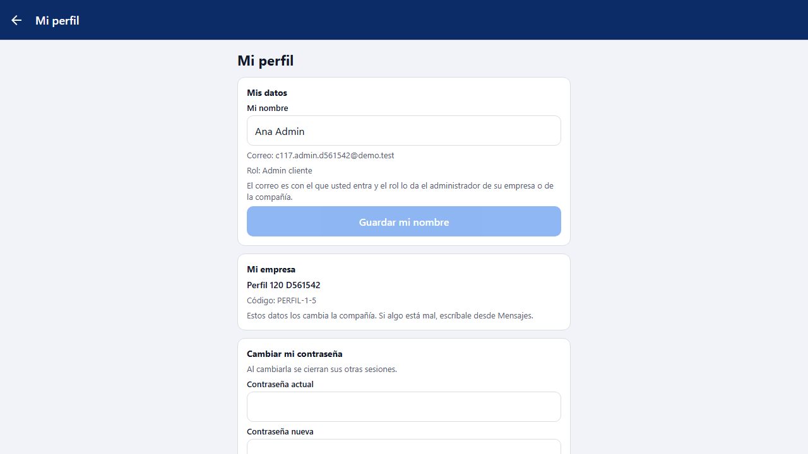
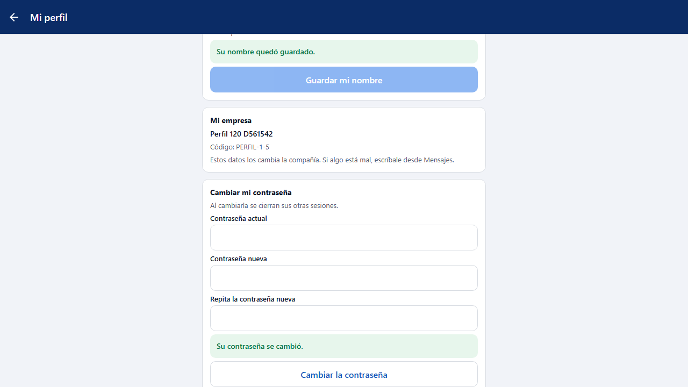

# L120 — Client portal: indicators, my profile and my password (client app)

Batch 120 screens in the **client app** (web and phone). Screenshots taken by the `web-app/e2e/lote120-perfil-indicadores.spec.ts` walkthrough against the real API (desktop and mobile at 360 px with no horizontal scroll). Rules and API: [chapter 37, §5 and §6](../37-portal-facturas-avisos-comprobante.md).

## Indicators on Home
From the last 7, 30 or 90 days. What does not apply (no promised date, no billing or no COD) is not shown.

## My profile
My name (editable), my e-mail and role (read-only) and my company's data (read-only: the company changes them).

## My password
Current, new and repeated password; the server messages come out in the person's language.

