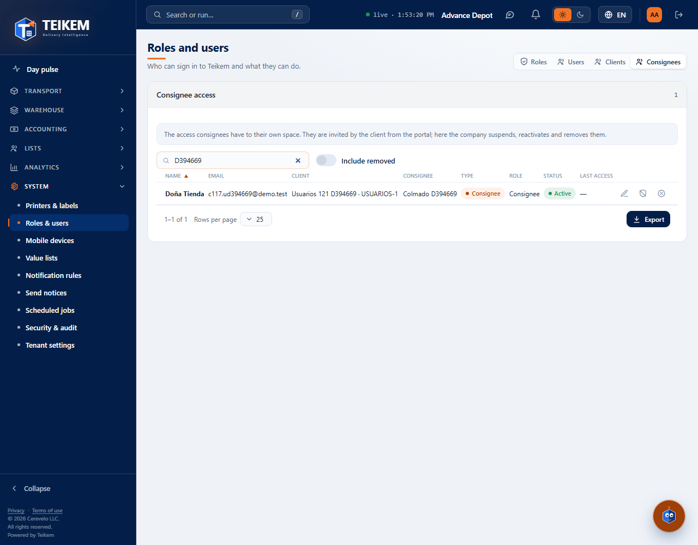
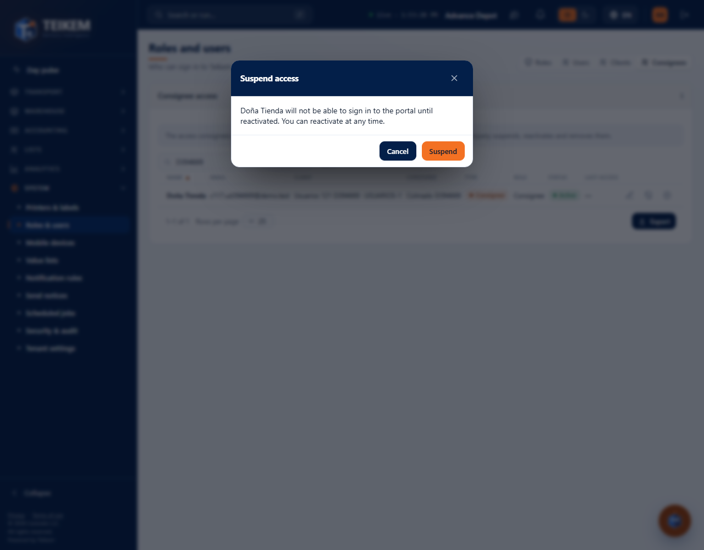
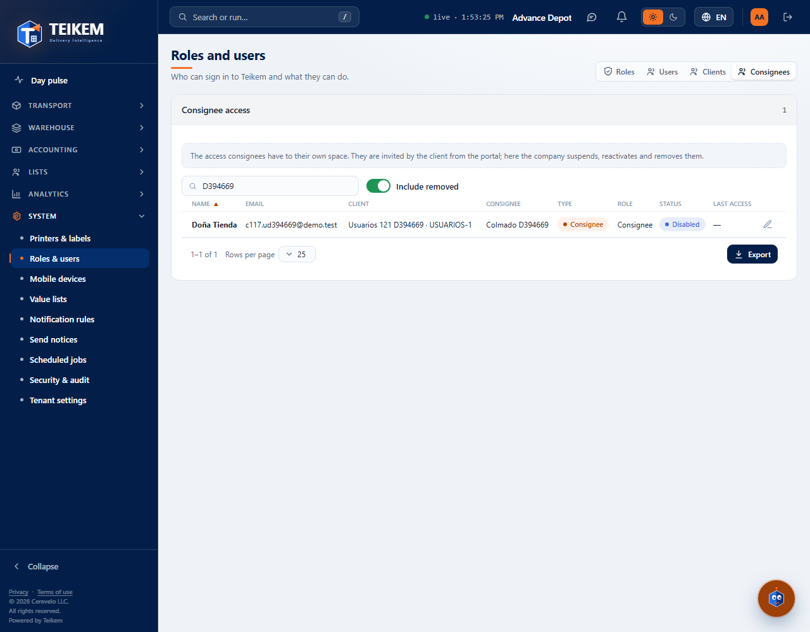

# L121 — Roles & users: Clients and Consignees tabs (staff web)

Batch 121 screens in **System → Roles & users**. Screenshots taken by the `web-app/e2e/lote121-usuarios-portal.spec.ts` walkthrough against the real API (desktop and mobile at 360 px with no horizontal scroll). Rules and API: [chapter 1, “Clients and Consignees”](../01-plataforma-y-seguridad.md).

## The tabs
Roles, Users, **Clients** and **Consignees**: the portal people of ALL the clients and the consignee accesses, each with their type and their client.

## Suspending an access
It asks to confirm; when confirmed, that person's open session is cut off instantly.

## Removed
They are shown with **Include removed** (status “Disabled”).

