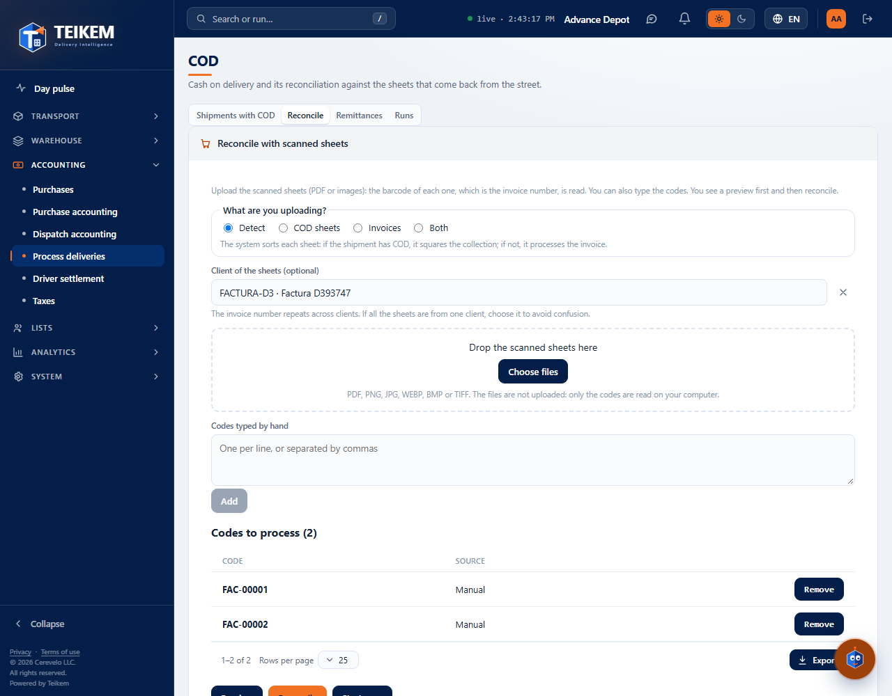
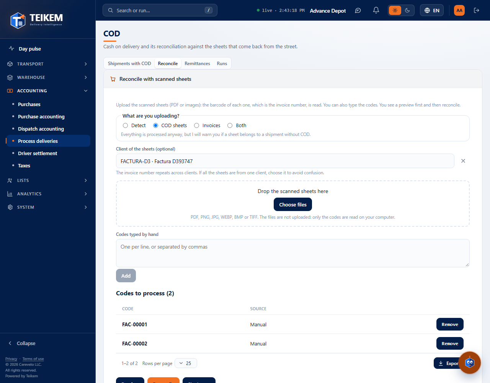
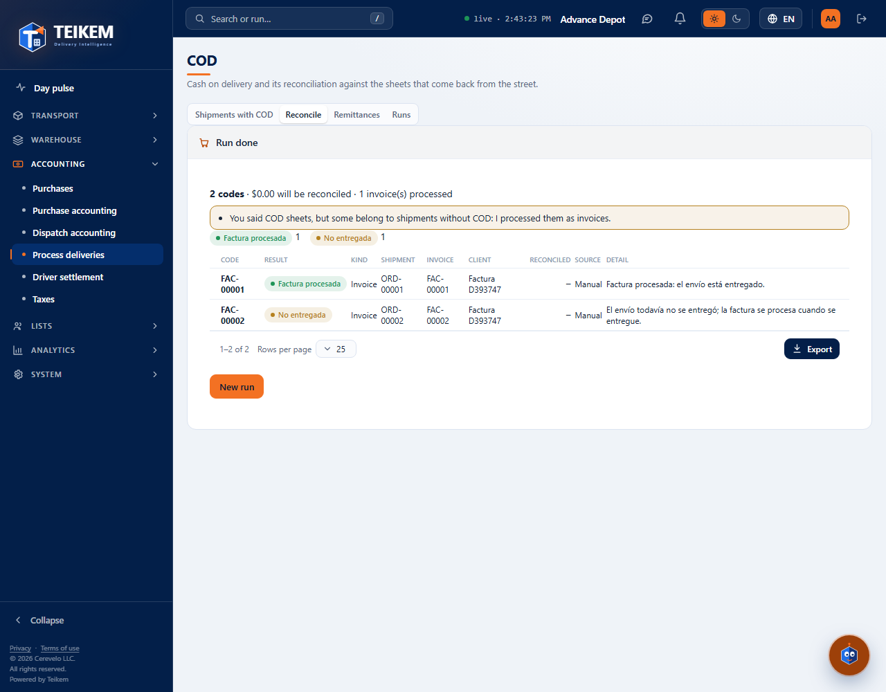
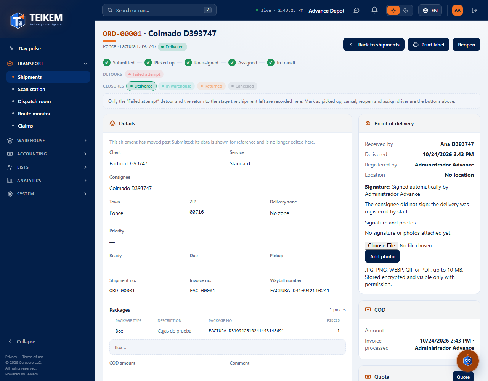

# L126 — Process deliveries: the client's invoice (staff web)

Batch 126 screens in **Money → Process deliveries → Reconcile** and in the order file. Screenshots taken by the `web-app/e2e/lote126-procesar-factura.spec.ts` walkthrough against the real API (desktop and mobile at 360 px with no horizontal scroll). Rules and API: [chapter 21, §7](../21-cod.md) and [chapter 02, §6b](../02-clientes-y-contratos.md).

## What are you going to upload?
The selector at the start of the tab: **Detect** (by default), **COD sheets**, **Invoices** or **Both**. The sheets are uploaded or the numbers typed in just as for COD; in the preview each sheet says its result (“Invoice processed”, “Undelivered”, “Already processed”…) and its **Type** (COD sheet or Invoice), and the summary counts the processed invoices.

## The mode warning
If you said “COD sheets” and one of them belongs to an order without COD (or the other way around), the system processes it anyway and warns you.

## The run
“Reconcile” processes everything: it reconciles the collections and leaves the invoices processed; the run stays in Runs with its detail.

## In the order file
The COD panel shows **Invoice processed: date · who** (or “Not yet”).

