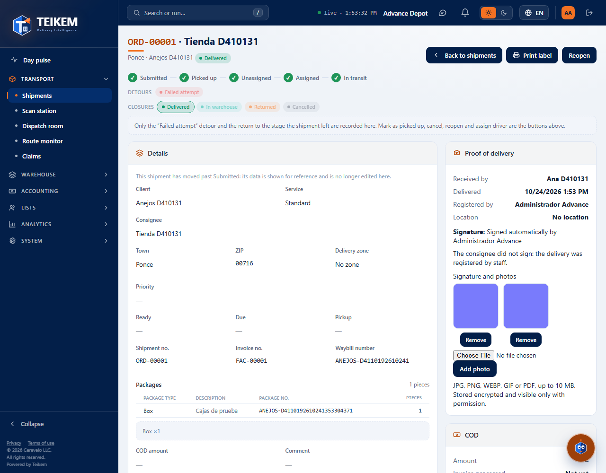

# L127 — Proof of delivery: signature and photos (staff web)

Batch 127 screens in the order file → **Proof of delivery** panel. Screenshots taken by the `web-app/e2e/lote127-anejos-comprobante.spec.ts` walkthrough against the real API (desktop and mobile at 360 px with no horizontal scroll). Rules and API: [chapter 38](../38-almacen-de-archivos.md).

## Signature and photos
The thumbnails of the signature and the photos (they open enlarged with one click); PDFs are shown as a link.

## Adding and removing
With `orders.deliver`: **Add photo** uploads another one (JPG, PNG, WEBP, GIF or PDF, up to 10 MB) and **Remove** takes it off the list.

