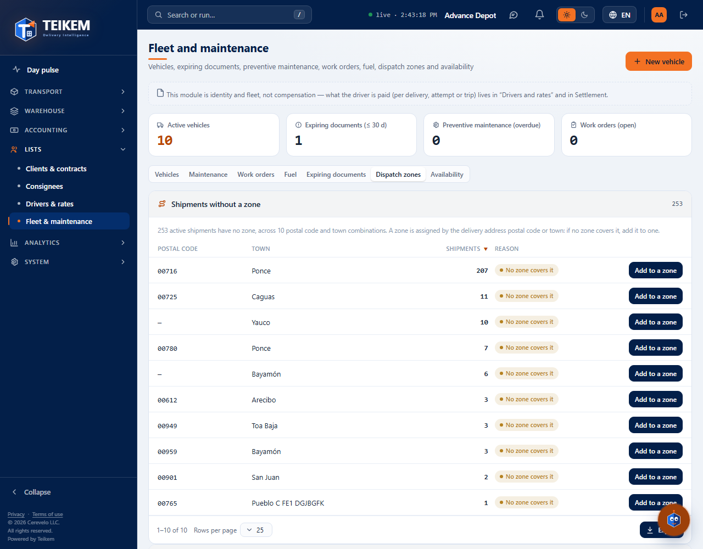
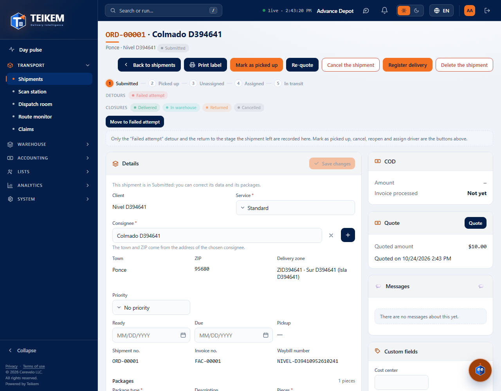
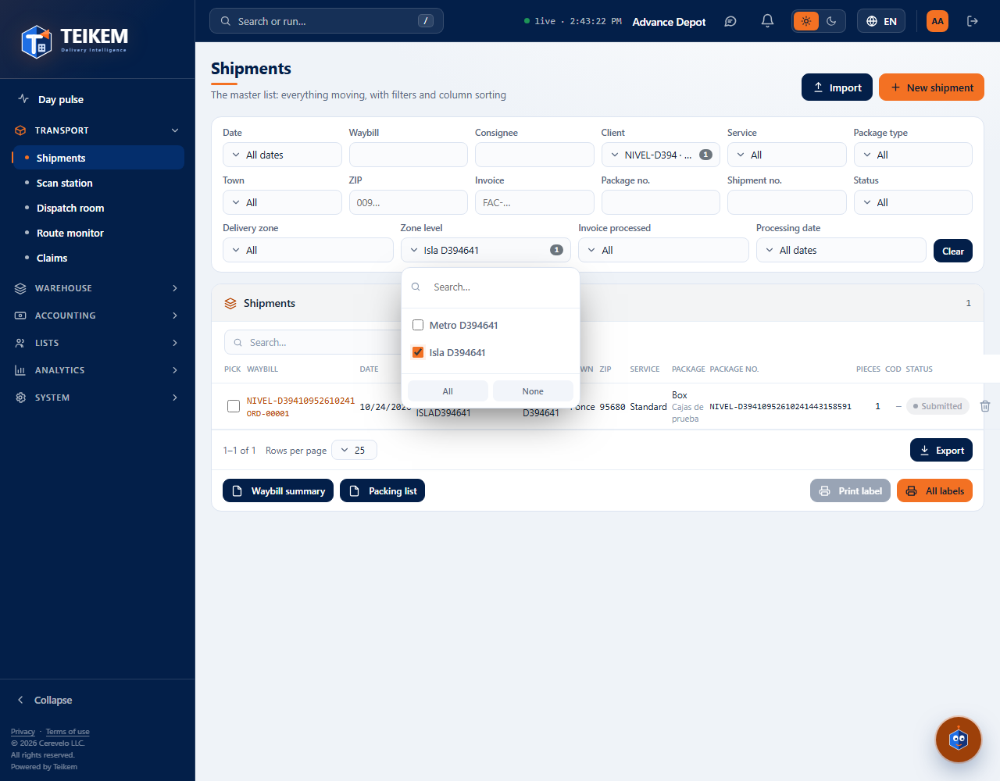

# L129 — Zone levels: Island and Metro (staff web)

Batch 129 screens. Screenshots taken by the `web-app/e2e/lote129-nivel-de-zona.spec.ts` walkthrough against the real API (desktop and mobile at 360 px with no horizontal scroll). Rules and API: [chapter 04, “Zone levels”](../04-flota-choferes-mantenimiento.md).

## Fleet → Dispatch zones
The **Zone levels** panel (code, name, default driver, zones) and the zones with their **Level**.

## Order file
**Delivery zone**: zone · name (level).

## Orders list
**Delivery zone** and **Zone level** filters; Zone column (zone · level).

