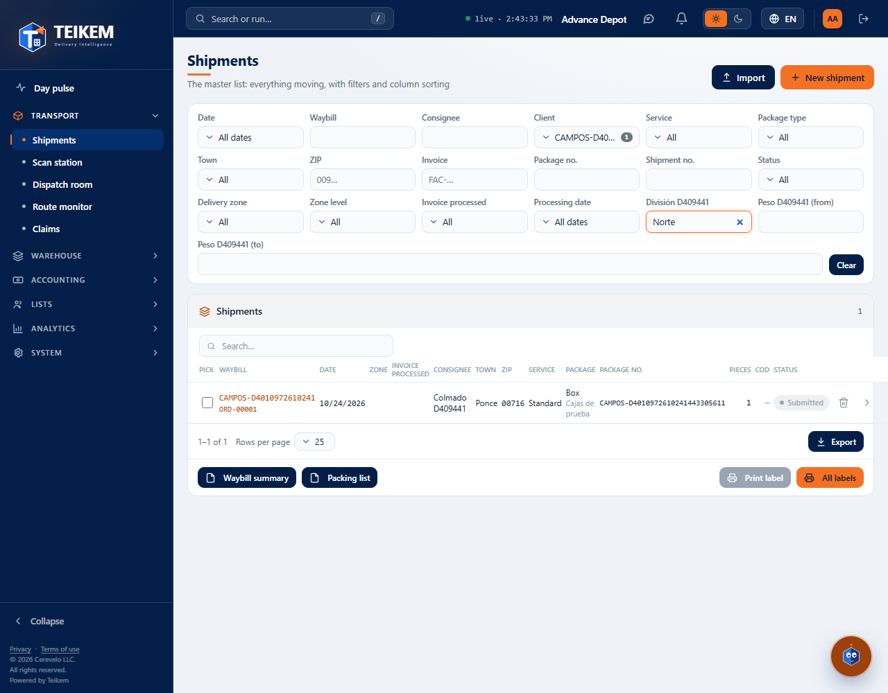
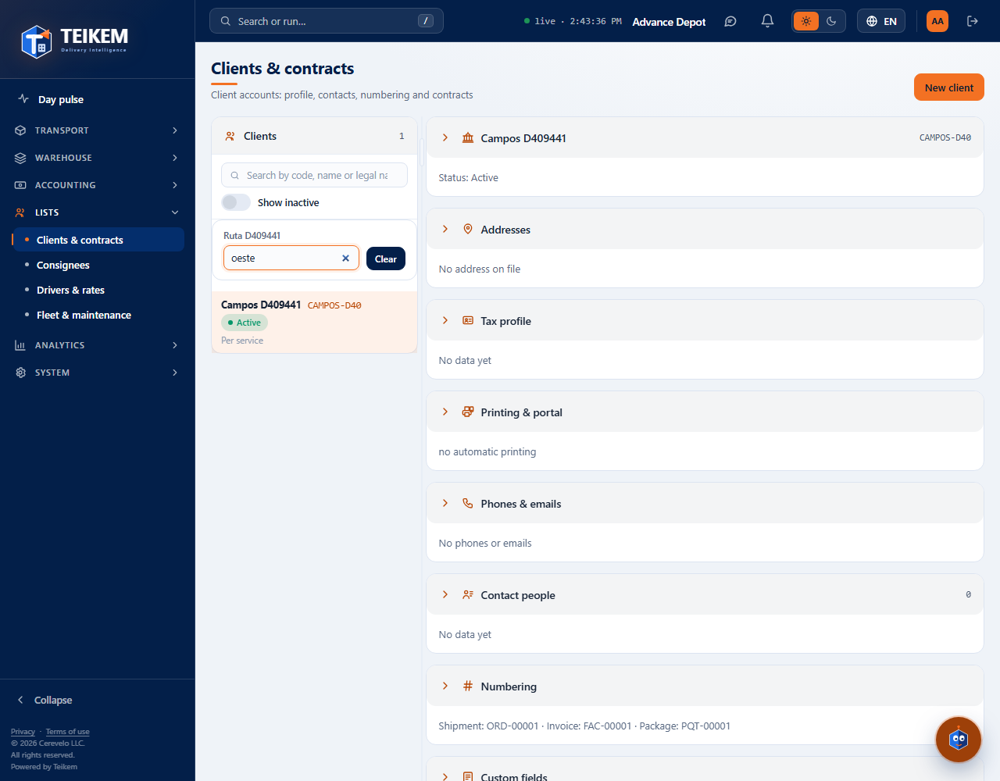

# L130 — Custom fields in the search (staff web)

Screenshots from the `web-app/e2e/lote130-campos-en-busqueda.spec.ts` walkthrough against the real API (desktop and mobile at 360 px with no horizontal scroll). Rules and API: [chapter 01, §7.x](../01-plataforma-y-seguridad.md).

## Orders
The fields with “Show in search” appear in the filter row, each one of the field's type (text, “from/to” for numbers, ranges for dates, lists, yes/no). “Clear” removes them.

## Clients
Under the list's search box, with its own “Clear” (same in Consignees, Drivers and Vehicles). If the entity has no enabled fields, nothing appears.

