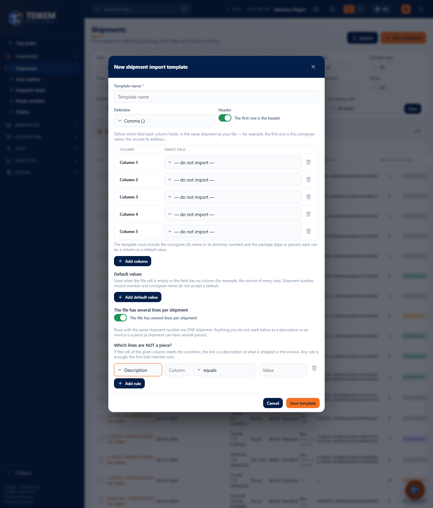
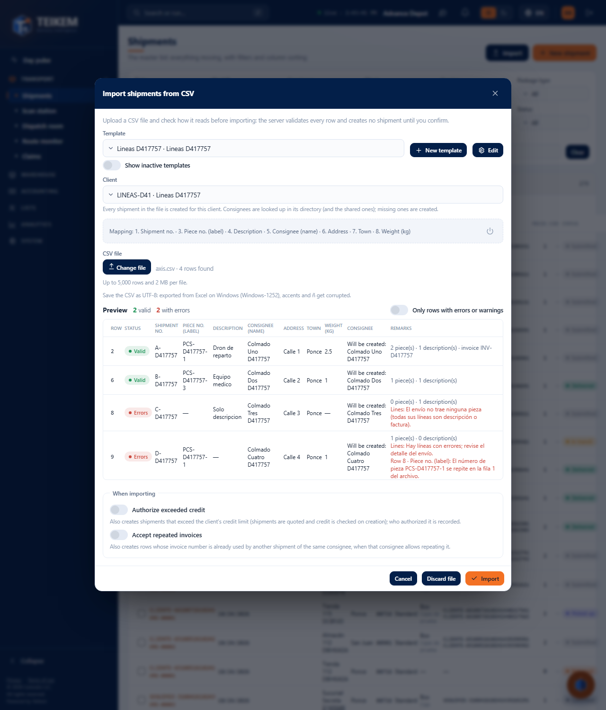

# L131 — Files with several lines per order (staff web)

Screenshots from the `web-app/e2e/lote131-lineas-por-orden.spec.ts` walkthrough against the real API (desktop and mobile at 360 px with no horizontal scroll). Rules and errors: [chapter 03, §7.5](../03-ordenes-de-transporte.md).

## Order template
**“The file has several lines per shipment”** opens the line rules: what is NOT a piece (description or invoice) by a column of the file; everything else is a piece. The new field **Piece no. (label)** is mapped like any other.

## Preview
One row per **order** with its line summary (“2 piece(s) · 1 description(s) · invoice …”) and the errors of each line; an order with no piece at all or with a repeated piece number is left with an error and is not created.

