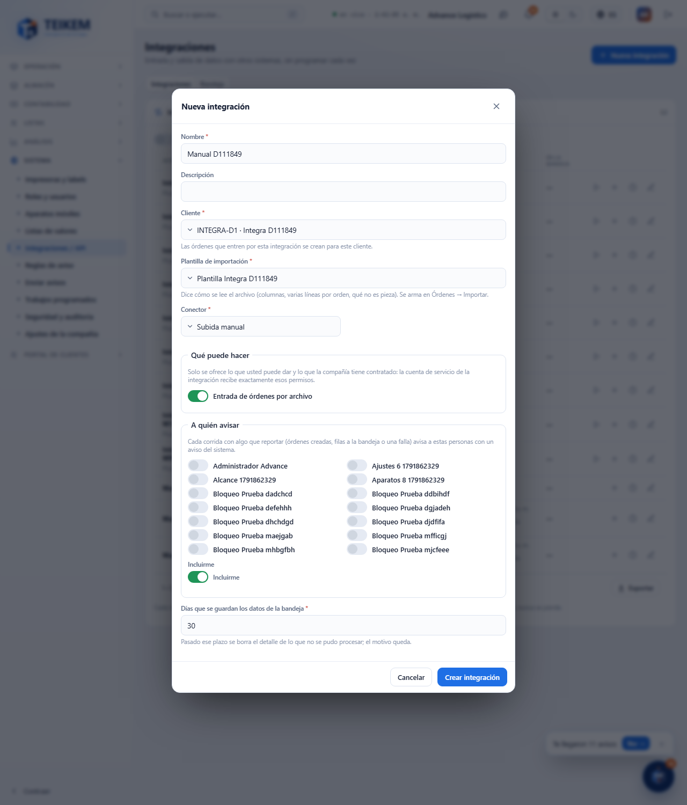
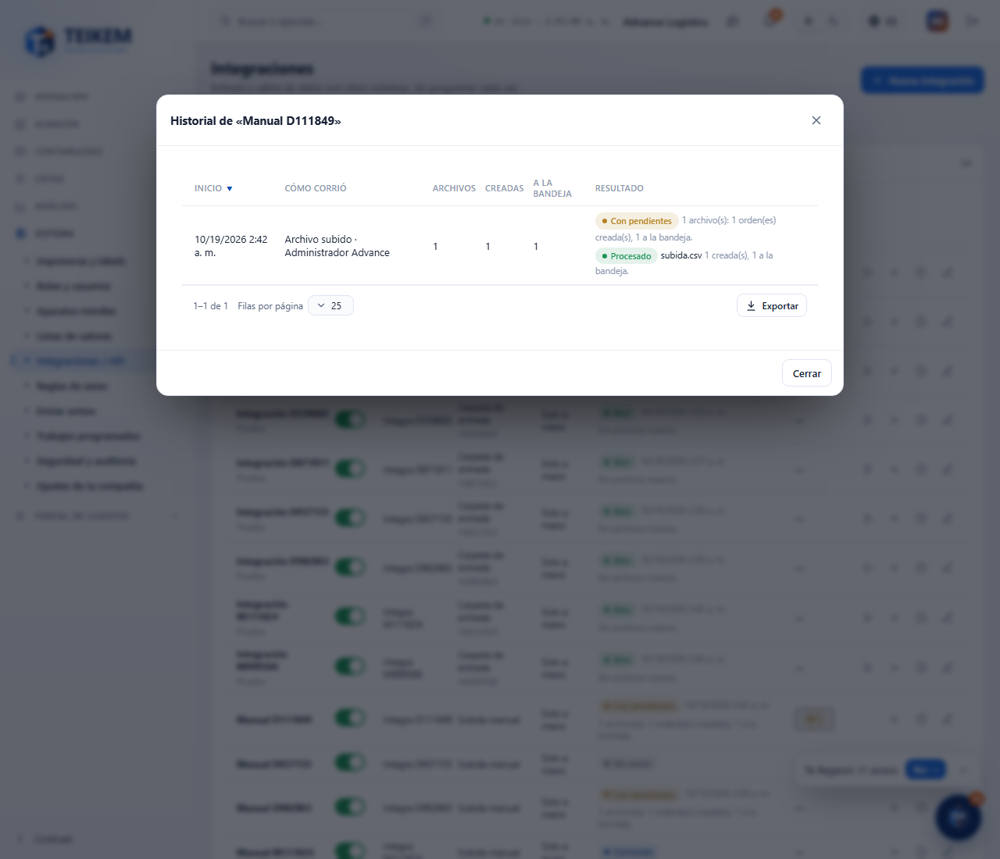
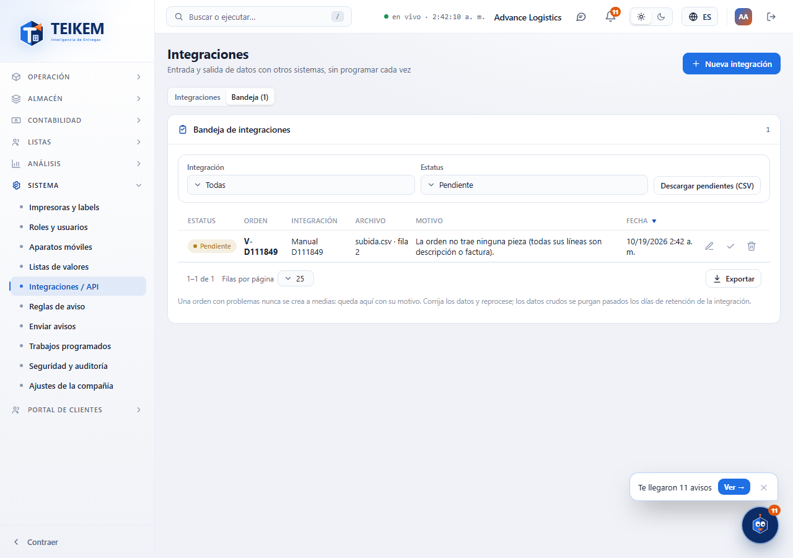
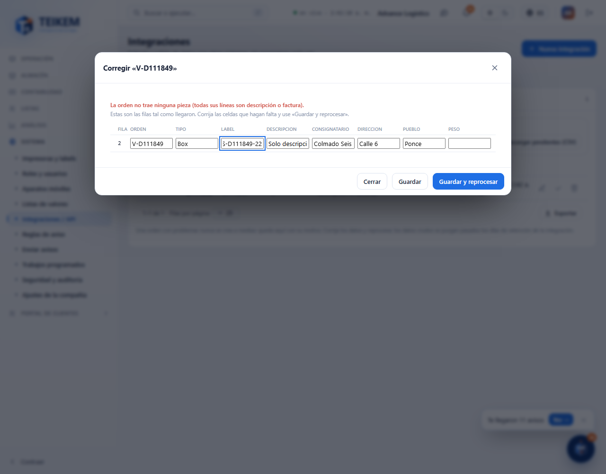

# L132 — Integrations (staff web)

Screenshots from the `web-app/e2e/lote132-integraciones.spec.ts` walkthrough against the real API and SQL (desktop and mobile at 360 px with no horizontal scroll). Rules and API: [chapter 39](../39-integraciones.md).

## List (System → Integrations / API)
Per integration: switch, client, connector, schedule, last run and pending items in the inbox; actions **Run now** (folder), **Upload file**, **History** and **Edit**.

## New integration
Client, import template, connector, schedule, **what it can do** (only what whoever creates it can grant), **who to notify** with “Include me” and the inbox retention.

## History
Each run with its files (Processed, Repeated, With error), orders created and sent to the inbox.

## Inbox
The exact reason for each order that could not be processed, with **Fix**, **Reprocess** and **Discard**.

## Fix
The rows as they arrived; the cells are fixed and “Save and reprocess”.

