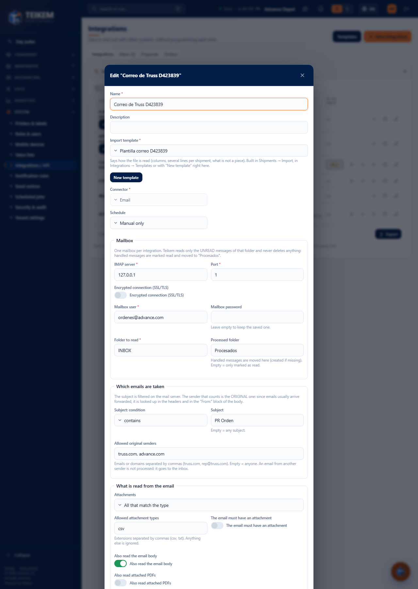

# L133 — E-mail integration (staff web)

Screenshot from the `web-app/e2e/lote133-correo.spec.ts` walkthrough against the real API (desktop and mobile at 360 px with no horizontal scroll). Rules and errors: [chapter 39, §6](../39-integraciones.md).

## Form (E-mail connector)
**Mailbox** (IMAP, user, password that is never shown again, folder and processed), **which e-mails are taken** (subject and allowed original senders) and **what is read** (attachments by mode, name and type; the body with fields to read by label, regular expression or block of lines, each one to its template column). In the list, **Test connection**; **Upload file** accepts `.eml` to test the configuration without a mailbox.

