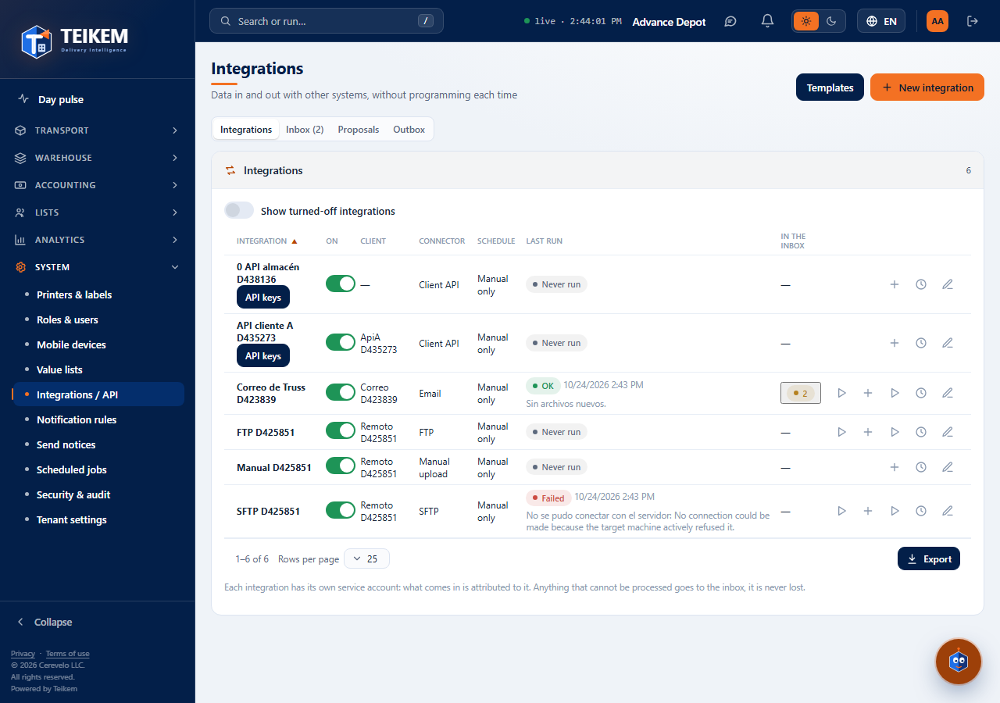
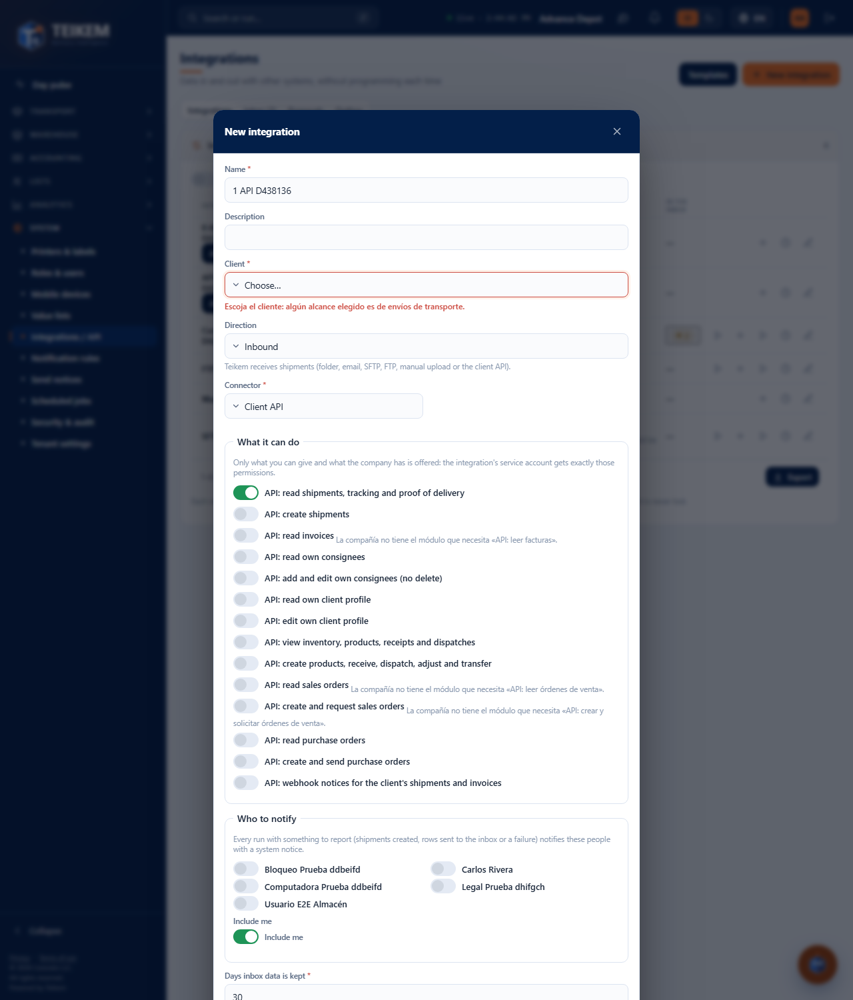
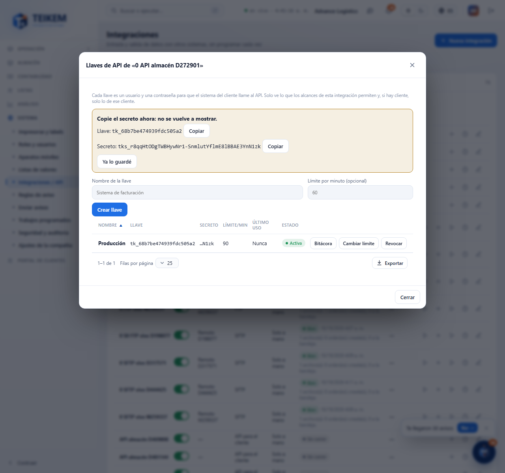
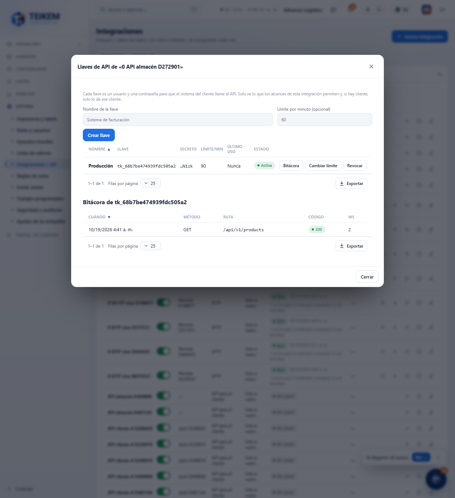

# L135 — API for clients (staff web)

Screenshots from the `web-app/e2e/lote135-api-clientes.spec.ts` walkthrough against the real API (desktop and mobile at 360 px with no horizontal scroll). Routes, scopes and errors: [chapter 39, §8](../39-integraciones.md).

## List
The **Client API** connector has no “Run now” or “Upload file”; instead, **API keys**.

## Form
With the API connector the template, the folder and the schedule disappear; only the API scopes are offered. The client is asked for only if there is a transport scope.

## Keys
Creating a key shows the **secret only once** (Copy); afterwards only the key and the last 4 characters remain. You can change the limit, revoke or open the log.

## Log of a key
Method, route, code and duration of each call (30 days).

