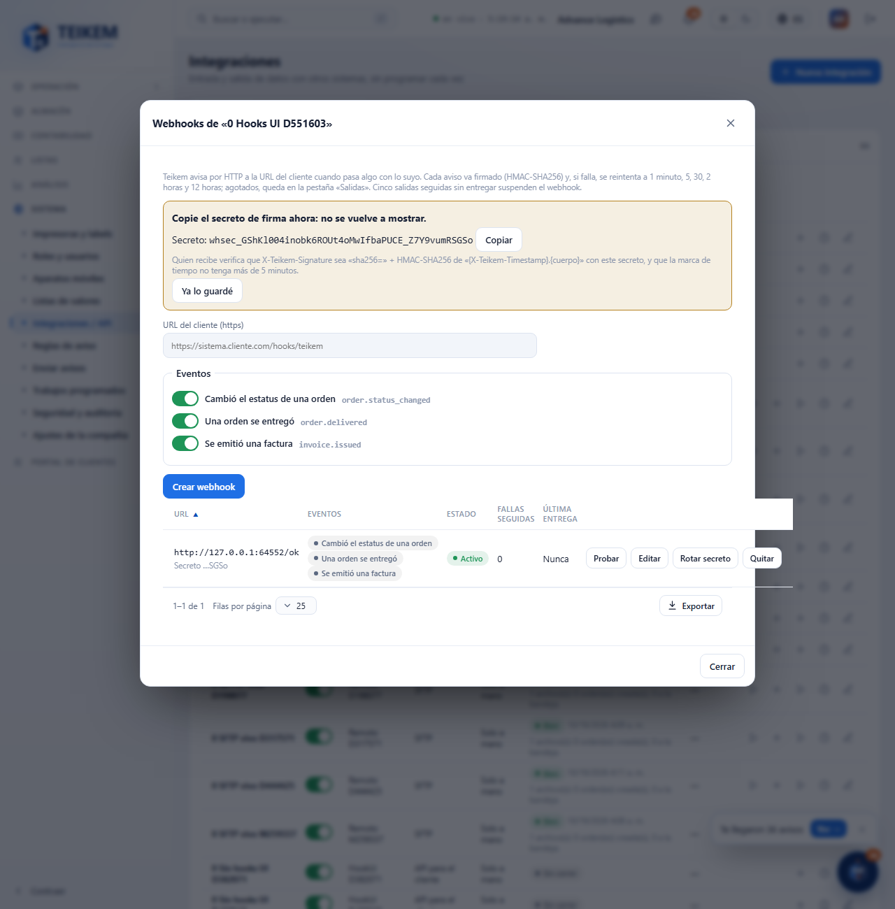
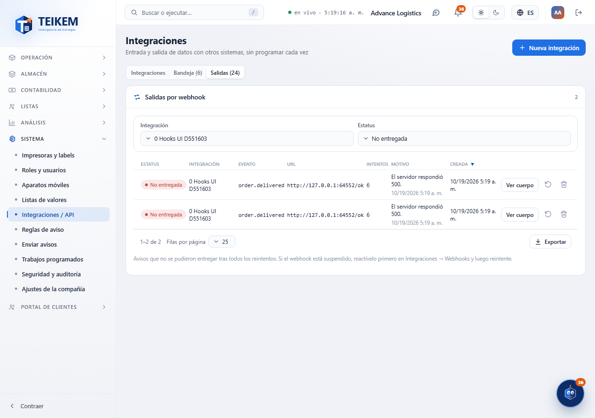

# L136 — Outbound webhooks and outbox (staff web)

Screenshots from the `web-app/e2e/lote136-webhooks.spec.ts` walkthrough against the real API and a test receiver (desktop and mobile at 360 px with no horizontal scroll). Rules, signature and errors: [chapter 39, §9](../39-integraciones.md).

## Webhooks of an integration
The **Webhooks** action (only on API integrations with the `webhooks:manage` scope) opens the management: client URL, events, state (Active / Suspended / Off), consecutive failures and last delivery. When creating (or rotating) the **signing secret is shown only once**.

## Outbox (undelivered)
The **Outbox** tab (with the undelivered counter) lists the notices that exhausted the retries, with the exact reason; filters by integration and status; **View body**, **Retry** and **Discard**.

## Body of an outbox item
The minimal body that was sent (id, type, date and data).

