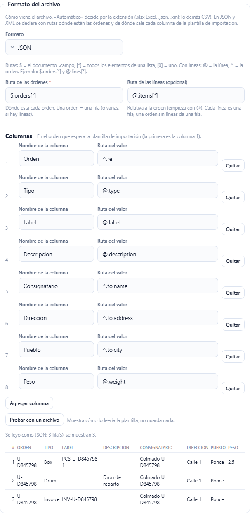
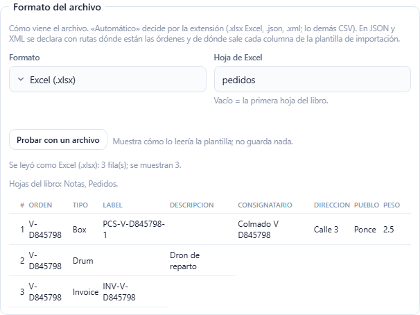
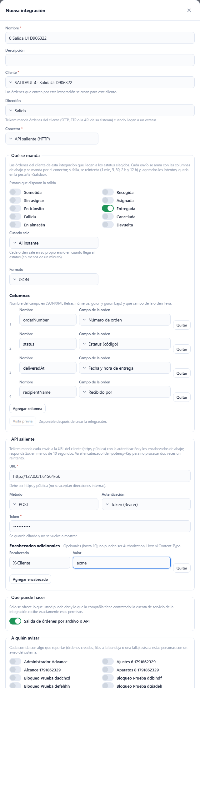
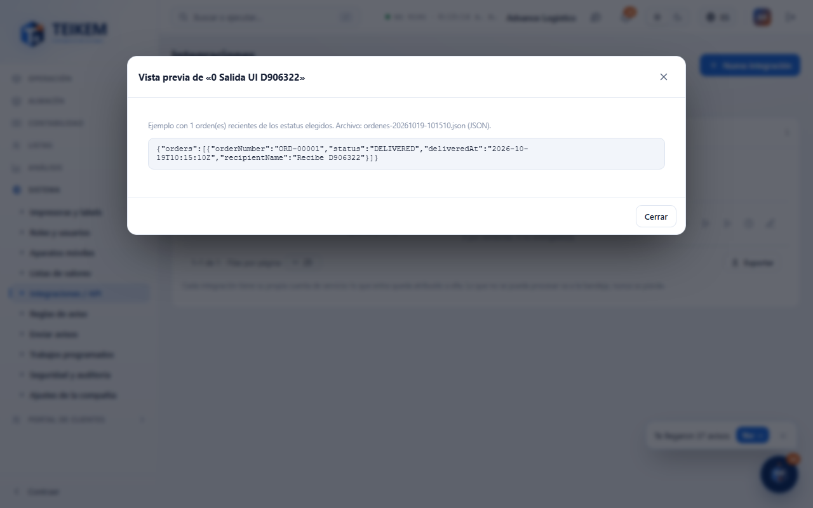
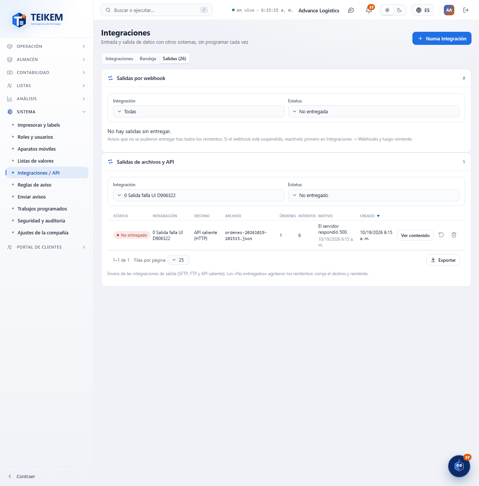

# L137 — File format: Excel, JSON and XML (staff web)

Screenshots from the `web-app/e2e/lote137-formatos.spec.ts` walkthrough against the real API (desktop and mobile at 360 px with no horizontal scroll). Rules and errors: [chapter 39, §10](../39-integraciones.md).

## JSON/XML format with path mapping
In the integration form (any file connector), the **File format** section: the path of the orders, that of the lines (optional) and the path → column mapping, in the template's order. **Test with a file** shows how the template would read it, without saving anything.

## Excel sheet
With the Excel format you type the sheet (empty = the first one); the test shows the workbook's sheets and the first rows.

## 137b — Outbound integrations
Rules and errors: [chapter 39, §11](../39-integraciones.md). Walkthrough `web-app/e2e/lote137b-salida.spec.ts`.

### Form of an outbound integration
Direction **Outbound**: no template or input format; “What is sent” (statuses, when, format, columns), “Outbound API” (URL, method, authentication with encrypted secret, headers) and the outbound scope.

### Preview
An example with recent orders of the client just as it would be sent, without sending anything.

### File and API outbox
The sends that exhausted the retries, with the reason, the content and Retry / Discard.

