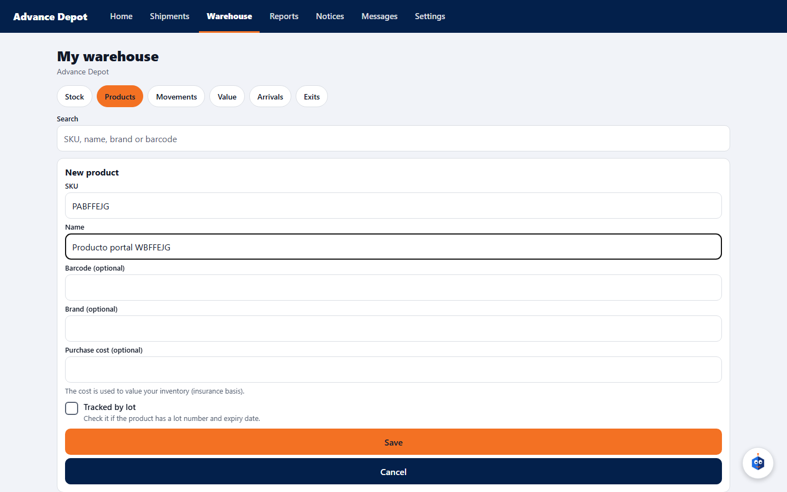
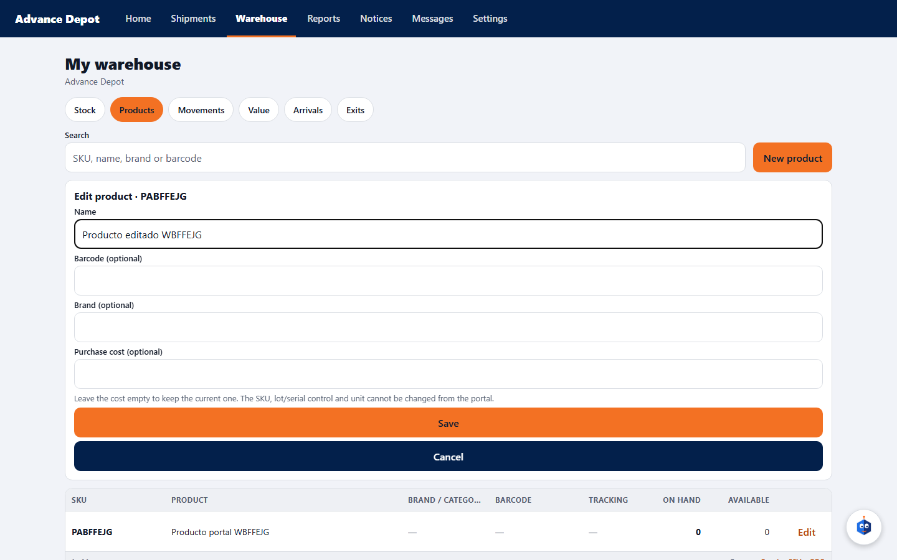
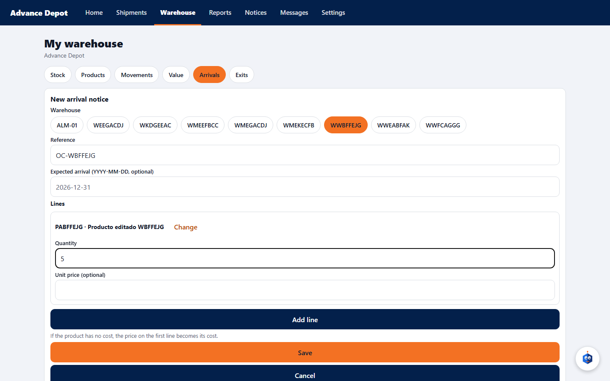
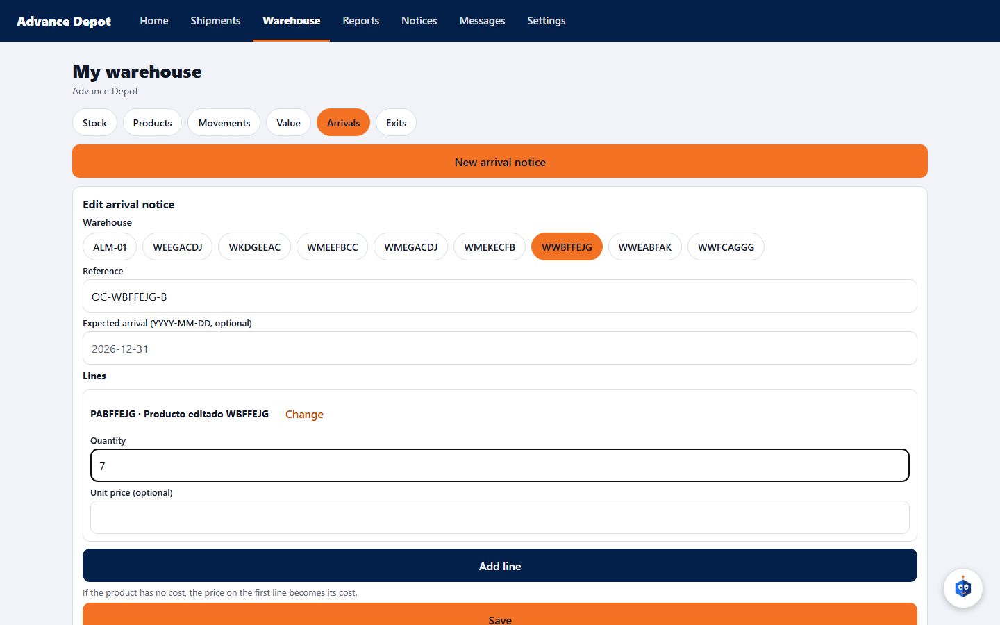
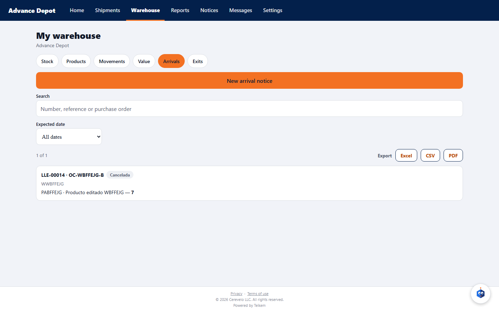
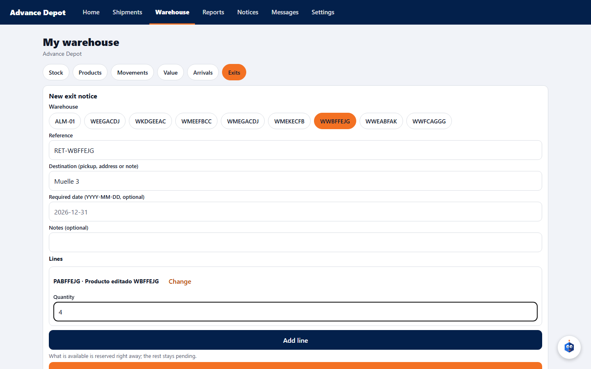
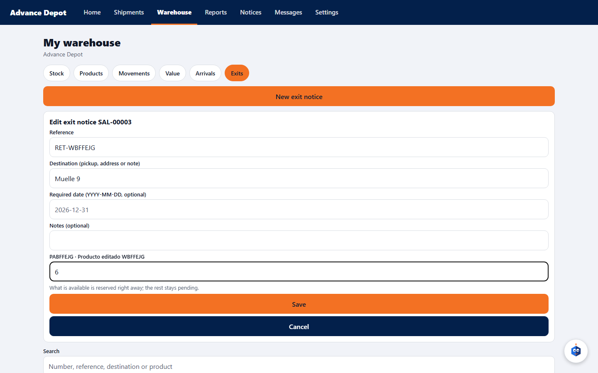
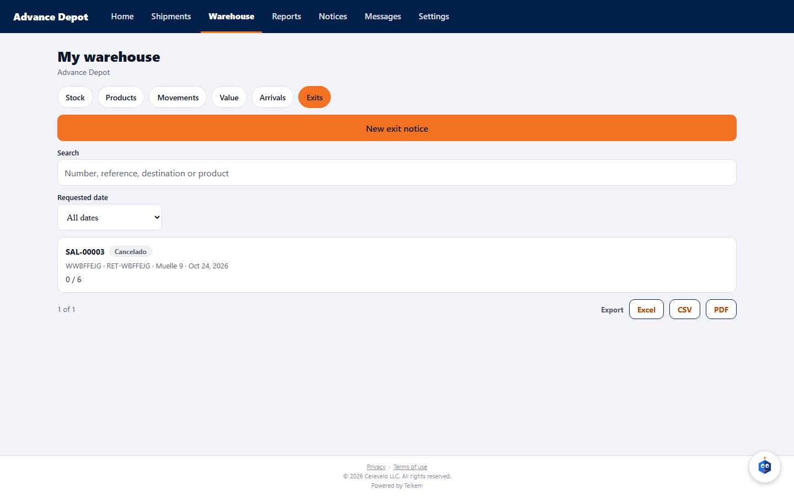

# L154 — Warehouse client portal: product, arrival and exit, from create to cancel

Screenshots from the Playwright verification of 2026-10-24 (`web-app/e2e/lote154-portal-almacen.spec.ts`, against the real API and the client app at `CLIENT_APP_URL`; desktop and mobile). Functionality: chapter [27](../27-app-cliente.md) and decisions in [lote154](../../lote154-decisiones.md), [lote156](../../lote156-decisiones.md), [lote157](../../lote157-decisiones.md) and [lote158](../../lote158-decisiones.md). The client's person (an administrator) needs the client flags “create products / arrivals / exits” turned on by the staff.

## Product: create and edit

In **Products**: “New product” (SKU and name required) and, on each row, **Edit** (name, barcode, make and cost; the SKU, lot or serial control and the unit do not change).

## Arrival notice: create, edit and cancel

While the notice is still **expected** you can **Edit** (reference, date, lines) or **Cancel notice**. Editing does not duplicate the notice; the server saves the new quantity.

## Exit notice: create, edit (with reservation) and cancel

When creating, the system **reserves** what is available (with 10 in stock and a notice for 4, 6 remain available). When **editing** you change reference, destination, date, notes and the quantity of each line, and the reservation is **readjusted** (at 6 requested, 4 remain available). When **cancelling**, everything is released (the 10 are back). It can only be edited or cancelled while the notice is still “Requested”.

## What the walkthrough verifies
Each step is also checked through the portal API (what the screen shows is what was saved) and that **another client cannot see or edit** these notices (403/404).
