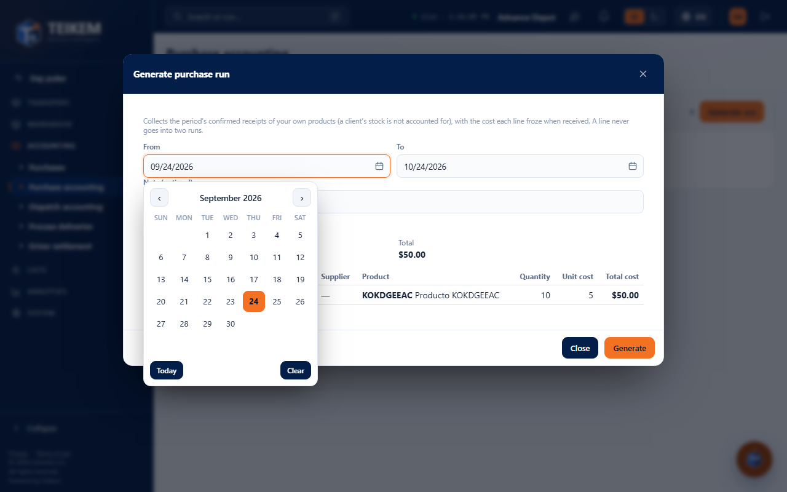
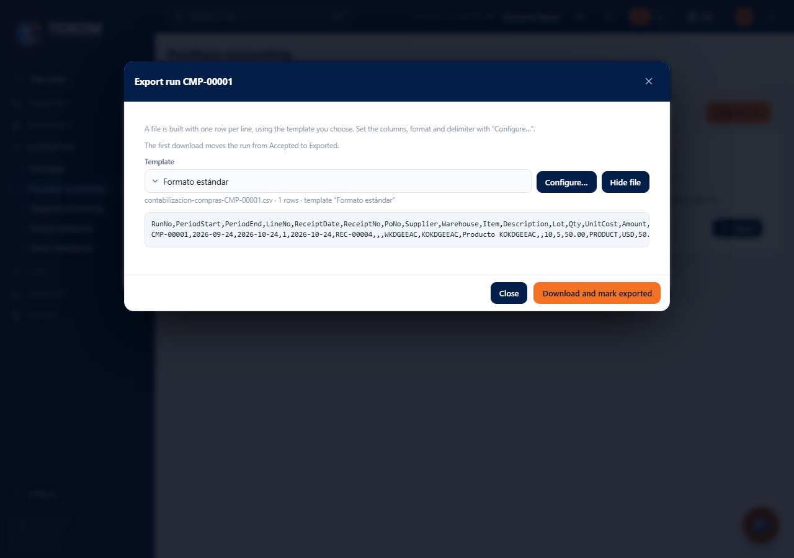
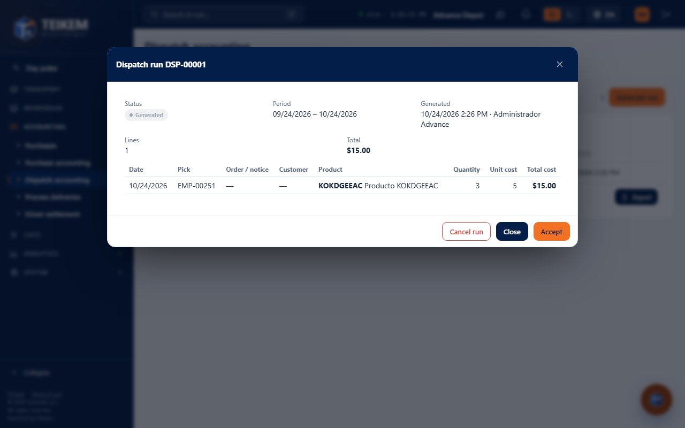

# L181 — Purchase accounting and dispatch accounting (screen)

Where: **Accounting → Purchase accounting** (`/money/purchases`; access permission `purchaseaccounting.view`, module `PURCHASING`) and **Accounting → Dispatch accounting** (`/money/dispatch`; `dispatchaccounting.view`, module `WMS_LOTSERIAL`). The rules, the endpoints and the error messages are in [chapter 43](../43-contabilizacion.md); here, how the screens are used. They work from 360 px up, with no horizontal page scroll (the lines scroll inside their box).

## Generating a run

**Generate run** opens the window with the period (by default, the last 30 days) and an optional note. Before generating it shows **what would go in**: the number of lines, the total, a warning if there are lines **without cost** and the detail. Anything belonging to a client does not appear. **Generate** creates the run and opens its record.

## The record

Status, period, who generated, accepted and exported it, total and the lines with their frozen cost (those with no cost are marked and left blank). The buttons depend on the status and on your permissions: **Accept** (generated), **Export** (accepted or exported) and **Cancel run** (generated or accepted, with confirmation).

## Exporting

Choose the **template**, adjust it with **Configure…** (the same window as Billing: format, delimiter, date, header and columns), look at the file with **View file** and download it. The first download marks the run as **Exported**; afterwards it can be downloaded again.

## Dispatch accounting

Same as the purchase one, but about what **went out**: the lines carry the pick or the dispatch, the sales order or the exit notice and the client.
