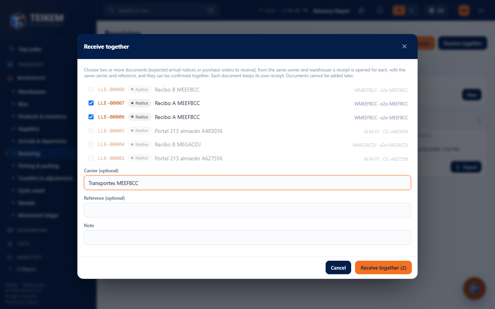
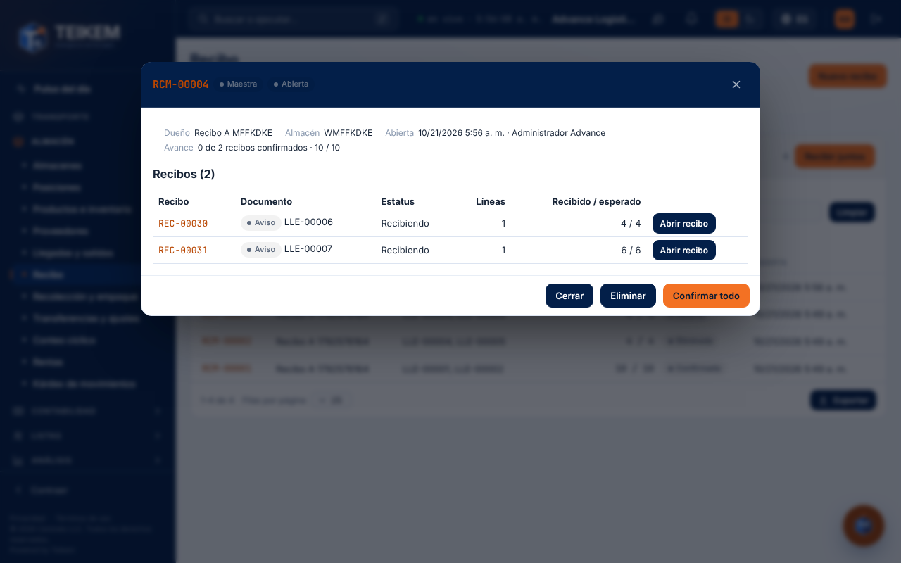
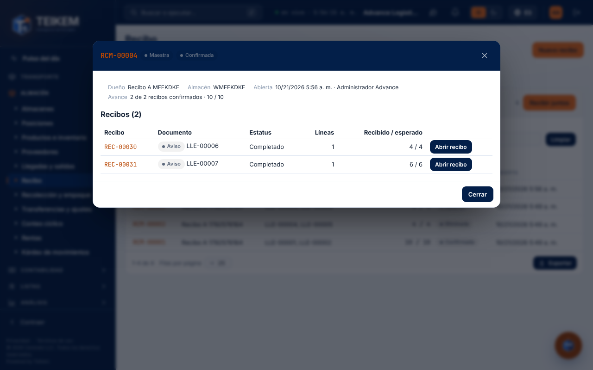

# L183 — Master receiving (screen)

Where: **Warehouse → Receiving → “Masters” tab** (`/warehouse/receipts?tab=groups`; permission `inventory.view`, module `WMS_LOTSERIAL`; opening, confirming and deleting require `warehouse.receive`). The rules, the endpoints and the error messages are in [chapter 44](../44-recepcion-maestra.md). It works from 360 px up, with no horizontal page scroll.

## Receive together

**Receive together** lists the arrival notices that are waiting and have no receipt. When you choose the first one, those of another owner or another warehouse are locked. Two or more are chosen, the carrier, the reference and a note are typed (if wanted), and **Receive together (n)** opens one receipt per notice.

## The master's record

Owner, warehouse, who opened it and when, the progress and the table of receipts (document, status, lines and received / expected). **Open receipt** takes you to the usual screen of that receipt; **Confirm all** confirms together the ones still pending (all or nothing); **Delete** (while none is confirmed) deletes the master and its receipts.

## Confirmed

With all the receipts confirmed the master becomes **Confirmed** and no longer offers confirming or deleting; each receipt follows its path (putaway) as always.
