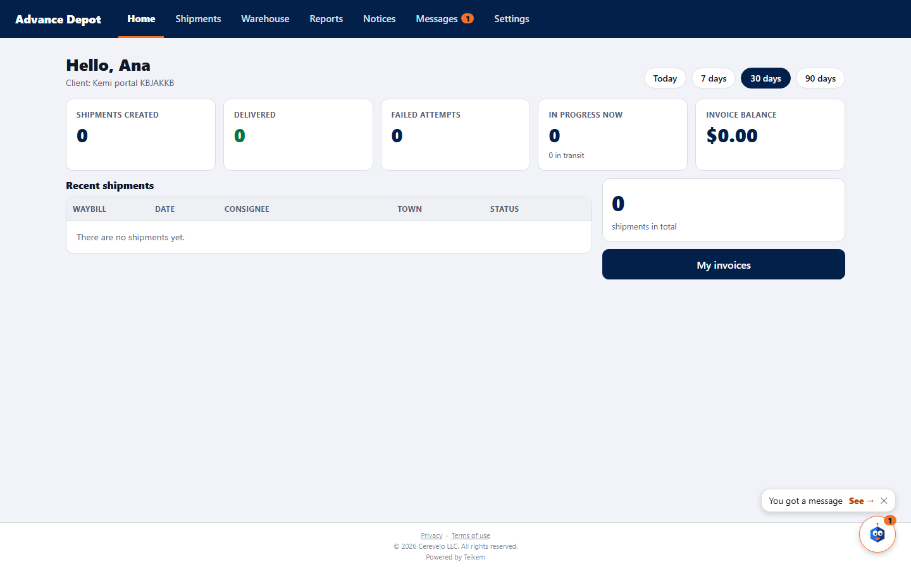
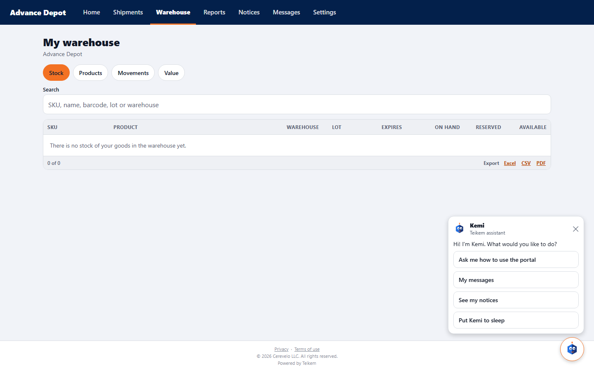
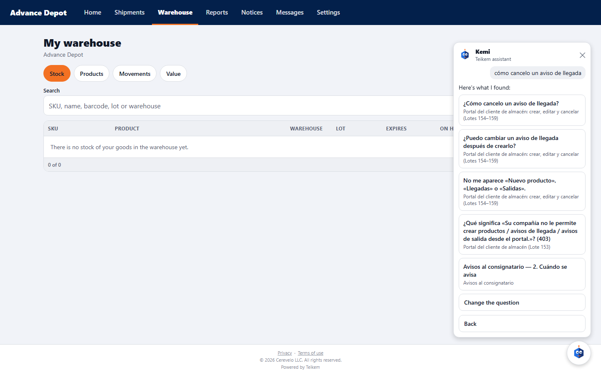
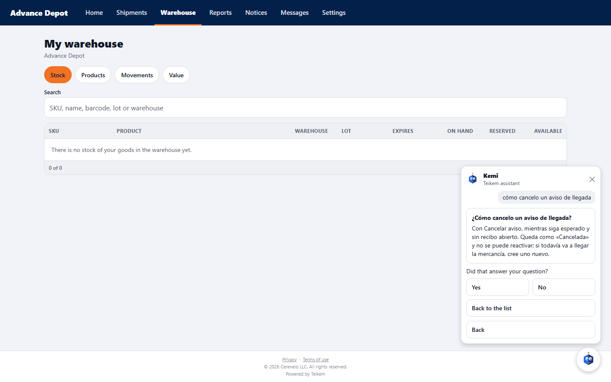
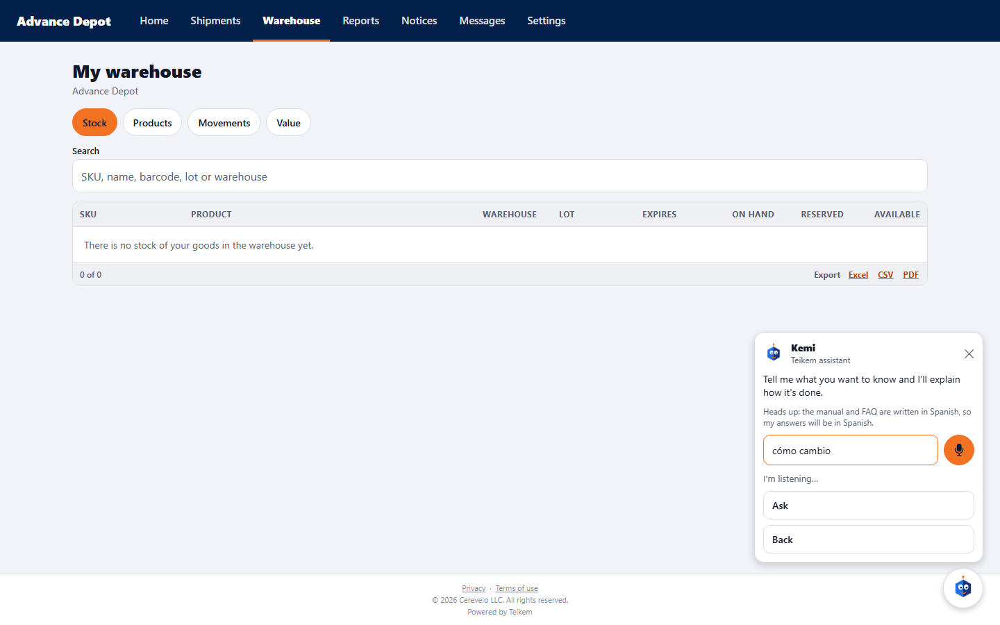
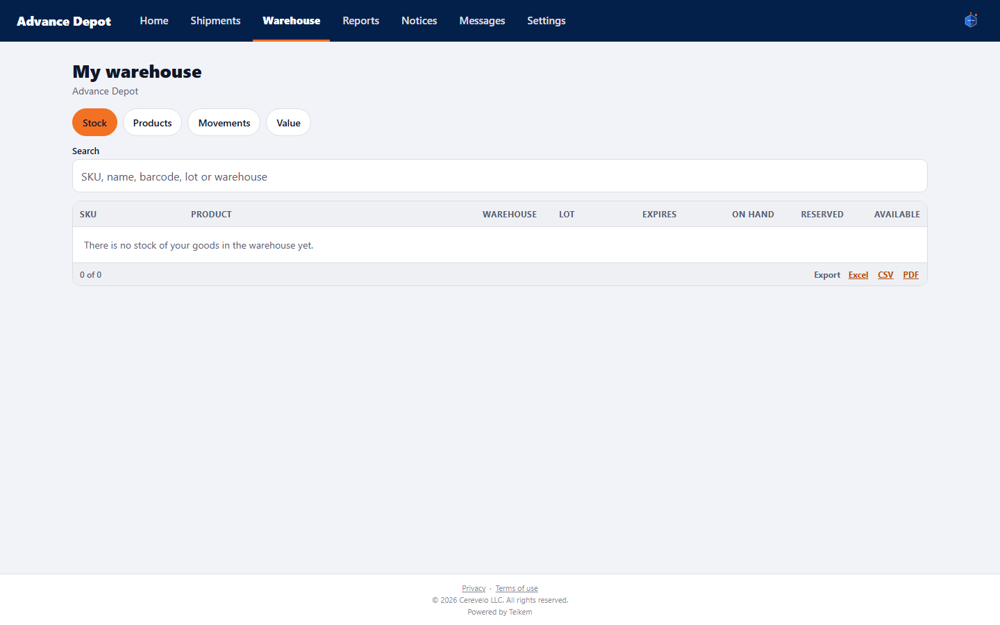
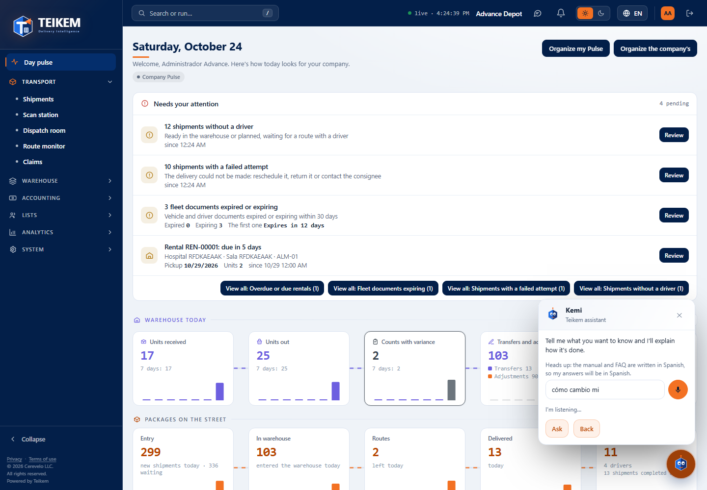

# L218 — Kemi in the client portal and talking to her (web and portal)

Screenshots from the Playwright verification of 2026-10-24: `web-app/e2e/lote218-kemi-portal.spec.ts` (client app with the real API) and `lote218-kemi-web.spec.ts` (staff web, desktop and mobile). The browser's speech recognition is **simulated** (a test browser has no microphone). Functionality and rules: chapter [46](../46-kemi.md); decisions in [lote218-decisiones.md](../../lote218-decisiones.md).

## Kemi in the portal: the new-message bubble

On sign-in, Kemi announces the unread message from the customer service team (“You got a message → See”). **See** opens Messages.

## The options panel

Ask me how to use the portal · My messages (with your account) · See my notices · Put Kemi to sleep (and “Send Kemi back to the corner” if you moved her).

## Asking by typing

The question “how do I cancel an arrival notice” brings options from the client's manual; when you open one, the answer appears with “Did that answer your question?”.

## Asking by speaking

The microphone (orange while listening) fills the field with what it understands as you speak; when you finish speaking, Kemi asks by herself.

## Asleep

Asleep, she hides next to the menu; one tap wakes her, and she remembers it on reload.

## You can talk to her on the staff web too

The same microphone in the web's question box (with the index of the whole manual).
