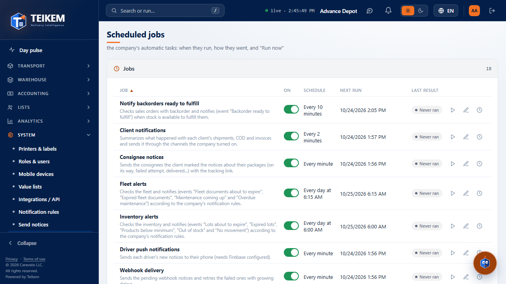
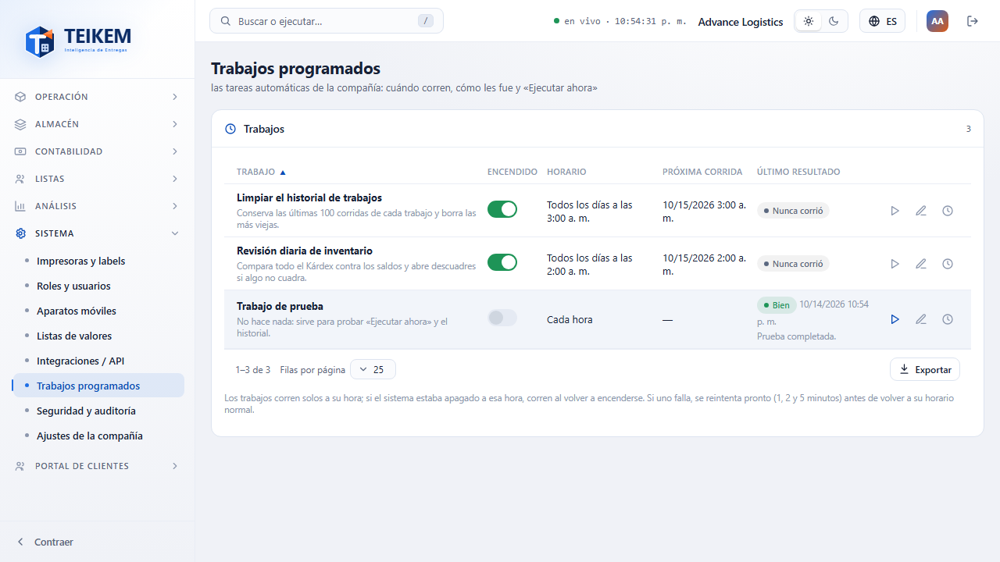
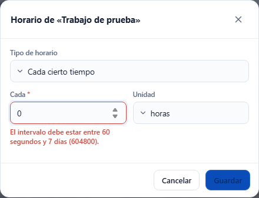
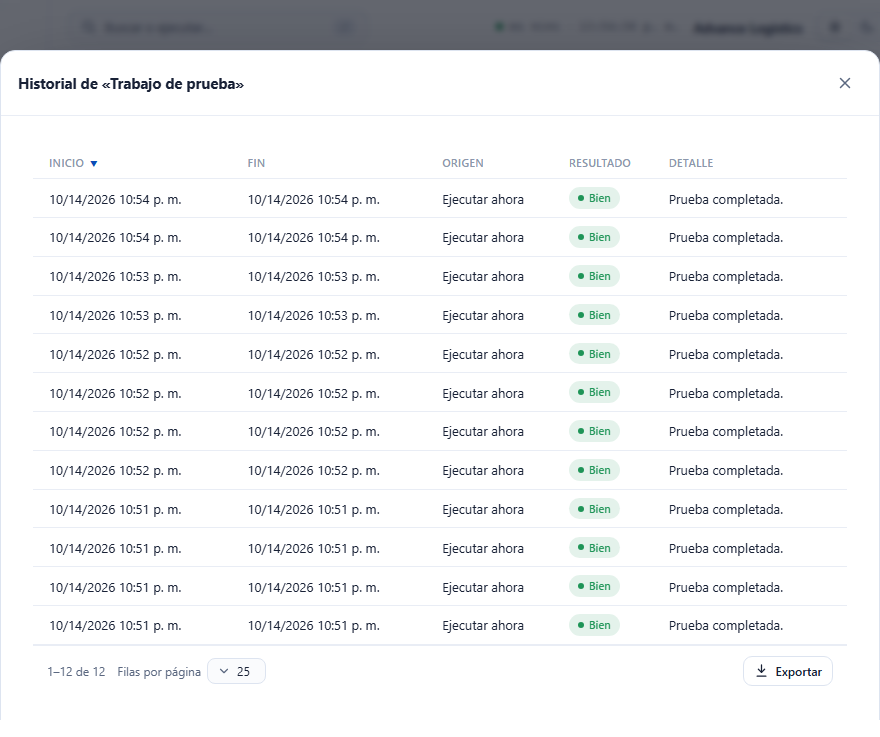

# L50 — Scheduled jobs

**System → Scheduled jobs** (`/system/jobs`). Who sees it: whoever has the **`jobs.manage`** permission (“Manage scheduled
jobs”; the Company admin role has it). System module (always on). Without the permission, the entry does not appear in the menu and the
address shows “No permission”. The rules, the messages with their code and the support notes are in chapter
[13 — Scheduled jobs](../13-trabajos-programados.md).

## 1. The list

One row per job (on a phone, a card): name with its description, **On** (switch), **Schedule**, **Next run**
(empty if it is off; “Requested: in a few seconds” if you asked for “Run now”), and **Last result** (*OK*, *Failed*, *Running* or *Never
ran*, with its time and the summary or the error). While something is running or waiting its turn, the screen refreshes by itself every 5 seconds.
**Export** downloads the list.

## 2. Run now

The ▶ button in the row. It says ““…” will run in a few seconds.”; the system picks it up right away (even if the job is off) and the
result appears in the same row.

## 3. Changing the schedule

The pencil in the row opens **Schedule of “…”**: *Every so often* (number and unit: minutes, hours or days; from 1 minute to 7 days) or *Every
day at a time* (24 hours, company time). A value out of range shows the same message as the server and does not save.

## 4. History

The clock in the row opens **History of “…”** with the latest runs: start, end, origin (*Scheduled* or *Run now*), result and
detail (the error if it failed).

It works from 360 px up with no horizontal page scroll.
