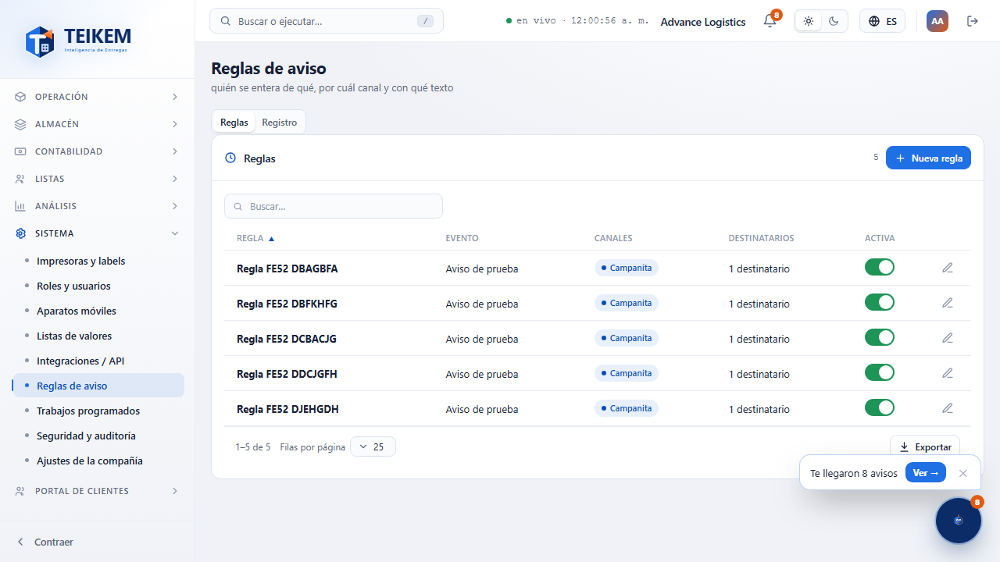
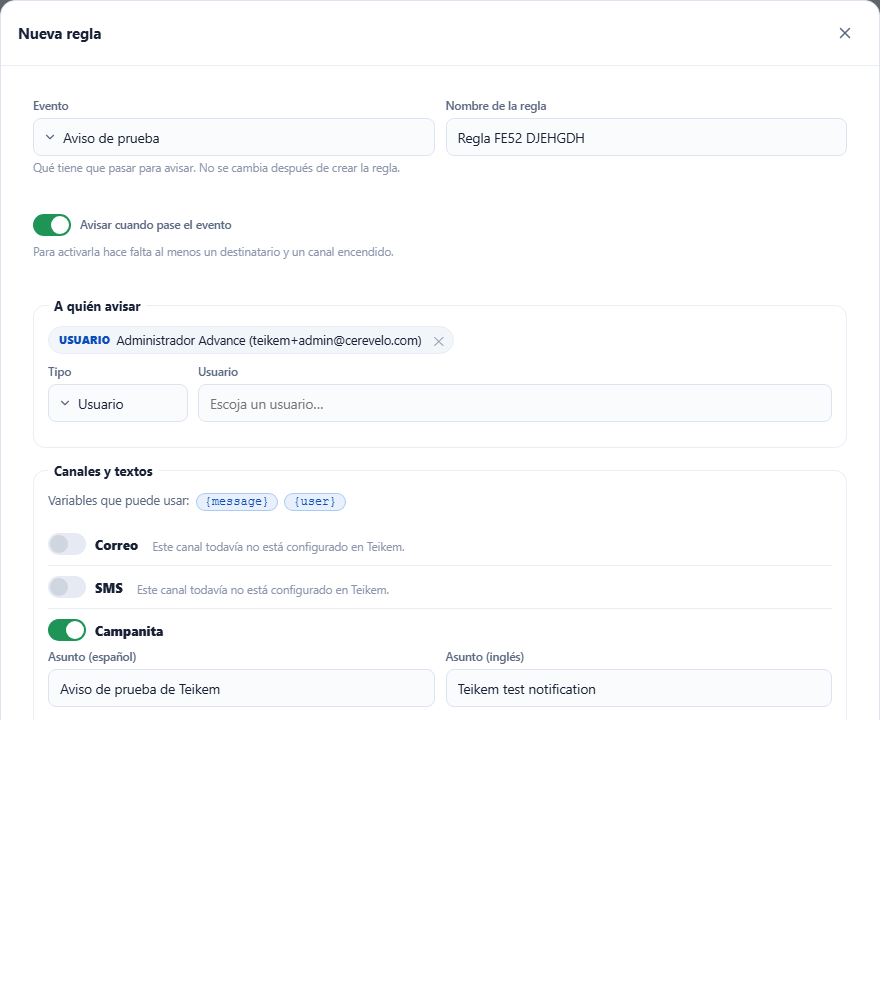
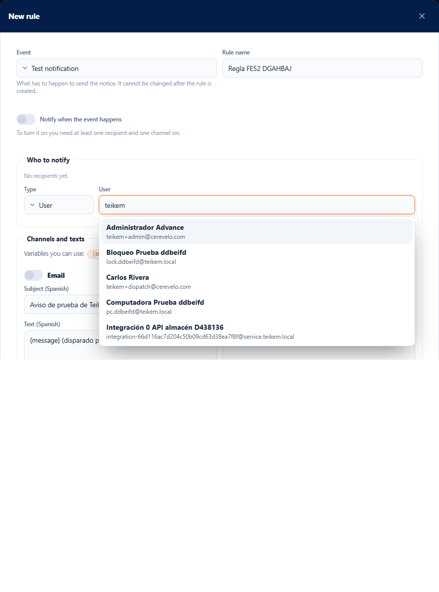
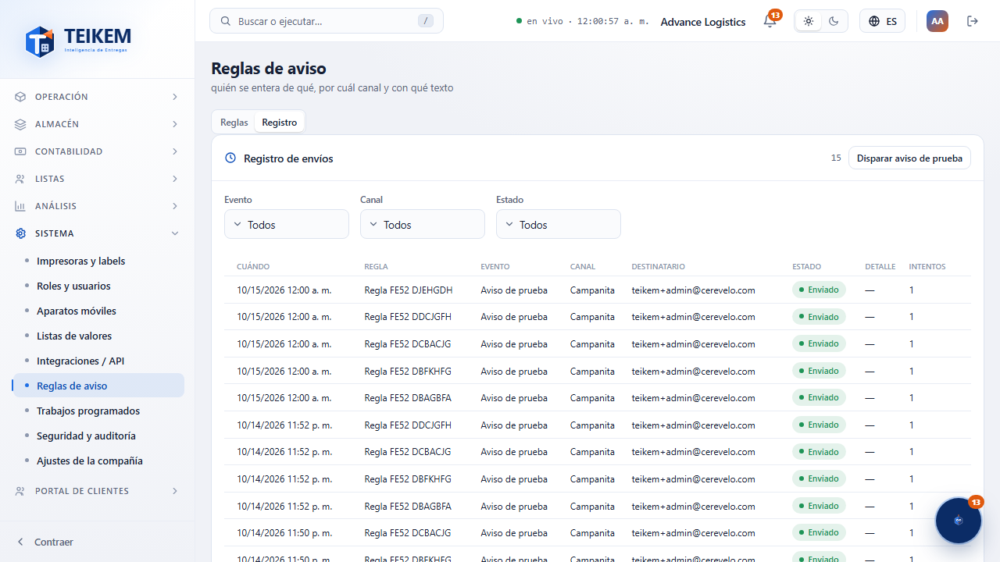
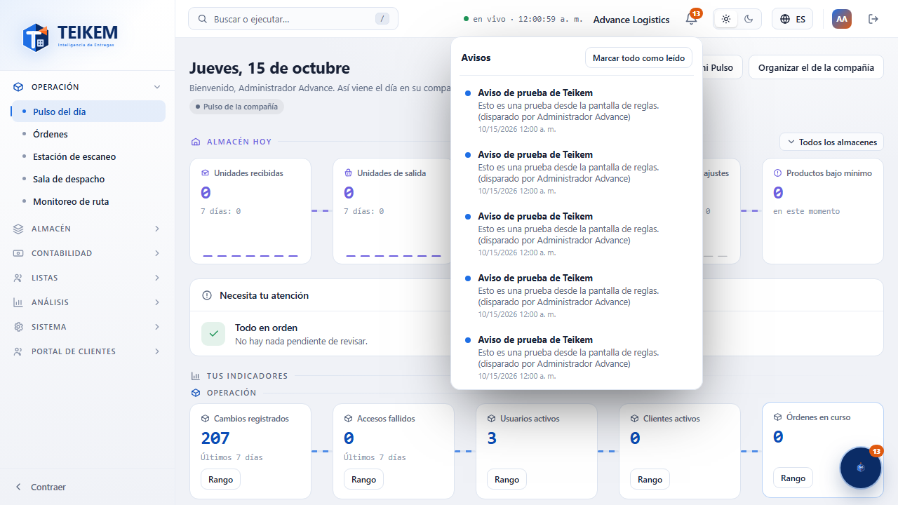
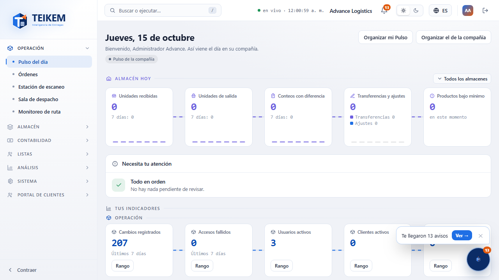
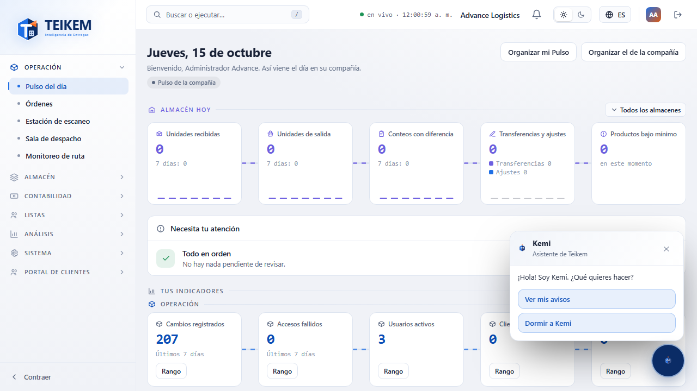
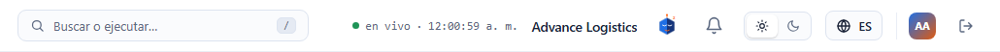

# L52 — Notification rules, bell and Kemi

Three pieces that use the notification engine of Batch 51 (chapter [14 — Notifications](../14-avisos.md)):

1. **System → Notification rules** (`/system/notifications`): who finds out about what, through which channel and with what text. Permission **`notifications.manage`**
   (“Manage notification rules”; the Company admin role has it). System module (always on). Without the permission, the entry does not appear in the menu.
2. **The bell** in the header: the notices of **whoever is signed in** (each person sees only their own; no permission needed).
3. **Kemi**, Teikem's assistant: **announces** new notices and offers options; it **does not replace** the bell.

## 1. Notification rules

**Rules** tab: one row per rule with its **event**, the **channels turned on**, how many **recipients** it has and its **Active** switch
(a rule that is off is shown dimmed). The pencil opens **Edit rule**; **New rule** opens the same box empty. There is a search box and **Export**.

### New rule / Edit rule

- **Event**: what has to happen to notify. It is chosen when creating and **does not change** afterwards (for another event, create another rule). Today the **Test notice** exists; the notices of each module will be added over time.
- **Rule name**: unique in the company (up to 100 characters).
- **Notify when the event happens**: activates the rule. To activate it you need **at least one recipient and one channel turned on**.
- **Who to notify**: choose the **Type** and add.
  - **Role**: it reaches all the active users of that role.
  - **User**: type part of the name or the e-mail and the search box lists the people with their **name and e-mail**; choose with the mouse or with the arrows and Enter.
  - **Email** or **Phone**: for someone who is not a user (the phone is saved, but not used until there is SMS). The format is validated.
  Each recipient is shown as a chip with its ✕ to remove it; they are not repeated.

- **Channels and texts**: **Email**, **SMS**, **Bell** and **Push**. Each one has its switch and, when on, its **subject** (e-mail and bell) and its **text** in **Spanish and in English**.
  The event's **{variables}** appear as chips: one click inserts it where the cursor is. A variable the event does not have is rejected when saving.
- **Channels not configured**: **SMS** and **Push** (no provider yet) and **Email** (if the server does not have Teikem's e-mail configured) come out **off**, unable to be turned on, with the note
  “This channel is not configured in Teikem yet.”.
- **Send test** (when editing, per channel): sends the **saved** text, with sample values, **to whoever asks for it**. It tells you whether it went out, whether it was skipped (and why) or whether it failed.
- Server errors are shown as is (see chapter 14 §7) and the box stays open.

## 2. Log

**Log** tab: each send (when, rule, event, channel, recipient, **state** —Sent, Skipped, Failed, In processing—, detail and attempts), with filters by **Event**, **Channel** and **State**, paginated and with **Export** (everything filtered).
**Fire a test notice** puts the test event in the real queue: the **active** rules of that event receive it (in a few seconds).

## 3. The bell

The bell icon in the header (next to the theme) shows how many **unread** notices you have (99+ if there are more than 99). When opened:
- It lists the **latest notices** (the unread ones with a blue dot). A click on a notice **marks it read** and, if it carries a link to a Teikem screen, **opens it**.
- **Mark all as read**.
- **Notices I can mute**: the optional notices with their switch; off, that notice no longer reaches your bell.
- It closes with Escape or with a click outside. The counter refreshes by itself every 30 seconds.

## 4. Kemi

- **Awake**: the floating mascot at the bottom right. When **a new notice arrives** it blinks and shows the balloon **“You got a notice → View”** (**View** opens the bell; the ✕ closes it; it hides by itself after 15 seconds).
  When opening the application with unread notices, Kemi greets you **once per session** with the count.

- **One click on Kemi** opens its **options** (buttons, no typing): **See my notices** and **Put Kemi to sleep**.

- **Asleep**: Kemi **hides in the header** (next to the bell) with its eyes closed and **no longer shows balloons**; the bell keeps its counter. A click on it **wakes it up** and it goes back to its place. It is remembered per user in this browser.

- **Kemi alive (Batch 76a)**: awake, it is never frozen.
  - It **blinks** every 2.5 to 6 seconds and, every 8 to 25 seconds, **makes a short gesture**: looks to one side, winks or smiles. Every 1 to 3 minutes it makes a bigger **face** (sticks out its tongue, gets surprised, gets worried). The waits are **random**, never a clock, and it does not repeat the same gesture twice in a row.
  - **With the pointer over it** it stays attentive (bigger eyes) and **the pupils follow the pointer**.
  - **When a notice or a message arrives** it opens its eyes and mouth wide, **jumps three times** and keeps that face while the balloon is in view.
  - **It can be dragged to wherever the user wants it**: grab and release; a movement of less than 5 px still counts as a click. It is **remembered per user** in the browser. The balloon and the panel open toward where there is room (if it is at the top, downward; if it is on the left, aligned to the left) and it does not move when they open. In its options **Send Kemi back to the corner** appears when it is not in its usual one. It always stays inside the window, also when its size changes.
  - **Lightweight**: it is a single vector drawing (SVG, no images) with the pieces of all its gestures; the motion is only CSS `transform` and `opacity`. There is no animation loop: just a few timers with random waits that change two attributes of the drawing, and they do not run with the tab hidden, with the pointer over it, with “reduce motion” enabled or if Kemi is asleep or has its panel open. The pupils follow the pointer only while it is over it, and at most one frame per screen refresh.
- With “reduce motion” enabled in the system, Kemi does not blink, move or jump (it can still be dragged).

It works from 360 px up with no horizontal page scroll. (More Kemi options —for example sending a message— come in later batches.)
