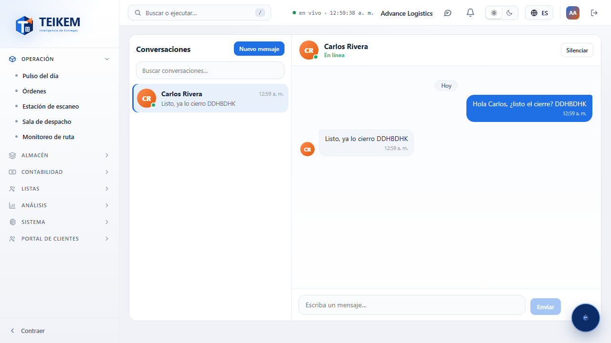
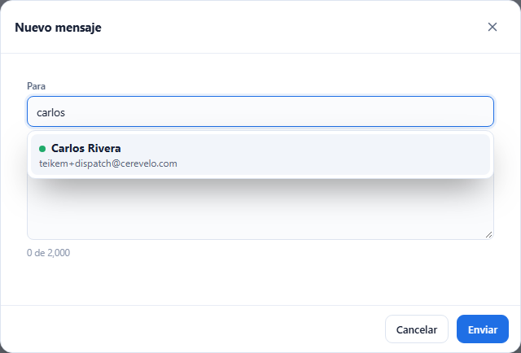
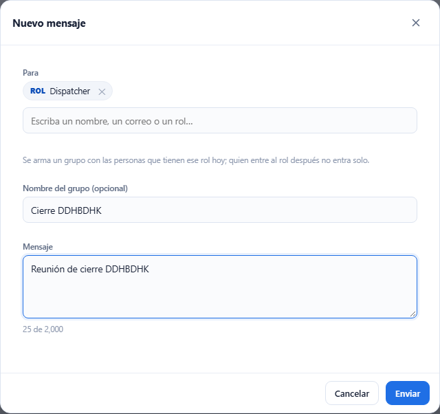
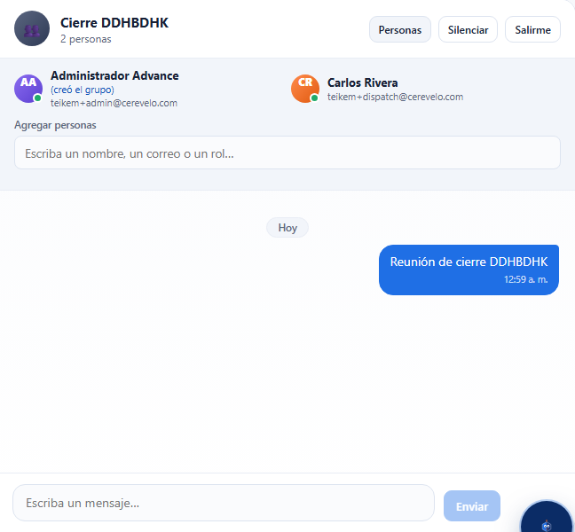
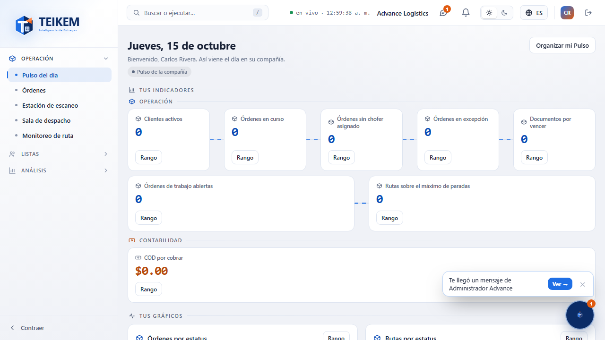

# L53 — Messages

Teikem's chat screen. Who sees it: whoever has the **`messages.use`** permission (“Use internal messaging”; the staff roles have it, see [chapter 15](../15-mensajeria.md)). It opens with the **chat balloon in the header**
(next to the bell), with **Kemi** (“My messages”) or from Kemi's notice “You got a message from…”. Without the permission, the button does not appear.

## 1. Conversation list (left)

- Each conversation with its **avatar** (the person's initials or 👥 if it is a group), the **green dot** if the other person is **online** (only in one-to-one threads), the **last message** (in groups, with the name of whoever wrote it; “You:” if it was you),
  the time (or the date if it is not from today) and the **number of unread messages**; 🔕 if you muted it. The most recent at the top.
- **Search conversations…** filters by name or by the last message. **New message** opens the window below.

## 2. The conversation (right)

- **Header**: the person (with “Online” or “Seen … ago”) or the group (with how many people), and the **People** (in groups), **Mute / Unmute** and **Leave** (in groups; asks for confirmation) buttons.
- **Messages** in bubbles: **yours on the right** (blue) and the other person's on the left, with the time and **Today / Yesterday / date** separators; consecutive ones from the same person are joined. In a group, each person carries their name.
- **Load earlier messages** brings the older ones (50 at a time).
- **Writing**: the box at the bottom; **Enter sends**, **Shift+Enter** adds a line break; it does not send empty. If sending fails, **what you wrote is not lost**.
- Everything arrives **instantly**; if you have the conversation open, new messages are marked read by themselves.
- **People** (groups): list with their presence, who created the group and, **only for whoever created it**, **Add people** with the search box (name and e-mail).

## 3. New message

- **To**: a single search field. Type part of the **name**, the **e-mail** or the **role** and the search box lists, at the same time, the **people** (with their name, their e-mail and their online dot) and the **roles** that have active people (“Role · 3 people”); choose with the mouse or with the arrows and Enter.
  You can add **as many people as you want** (chips with ✕): a single one opens the one-to-one thread; **two or more make a group**. Choosing a **role** adds those who have it **today** (a group is made; whoever joins the role later does not get in by themselves); only one role per message.
- **Group name (optional)**: appears if there are several people or a role; empty = the role's name or the people's names.
- **Message** (up to 2000 characters, with counter). **Send**: a single person opens (or returns to) the one-to-one thread; if something is missing or fails, the server message is shown as is and the window stays open.

## 4. Groups

## 5. Kemi and messages

- When a message arrives, **Kemi blinks** and shows the balloon **“You got a message from Ana → View”** (**View** opens that thread). Muted, or with Kemi asleep, there is no balloon (the header counter continues).
- In **Kemi's options** (one click on it): **Send a message to…** (opens “New message”) and **My messages** (with the counter).

## 6. On a phone

From 360 px up, with no horizontal page scroll: you see **one thing at a time**: the list or the conversation (with **←** to go back to the list).
