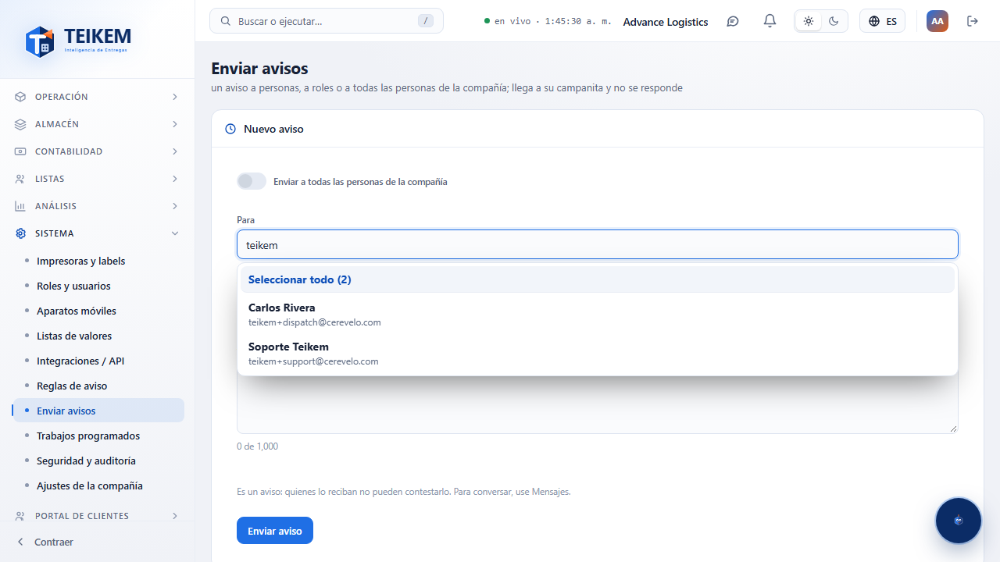
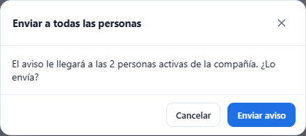
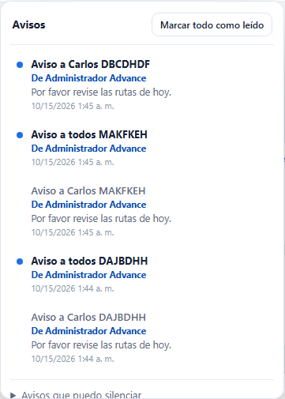
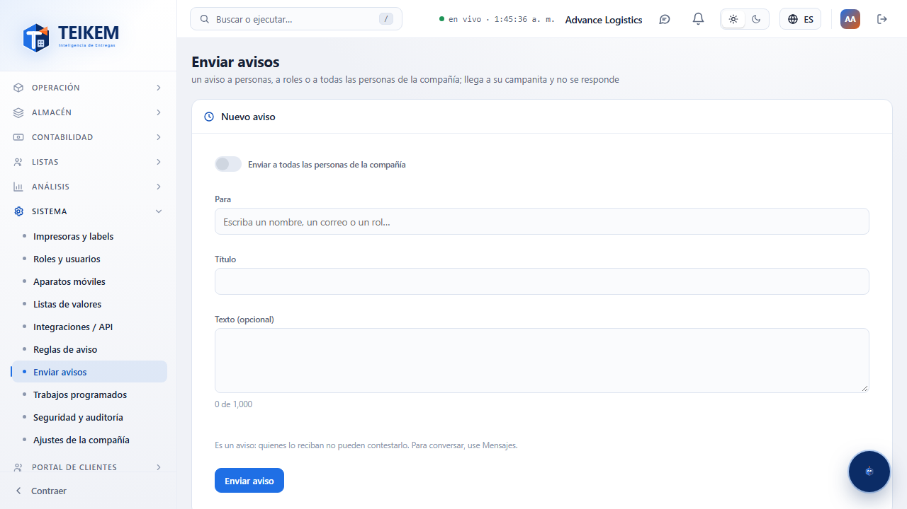

# L54 — Send notices

**System → Send notices** (`/system/announcements`). Who sees it: whoever has the **`notifications.send`** permission (“Send notices to other people”). The **Company admin** role has it; **it is not given to other roles by default**: the administrator assigns it to
whoever they want (System → Roles & users). System module (always on). Without the permission, the entry does not appear in the menu and the API answers 403.

A **notice** is different from a **message**: a notice **is not answered**. It reaches each person's **bell** (“From Ana Rivera”), instantly if they have Teikem open and, if not, it stays pending until they sign in. To have a conversation, use [Messages](l53-mensajes.md).

## 1. New notice

- **Send to everyone in the company**: the switch sends the notice to **all active people** (except you). It says how many there are and, when sending, **asks for confirmation** with that count.
- **To**: a single search field for **people and roles**. Type part of the **name**, the **e-mail** or the **role**; the list shows the people with their name and e-mail and the roles with how many active people they have (“Role · 3 people”; empty roles do not appear). Choose with the mouse or with the arrows and Enter.
  You can choose **several people and several roles**; each one stays as a chip with its ✕ (10 chips are shown plus a summary of the rest) and **Clear all** empties the selection.
- **Select all (N)**: the first row of the list. It chooses **all the people and roles that match what was typed** (the N, even if the list only shows 8) and **nothing else**: if you typed “operator”, it marks the operators; if you typed nothing, it marks everyone.
  The search brings up to 500 people; if there are more, refine what you typed. A chosen role notifies those who have it **today**.
- **Title** (required, up to 150 characters) and **Text** (optional, up to 1000, with counter).
- **Send notice**. No repeats: whoever is in as a person and through a role receives only one, and **you never notify yourself**. When done it says how many people it reached and the form is left clean.

## 2. What the recipient sees

In their bell: the notice with the **title**, the text and **“From Ana Rivera”**; the counter goes up and, if they have Teikem open, **Kemi** blinks with “You got a notice → View”. There is no way to answer it; manual notices **cannot be muted**.

## 3. Sent notices (history)

Table with **when**, the **notice** (title and text), **who it was for** (everyone, or “Management, Ana Rivera, +2”), **how many people** received it, **how many have read it** (“2 of 5”) and **who sent it**. Most recent first, paginated, with **Export** (the whole history). Sent notices **cannot be edited or deleted**.

In “New message” (Messages) the same “To” field also has **Select all**, which adds the people that match what was typed (roles are chosen one at a time).

It works from 360 px up, with no horizontal page scroll.
