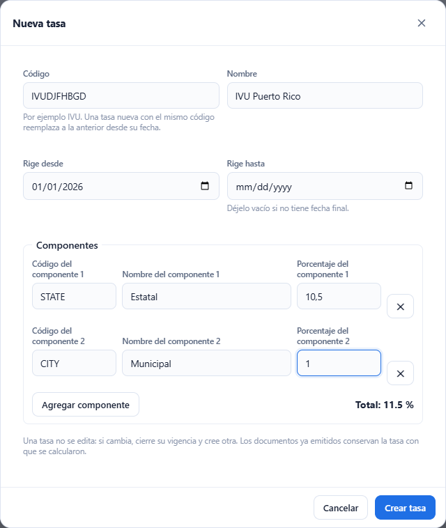
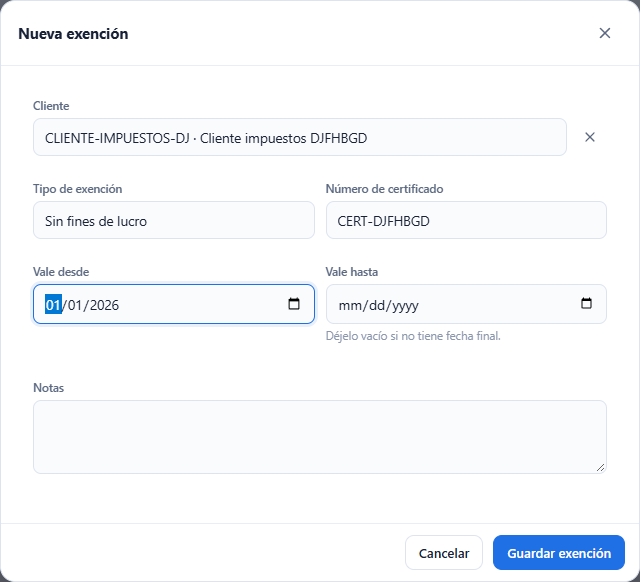

# L56 — Taxes

**Accounting → Taxes** (`/money/tax`). Who sees it: whoever has the **`tax.manage`** permission (“Manage taxes (rates, exemptions)”; the **Company admin** role has it) and the company with the **Taxes** module turned on (it comes off: System → Modules). Without that, the entry does not appear in the menu and the API answers 403.

Teikem provides the **mechanism** and the company **configures** it: no rate or rule is fixed in the program and none comes seeded. The figures (rates, components, what is taxable) are defined by the company's accountant. The rest of the staff only sees the **result** of the tax on the order and on the invoice.

The screen has five tabs: **Rates**, **Rules**, **Products**, **Exemptions** and **Simulator**.

## 1. Rates

A table with **code**, **name**, **percentage** (with its components below, e.g. “State 10.5 % + Municipal 1 %”), **effective from**, **effective until** and **state**: **In effect** (applies today), **Scheduled** (starts later) or **Closed**. The whole history is shown and exported in full.

**A rate is not edited.** If it changes (for example, on October 15 it goes up from 11.5 % to 12.5 %):
1. In the row of the old rate, **Close validity** (clock) and type the **last day** it applies (October 14).
2. In that same row, **New rate from this one** (money icon): it brings the same code, name and components, and proposes starting the next day (October 15). Change the percentage of the components and **Create rate**.

Documents already issued keep the rate they were calculated with. For the same code **the validity periods cannot overlap** (“There is already a rate with that code covering those dates. Close the validity of the previous one first.”).

**New rate**: code (letters, numbers, hyphen; saved in uppercase), name, **effective from**, **effective until** (empty = no end date) and one or more **components** (code, name, percentage; **Add component**). The **total** of the components is the rate's percentage and is shown while you type; it cannot exceed 100 %.

## 2. Rules

A single configuration per company (it is created by itself with default values: prices without tax included, rounding per line, no taxable charges).

- **Default rate**: the code of the rate used for what is taxable; the one in effect on the document's date is taken.
- **Prices already include the tax**: on, the amount of each line includes the tax and it is extracted (111.50 with 11.5 % = 100.00 + 11.50); off, it is added on top.
- **Rounding**: **per line** (the tax of each line is rounded to cents and added up) or **per document** (it is added up without rounding and rounded only once; it may differ by one cent).
- **Charges that pay tax**: one switch per charge type (freight, handling, surcharge, pickup). **Product sales** are decided by the product's category.

## 3. Products

The **tax category** of each product: **Taxable** (the usual), **Exempt** (does not pay) or **Zero rate** (appears taxed at 0 %). It is changed with the row's list and **is saved when chosen**. Search box by code, name or barcode and filter by category; it brings up to 500 products (refine with the search box).

## 4. Exemptions

The clients' exemption certificates: **client**, **type** (e.g. “Non-profit”), **certificate number**, **valid from / until** (empty = no end date) and notes. State: **In effect**, **Scheduled**, **Expired** or **Deactivated**.

- With an exemption **in effect** no tax is charged to that client and the line is marked as exempt with the **certificate noted**.
- With the exemption **expired** the tax is charged and the calculation **warns** which certificate expired.
- They are never deleted: **Deactivate** and **Reactivate** (row icon); **Edit** changes the type, the certificate, the dates and the notes (the client cannot be changed).

## 5. Simulator

It calculates the tax of a few lines **with the company's rules and without saving anything**. It is the same calculation that sales orders and the invoice will use: it serves to check with the accountant that the rates and the rules are right. You choose a **client** (optional: with an exemption in effect the tax comes out as zero), a **date** (empty = today; try the day before and the day after a rate change) and the **lines** (type —taxable product sale or a charge type— and amount).

The result says the **rate used** and its validity, the **reason** for each line (Taxable, Zero rate, Exempt product, Exempt client —with the certificate—, Non-taxable charge), the net, the tax and the total per line, the totals, the tax **per component** and the warnings (for example, an expired exemption).

It works from 360 px up, with no horizontal page scroll. The exact error messages are in [chapter 17](../17-impuestos.md) and in the frequently asked questions.
