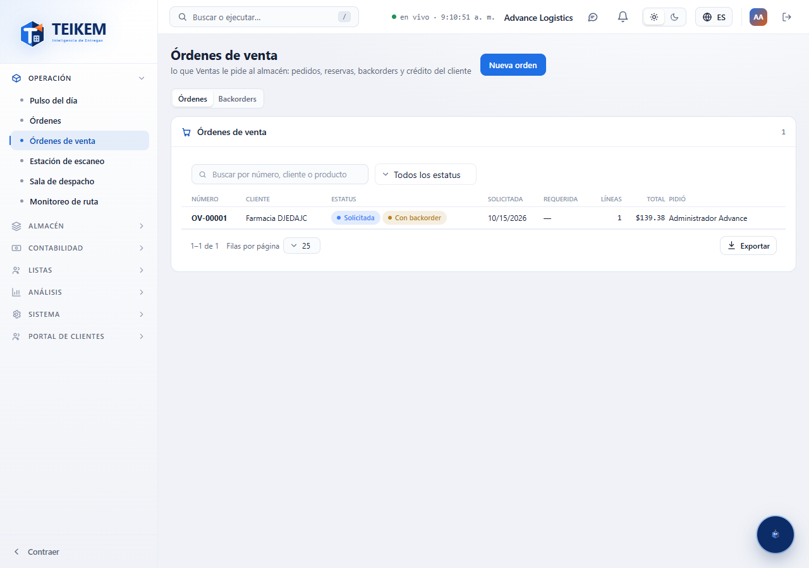
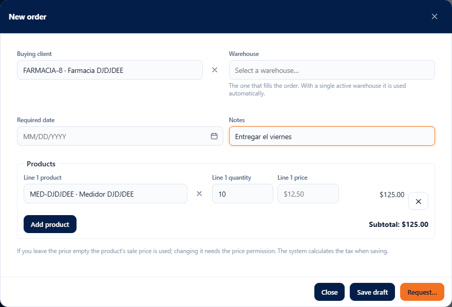
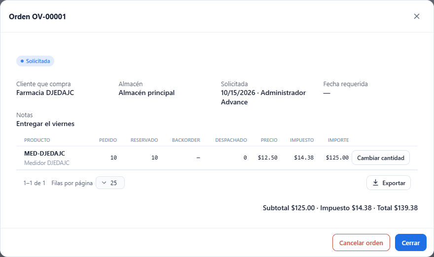
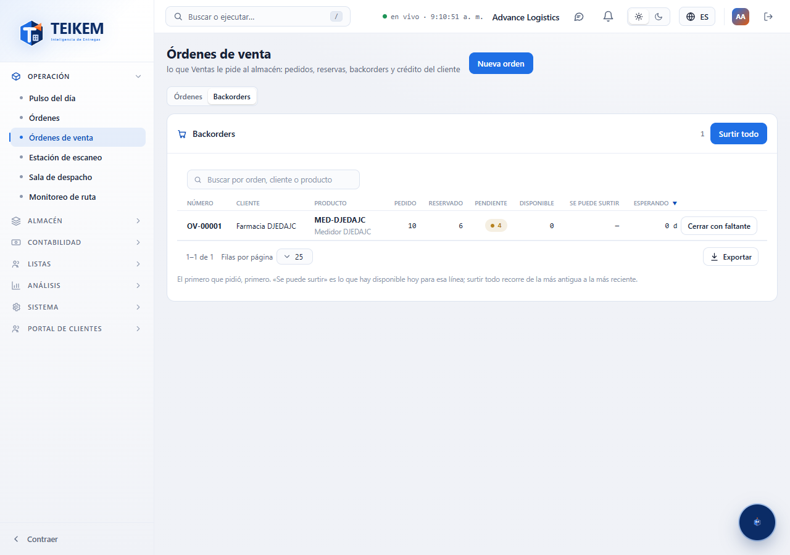

# L60 — Sales orders

**Operations → Sales orders** (`/sales-orders`). Who sees it: whoever has the **`sales.view`** permission (Company admin, **Sales** role and Warehouse operator) and the company with the **Sales orders** module turned on (it comes off: System → Modules). Without that, the entry does not appear in the menu and the API answers 403.

A **sales order** is the document that travels from **Sales to Warehouse**: Sales asks the warehouse to dispatch something for a client. The complete rules and the error messages are in [chapter 18](../18-ordenes-de-venta.md). This screen covers part S1: building the order, requesting it (reserving the inventory), backorders and cancelling or modifying. Dispatching against the order comes in the next batch.

The screen has two tabs: **Orders** and **Backorders**.

## 1. Orders

Paginated list (most recent first) with **number**, **client**, **status** (Draft, Requested, Partially shipped, Shipped, Cancelled, with the **With backorder** mark if any line has something pending), request date, required date, lines, **total** and who requested it. Search box by **number, client or product**, **status** filter and **Export** (all the rows of the filter). A click on the row opens the order.

## 2. New order and draft

**New order** (permission `sales.create`) opens the window of a draft:

- **Buying client** (required, active) and **Warehouse** (if the company has only one active it is used by itself).
- **Required date** and **Notes** (up to 500 characters).
- **Products**: per line, the **product** (only the company's own products, with search by code or name), the **quantity** (up to 3 decimals) and the **price**. If you do not type a price the product's **sale price** is used (it appears as a gray hint); typing another price requires the `sales.price` permission. Each line shows its amount and below it the **subtotal**; the **tax** is calculated by the system when saving (with the Taxes module turned on) and is copied onto the line.
- **Save draft** saves without reserving anything. A draft can be reopened, changed (the lines are replaced) or **Cancel order**.

## 3. Requesting: checking, shortage and credit

**Request…** saves the draft and **checks before reserving**: it opens a dialog with the result.

- **Everything is enough**: it says there is inventory for everything and the client's credit is enough; **Request and reserve** reserves on the spot (the inventory is kept for that order and the warehouse sees it).
- **Inventory is short**: the table shows per product **Ordered / Available / Short** (“available” is what is sellable: without quarantine, cross-dock or rental, nor what is already reserved). **Nothing has been reserved yet.** You can **Reserve what is available and leave the rest on backorder**, or go **Back to editing** the order to order only what is available or remove the line.
- **Credit exceeded**: the dialog warns with the figures (limit, in progress, this order). Whoever has the **Authorize orders over credit limit** permission can turn on **Authorize the exceeded credit** and request it; who authorized it is recorded. Without that permission it cannot be requested.

## 4. Requested order

When opening a requested order you see the status, the client, the warehouse, who requested it and when, the notes and the lines with **Ordered / Reserved / Backorder / Shipped / Price / Tax / Amount**, and the totals.

- **Change quantity** (`sales.create`): on a line with nothing shipped. Raising it reserves more (if there is not enough it warns; with **leave the rest on backorder** it reserves whatever there is); lowering it first takes from the backorder and then releases the reservation. The tax and the totals are recalculated.
- **Fill** and **Close with shortage** (`sales.backorder`): on lines with backorder (see section 5).
- **Cancel order** (`sales.cancel`): releases **exactly what it had reserved** and deletes its backorder. An order with something already shipped cannot be cancelled.

## 5. Backorders

All the lines with something pending from the requested orders, **the oldest first** (“first to order, first served”): order, client, product, **ordered / reserved / pending**, what is **available today**, what **can be filled now** (green) and how long it has been waiting. Search box by order, client or product.

- **Fill** (in the row; `sales.backorder`) reserves for the line whatever there is, all or part.
- **Fill all** (at the top) goes through the backorders **from the oldest to the most recent** and fills what it can; the notice says how many units were reserved and in how many lines. A completed line **leaves the view**.
- **Close with shortage** considers the line finished without waiting for more inventory; what is already reserved is shipped anyway.

It works from 360 px up, with no horizontal page scroll.
