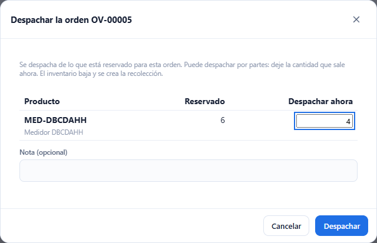
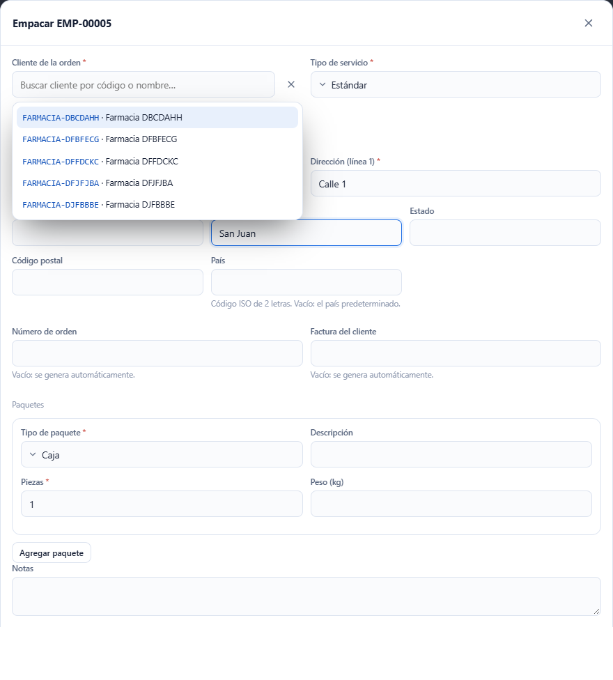
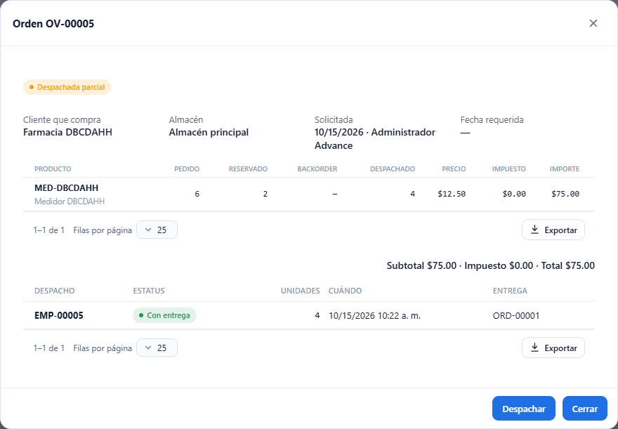

# L63 — Dispatching against a sales order (web)

From the window of a **requested** order (Operations → [Sales orders](l60-ordenes-de-venta.md)) you dispatch what is reserved, decide what comes next (pickup or delivery) and see the list of the order's **dispatches**. The complete rules and the error messages are in [chapter 18](../18-ordenes-de-venta.md), sections 10 and 11. The **`warehouse.pick`** permission (the same as picking) is required; creating the delivery also requires `orders.create`.

## 1. Dispatching

In the order, **Dispatch** (it appears while something remains reserved). The window shows per line what is **reserved** and the quantity that goes out **now** (by default, everything reserved). You can dispatch **in parts**: lower the quantity of a line or leave at zero the ones that are not going out today. There is an optional note.

- You cannot dispatch more than what is reserved (“You cannot dispatch more than what is reserved: XXX has n reserved.”).
- When you confirm, **the inventory goes down** (always, whether it is delivered or picked up), the pick batch (`EMP-#####`) linked to the order is created and the reservation is consumed.
- The system uses the bins and lots it reserved. If the product is in another bin, that is done with the **device** (which guides by bin and allows taking from another one); the reservation moves by itself.

## 2. What comes next with what was dispatched?

When finished, a question appears:

- **Pickup: the client collects it (done)**: nothing else is needed; the dispatch stays as “Shipped” (without delivery).
- **Delivery: create the transport order…**: opens the packing form (service, consignee, packages, COD…), with the **client and the consignee of the sales order already filled in** (or a new consignee). It creates the real transport order and the dispatch moves to “With delivery”.
- **Decide later**: the delivery can be created later from the list of dispatches.

## 3. The order's dispatches

Below the lines, the table of **dispatches**: pick batch number, status (**Shipped**, **With delivery**, **Undone**), units, when and the **transport order** of the delivery (if it has one). **Create delivery** appears on the dispatches without delivery.

The order's status follows what was dispatched: **Partially shipped** while something remains reserved or on backorder and **Shipped** when everything went out (or was closed with shortage). If a dispatch is **undone** (by deleting its pick batch), the stock comes back, what was shipped goes down and is reserved again, and the order is reopened.

It works from 360 px up, with no horizontal page scroll.
