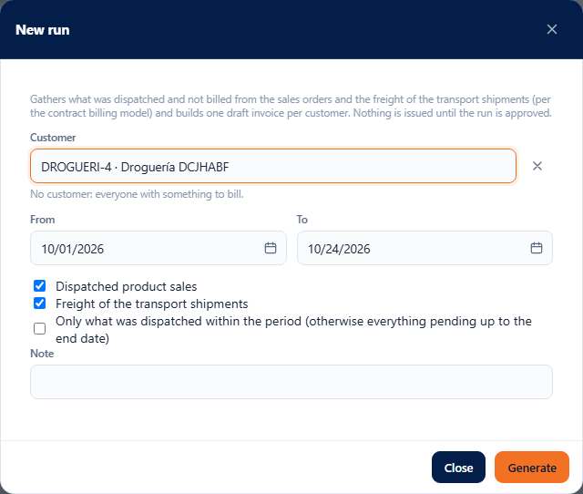
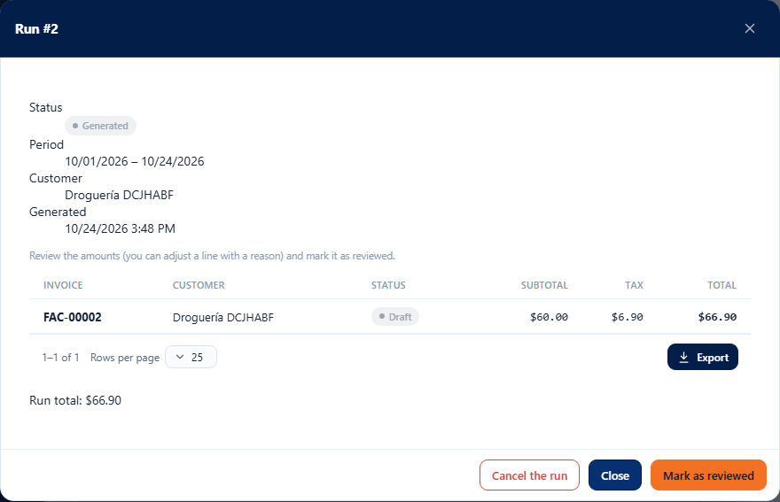
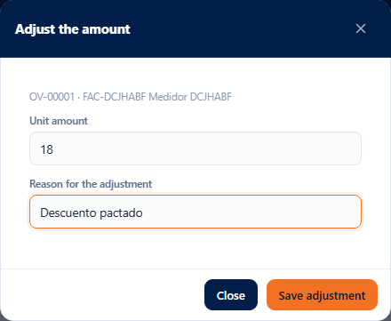
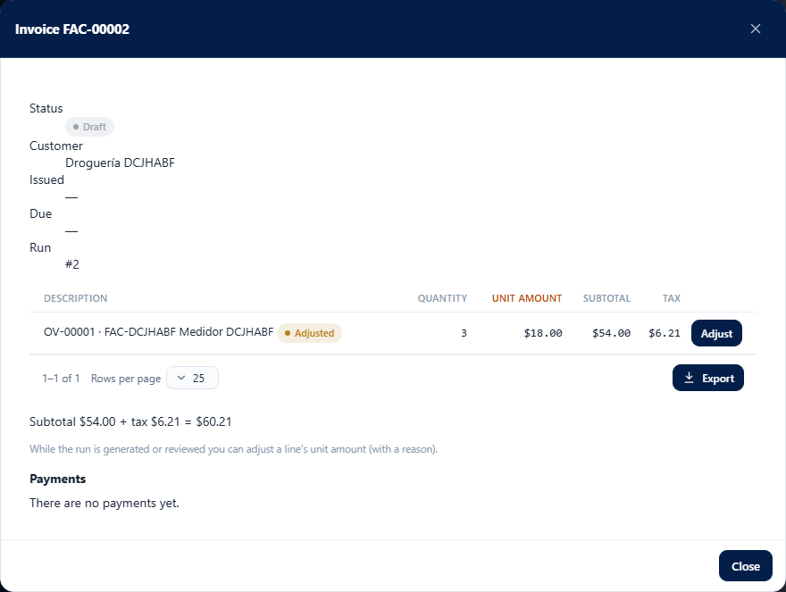
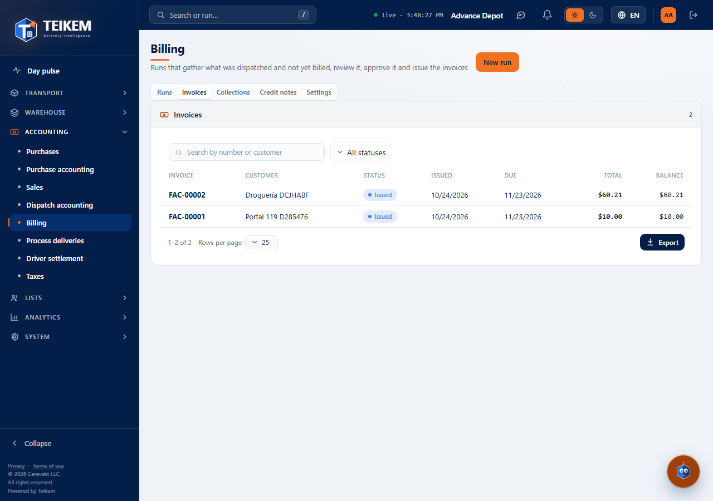
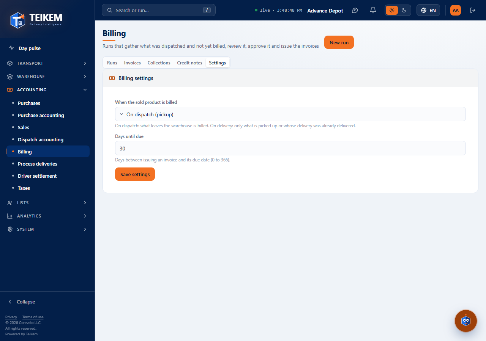

# L73 — Billing

**Money → Billing** (`/money/billing`). It is seen by whoever has the **`billing.view`** permission and the company with the **Billing** module (`BILLING`) turned on. The complete rules and the error messages are in [chapter 19](../19-facturacion.md).

A **run** gathers what was dispatched and not billed from the sales orders, builds a draft invoice per client, is reviewed, is approved (issues the invoices) and, if needed, is cancelled or an invoice is voided. The screen has three tabs: **Runs**, **Invoices** and **Settings**.

## 1. New run

**New run** (permission `billing.generate`) asks for the **client** (optional: without a client everyone with something to bill comes in), the **From / To** period, **what to bill** (*Dispatched product sales* and *Freight of the transport shipments* checkboxes, both checked by default; at least one, Batch 74), whether it counts **only what was dispatched within the period** and a **note**. It validates before sending: both dates, the end one not before the start one and the note of up to 500 characters. **Generate** opens the run.

## 2. The run

It shows the status (Generated → Reviewed → Approved, or Cancelled), the period, the client and the invoices with their subtotal, tax and total. Depending on the status:

- **Generated / Reviewed**: the lines can be adjusted and **Cancel the run** (voids its invoices and what was claimed is left to be billed again).
- **Generated**: **Mark as reviewed**.
- **Reviewed**: **Approve and issue** (`billing.approve`, asks for **re-authentication**: the “Confirm your identity” window appears).

## 3. Invoice and adjusting a line

When opening an invoice you see its lines (sales order, product, quantity, unit amount, subtotal and tax) and the totals. While the run is generated or reviewed, **Adjust** changes the **unit amount** (up to 4 decimals) and requires the **reason** (up to 250 characters); the line is marked **Adjusted** and the tax is recalculated.

## 4. Invoices and voiding

The **Invoices** tab lists them all with a search box (number or client) and a status filter (Draft, Issued, Paid, Overdue, Void). An **Issued** or **Overdue** invoice is voided with **Void the invoice** (`billing.approve`, re-authentication; optional reason): what it had billed is left to be billed again. The server refuses to void an invoice with payments.

## 5. Settings

Whoever has `billing.approve` chooses **when the sold product is billed** (on dispatch or on delivery) and the **days until due** (0 to 365). Everyone else sees them without being able to change them.

## Mobile

From 360 px the tables turn into cards and the windows take the full width; there is no horizontal page scroll.
