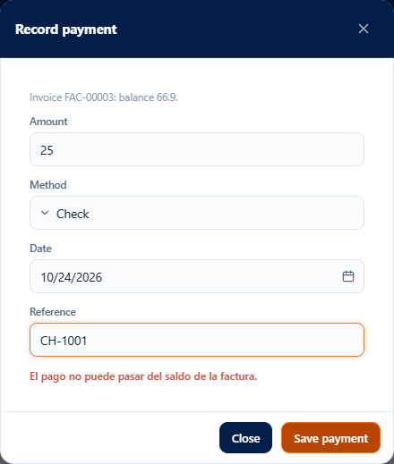
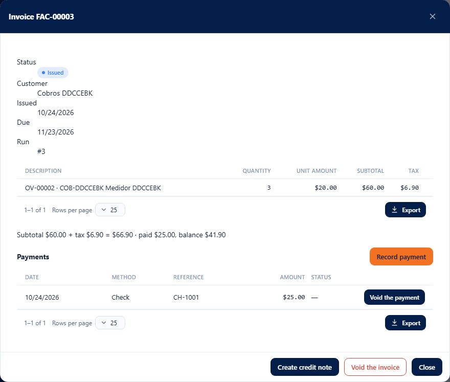
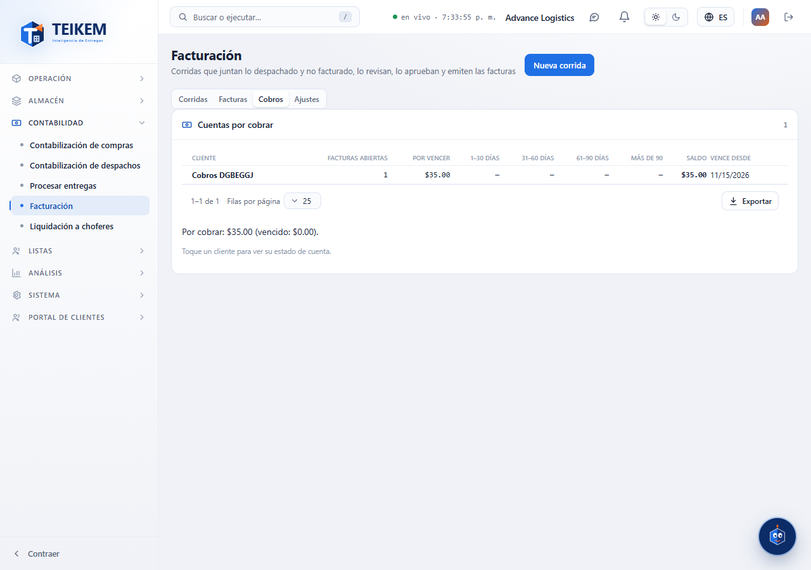
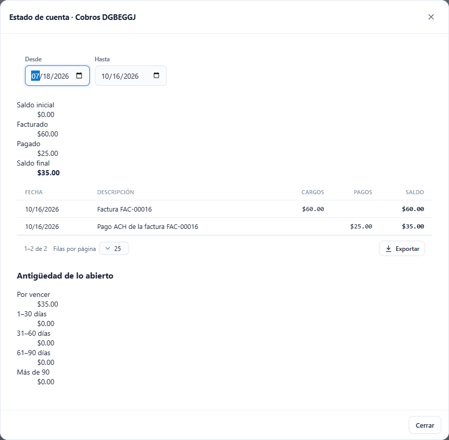

# L76 — Collections: payments, accounts receivable and statement

**Accounting → Billing** (`/money/billing`), the **Collections** tab and each invoice's record. The complete rules and error messages are in [chapter 19 §4b](../19-facturacion.md).

## 1. Payments of an invoice

In an invoice's record (**Invoices** tab, one click on the row), below the totals, the **Payments** section lists each payment with **date, method, reference and amount**; a voided payment appears struck through with the status **Voided** (the reason in the tooltip).

- **Record payment** (permission `billing.generate`; only on an **Issued or Overdue** invoice): amount (by default, the balance), **method** (Check, ACH, Card or Cash), **date** (today by default; not in the future nor before the issue date) and **reference** (check or confirmation, up to 80 characters). The screen warns before sending if the amount is empty, has more than 2 decimals or **exceeds the balance**; the rest of the messages come from the server. When what has been paid covers the total, the invoice becomes **Paid**.

- **Void the payment** (permission `billing.approve` and **re-authentication**; only if the invoice is not Paid): asks for the **reason** (required, up to 250 characters). The payment no longer counts toward the balance.

## 2. Collections: accounts receivable

The **Collections** tab lists, per client, the **open invoices**, the **balance** and its **aging** in five columns (not yet due, 1–30, 31–60, 61–90 and over 90 days), with the oldest due date; from highest to lowest balance. Below, the total receivable and how much of it is overdue. The table sorts and exports like the others. One click on a client opens their statement.

## 3. Statement

The **Statement · client** window brings the **From / To** range (by default, the last 90 days), the **opening balance** (what came before the period), what was **invoiced**, what was **paid** and the **closing balance**; the table of **movements** (issued invoices as charges and payments as payments, with the running balance) and the **aging** of what is open today. One click on a movement opens its invoice (to record the payment of what is missing).

## Mobile

From 360 px the tables become cards and the windows take the full width; there is no horizontal page scroll.
