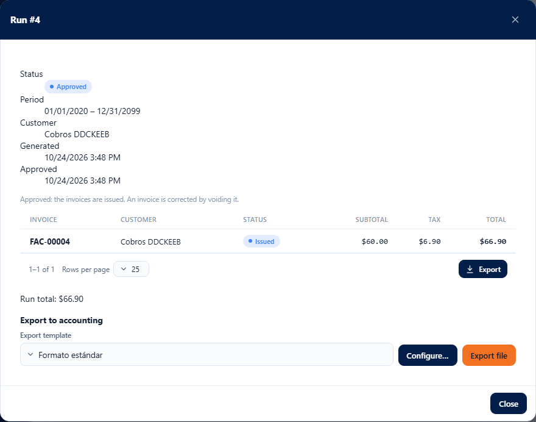
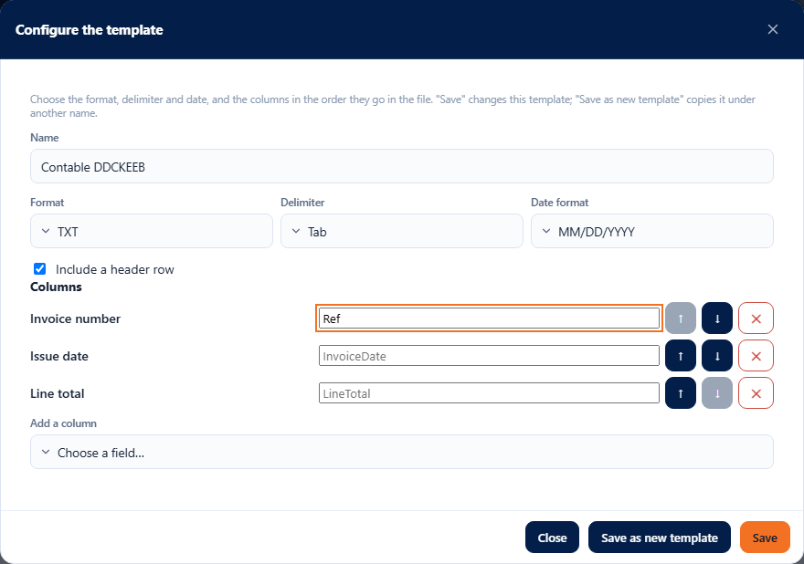
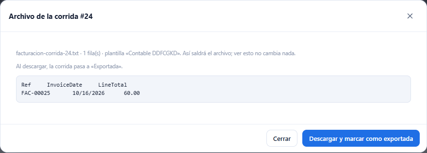

# L78 — Export to accounting

**Accounting → Billing → Runs**, inside an **Approved or Exported** run, in the **Export to accounting** section (only with the **`billing.export`** permission). The rules, fields and error messages are in [chapter 19 §4c](../19-facturacion.md).

## 1. The template selector

Below the run's invoices appears the section with the **template selector** (the company starts with **“Standard format”**: CSV with comma, ISO date, header and all columns) and two buttons: **Configure…** and **Export file**. If the run has already been exported, it says when (“Exported on …”) and reminds you that it can be exported again with another template.

## 2. Configure the template

**Configure…** opens the editor of the chosen template:

- **Name** (up to 80 characters), **Format** (CSV or TXT), **Delimiter** (comma, semicolon, tab or vertical bar), **Date format** (`YYYY-MM-DD`, `MM/DD/YYYY` or `DD/MM/YYYY`) and **Include a header row**.
- **Columns**: the list in the order they go in the file. Each one has its **own header** (optional; the gray text is the one used if left empty), arrows to **move it up or down** and ✕ to **remove it**; **Add a column** offers the catalog fields that are missing.
- **Save** changes this template; **Save as new template** copies it under the name you type (the name is not repeated among the active ones, ignoring case and accents: if it already exists, the server says so); **Deactivate the template** removes it from the list (asks for confirmation and does not appear if it is the only one).
- The screen warns before sending if the name is missing, no column is left or a header exceeds 60 characters.

## 3. Export file

**Export file** opens the **preview**: the file as it will come out with the chosen template (file name, number of rows and the full text). **Viewing the preview changes nothing.**

- In an **Approved** run, **Download and mark as exported** downloads the file (CSV or TXT, UTF-8) and the run becomes **Exported**, with who and when.
- In a run already **Exported**, **Download again** downloads the file once more (with the same or another template) without changing anything else.

## Mobile

From 360 px the windows take the full width and the editor's columns move the header to its own line; there is no horizontal page scroll.
