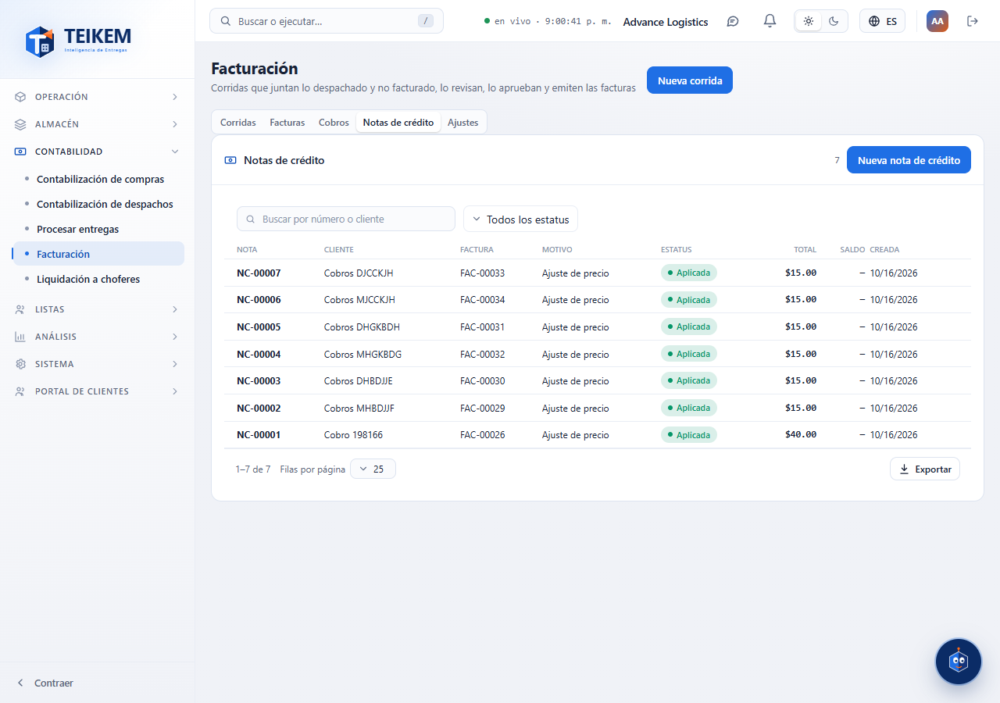
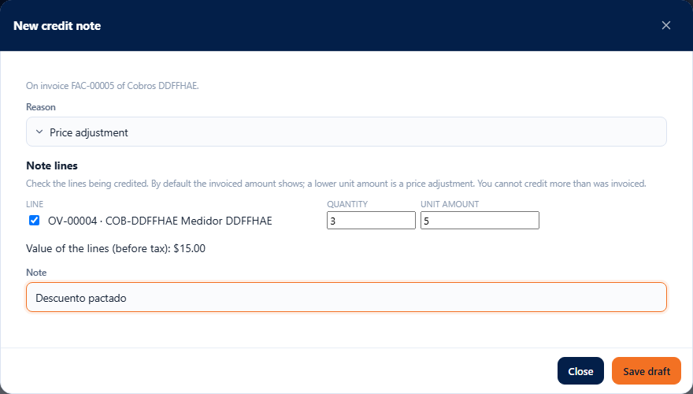
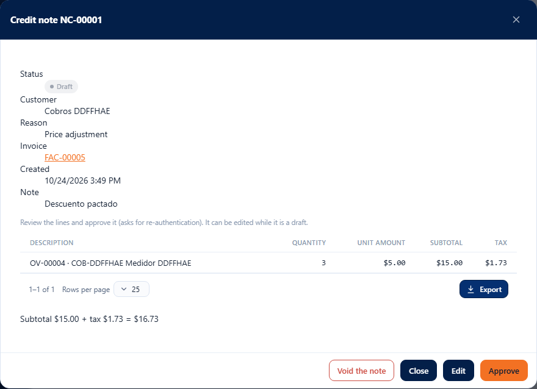
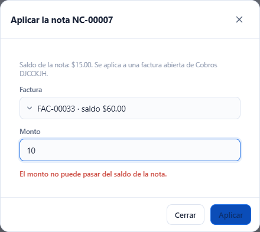

# L80 — Credit notes

**Accounting → Billing → Credit notes** and each invoice's record. Those with `billing.view` can see them; **creating, changing, applying and voiding** require **`billing.credit`** and **approving** also requires **re-authentication**. The rules, the limits and the error messages are in [chapter 19 §4d](../19-facturacion.md).

## 1. The list

The **Credit notes** tab lists each note with its **number (NC-#####)**, client, invoice, **reason**, status (Draft, Approved, Applied, Void), total, **balance** (the approved amount still to be applied) and date. It has a search box (number or client), a status filter, sorting by column and export like the other tables. One click opens the record.

## 2. Create a note

**New credit note** (or **Create credit note** in the record of an issued, overdue or paid invoice, which already brings the invoice):

- **On an invoice:** you choose the invoice (search box by number or client) and its lines appear, all checked, with the **invoiced quantity and unit amount**. Uncheck the ones not being credited and lower the unit amount for a **price adjustment**. The estimated value of the lines is shown below (the tax is calculated by the server with the invoice's tax). **No more than what was invoiced is credited**, nor more than what other approved notes already credit: the server says so.
- **Free** (invoice from another system or an adjustment): you choose the **client**, the external invoice reference (optional) and type the lines (description, quantity, unit amount and charge type: freight, surcharge, handling or pickup); the tax is calculated by the tax engine.
- In both: **reason** (return, price adjustment, service failure or billing error; required) and a **note** of up to 500 characters. **Save draft** creates it.

The screen warns before sending if the reason, the client or the invoice is missing, no line is left or a quantity or amount is not valid.

## 3. The record

It shows the status, the client, the reason, the invoice (one click opens it), the dates, the lines with their tax and the totals; if something has already been applied, the **applications** (invoice, date and amount) and “applied X, balance Y”. The actions depend on the status:

- **Draft:** **Change** (opens the editor with the note's lines), **Approve** (with re-authentication) and **Void the note**.
- **Approved with balance:** **Apply to an invoice** and **Void the note** (only if nothing has been applied yet).
- **Applied or Void:** view only.

## 4. Apply to an invoice

**Apply to an invoice** lists the **issued or overdue invoices with balance of the same client** and proposes the **lesser of the note's balance and the invoice's**. The screen warns if the amount is not valid, has more than 2 decimals or exceeds either of the two balances. When applied, the invoice's balance goes down just like with a payment (if it reaches zero it becomes **Paid**) and, when the note is used up, it becomes **Applied**. What is not applied remains as a **credit balance**.

## 5. In the rest of Billing

- The **invoice record** shows what was **credited** next to the payment (“credited X, balance Y”) and offers **Create credit note**.
- **Collections → accounts receivable** brings the **Credit balance** column per client, and the **statement** shows the approved notes as credits with the running balance and the **credit balance (unapplied)**.

## Mobile

From 360 px the tables become cards and the windows take the full width; the editor's lines arrange themselves in two columns. There is no horizontal page scroll.
