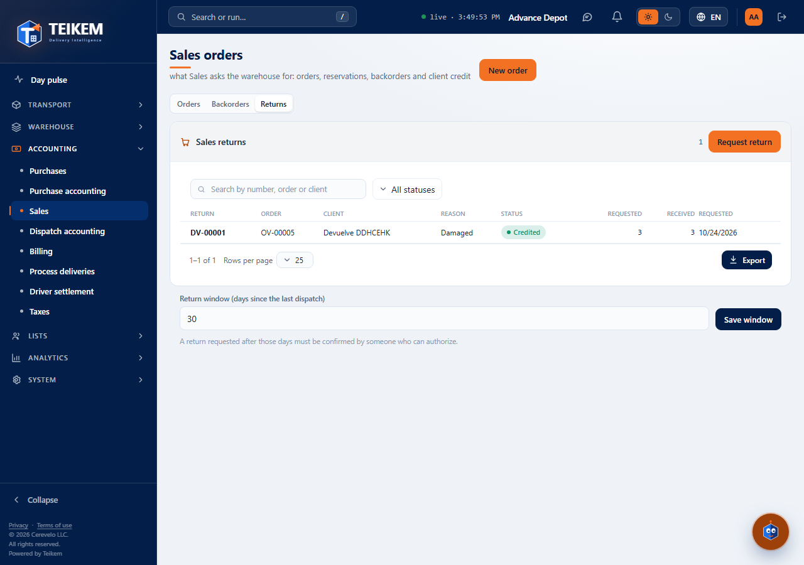
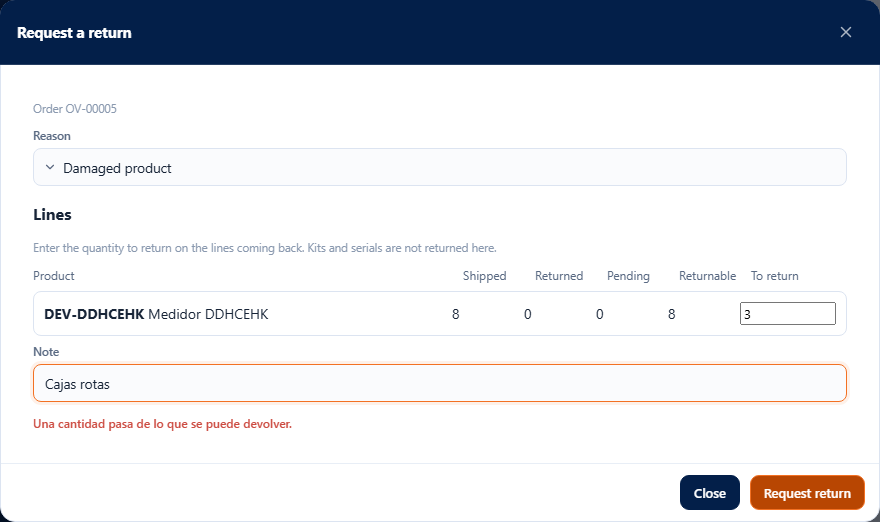
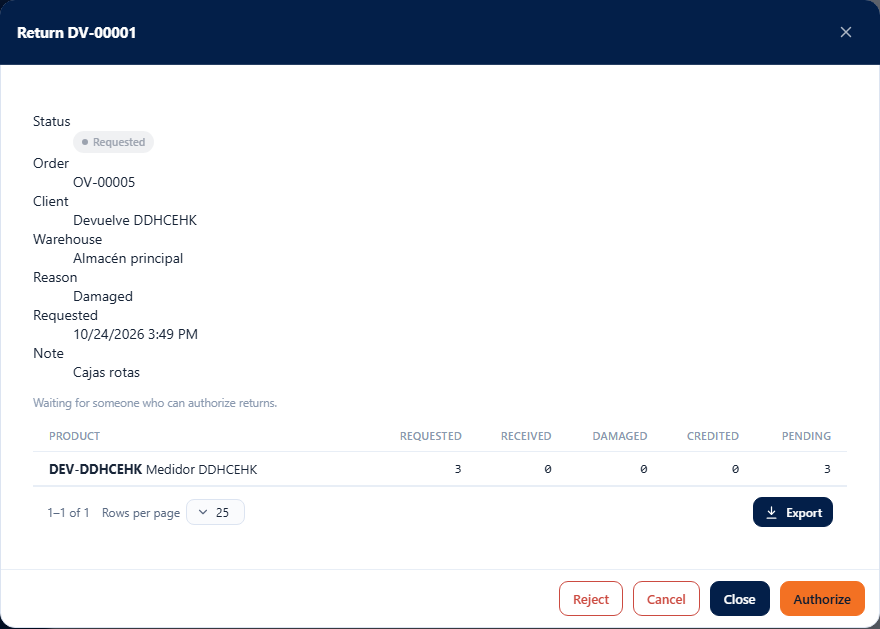
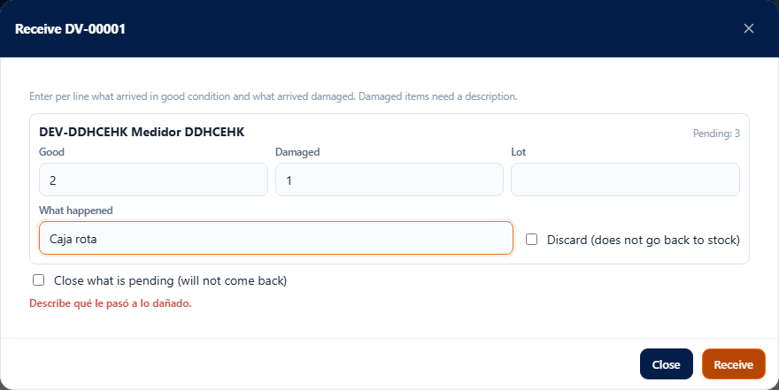
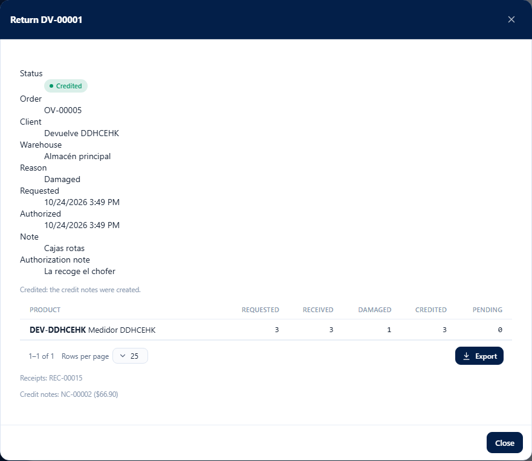

# L82 — Sales returns

**Operations → Sales orders → Returns** and the **Request return** button in the record of a dispatched order. Those with `sales.view` (SALES_ORDERS module) can see them. **Requesting and cancelling** require **`sales.return`**; **authorizing, rejecting and changing the window**, **`sales.return.authorize`**; **receiving**, **`warehouse.receive`**; **crediting**, **`billing.credit`**. The rules, the limits and the error messages are in [chapter 20](../20-devoluciones-de-venta.md).

## 1. The list

The **Returns** tab lists each return with its **number (DV-#####)**, the order, the client, the reason, the status (Requested, Authorized, Received, Credited, Rejected, Cancelled), what was requested and what was received and the date. If it was requested outside the window it carries the **Outside window** mark. It has a search box (number, order or client), a status filter, sorting by column and export like the other tables. One click opens the record.

Below the table is the **return window**: the days since the last dispatch during which a return is accepted (30 by default). Whoever can authorize changes it (integer from 0 to 3650); everyone else only sees it.

## 2. Request a return

**Request return** in the list (you choose the order among the dispatched ones) or in the record of an order with something dispatched (it already brings the order):

- The lines appear with what was **dispatched, returned, pending and returnable**; type the quantity in the ones coming back. **You cannot exceed what is returnable.** **Kits** and products with **serial** are not returned here (the box appears disabled).
- Choose the **reason** (damaged product, wrong item, client no longer needs it, expired or other; required) and a **note** of up to 500 characters.
- If **more days than the window** have passed since the last dispatch, the screen says so: only whoever can authorize requests it, checking **I confirm receiving it outside the window**; everyone else sees that it needs an authorizer.

The screen warns before sending if the reason or the order is missing, there are no quantities, a quantity is not valid or exceeds the limit.

## 3. The record and its actions

It shows the status, the order, the client, the warehouse, the reason, the dates, the notes, a help line about what comes next, the lines (requested, received, damaged, credited and pending) and, when they exist, the **receipts** and the **credit notes** generated.

| Status | Actions |
|---|---|
| Requested | **Authorize** (with an optional note), **Reject** (the reason is required), **Cancel** |
| Authorized | **Receive**, **Cancel** (as long as nothing has been received) |
| Received | **Receive** (if something is still pending), **Credit** |
| Credited, Rejected, Cancelled | view only |

## 4. Receive the good and the damaged

**Receive** opens one line per product with something pending. You note what arrived **good**, what arrived **damaged** and, if needed, the **lot**. Damaged items ask for the description **What happened** and a **Discard** box (does not go back to stock). **Close what is pending** ends the return even if something is missing (it will not come back anymore). Good items enter stock with the return-type receipt; damaged items remain in a damage report with the cause “Customer return”. The screen does not let you send with nothing, with a quantity that is not valid, that exceeds what is pending or with damage without a description.

## 5. Credit

**Credit** (in a Received return) creates **draft credit notes** for what was received and invoiced; they are approved and applied in **Billing → Credit notes**. If what was returned had not been invoiced, the server says there is nothing to credit.

## Mobile

From 360 px the tables become cards, the windows take the full width and the request and receive lines arrange themselves in one or two columns. There is no horizontal page scroll.
