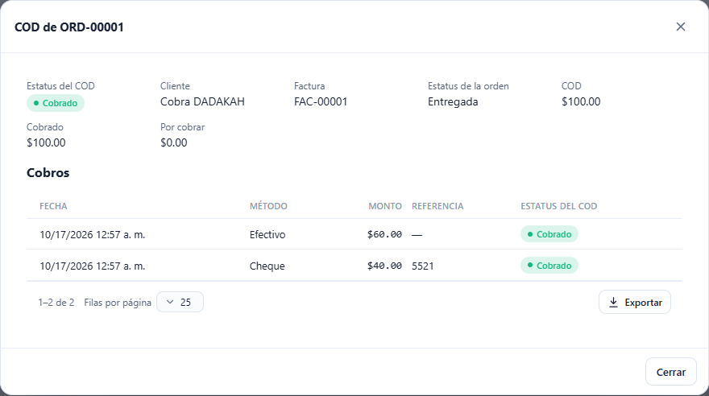
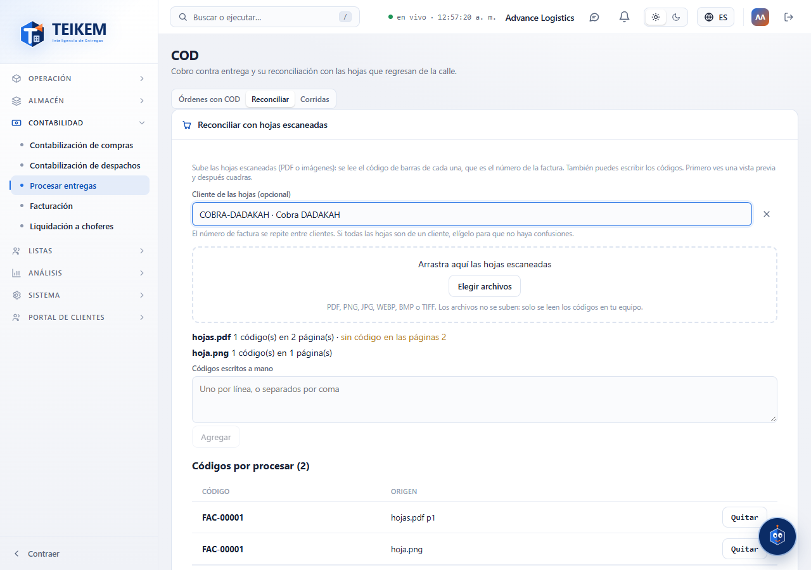
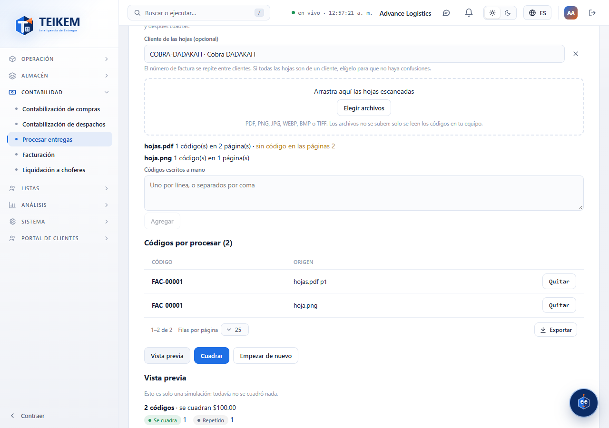

# L85 — COD: collection and reconciliation with scanned sheets

**Accounting → Process deliveries (COD)** (`/money/cod`). Those with `cod.view` (COD module) can see it. **Recording collections** requires `cod.collect` and the **Reconcile** tab requires `cod.reconcile`. The rules and the server messages are in [chapter 21](../21-cod.md).

## 1. Shipments with COD

The **Shipments with COD** tab lists each order with COD: order, **invoice**, client, order status, **COD**, **collected**, **to collect** and the COD status (To collect, Partial, Collected, Reconciled, Remitted). It has a search box (order, invoice or client), a status filter, sorting by column and export like the other tables. One click opens the record.

The **record** shows what was requested, what was collected and what is missing, and each collection (date, method, amount, reference and status). **Record collection** (only with something to collect and the order already out of draft) asks for the **method** (cash, check, company check, ATH Móvil or card), the **amount** (by default what is missing; it can be collected in parts), the **check number** (only for check and company check), a reference and a note. The screen warns before sending if the amount is not valid or exceeds what is missing.

## 2. Reconcile with scanned sheets

The **Reconcile** tab reconciles what was collected against the sheets (invoices) that come back from the street, whose **barcode is the invoice number**:

1. **Client of the sheets (optional).** The invoice number repeats across clients (`FAC-00001` exists in every client): if all the sheets belong to one client, choose it and the code is only searched among its orders. Without a client, a code that matches several orders appears as **Ambiguous**.
2. **Files.** Drag or choose the scanned files: **PDF** (each page is read) or images (**PNG, JPG, WEBP, BMP, TIFF**). **The files are not uploaded to the server:** the browser reads the barcode on the computer (Code 128, Code 39, EAN, ITF, QR and the other common formats, also rotated or inverted) and only the **codes** travel to the server. For each file you see the progress (“reading page 2 of 5…”), how many codes came out and the **pages with no code** (to review them). A file that is neither PDF nor image, or that cannot be opened, gives a warning and the others continue.
3. **Codes typed by hand.** One per line, or separated by comma, semicolon or space; they enter with the origin “Manual”.
4. **Codes to process.** The list gathers what was read from the files (with each one's file and page) and what was typed; any of them can be **removed**.
5. **Preview.** It says, for each code, what would happen —**Will reconcile**, Already reconciled, **Not found**, **Ambiguous**, No COD, **Nothing collected** or Repeated (the same sheet twice)— with the order, the invoice, the client, the amount and the detail; and a summary with the total that would be reconciled. **It changes nothing.** If the list or the client changes, the preview is discarded.
6. **Reconcile.** It is only enabled with a preview that reconciles something; it asks for confirmation and leaves the run saved.

## 3. Runs

The **Runs** tab lists the reconciliations done (date, origin —the file names or “Manual”—, codes, reconciled, with issues and who). One click opens the detail with the result of each code.

## Mobile

From 360 px the tables become cards and the windows take the full width. On the phone the file selector opens the camera or the gallery depending on the system. There is no horizontal page scroll.
