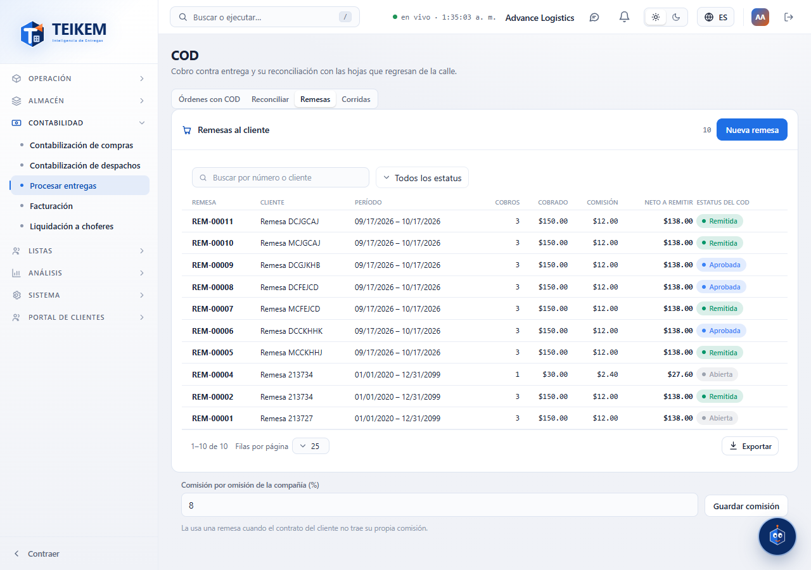
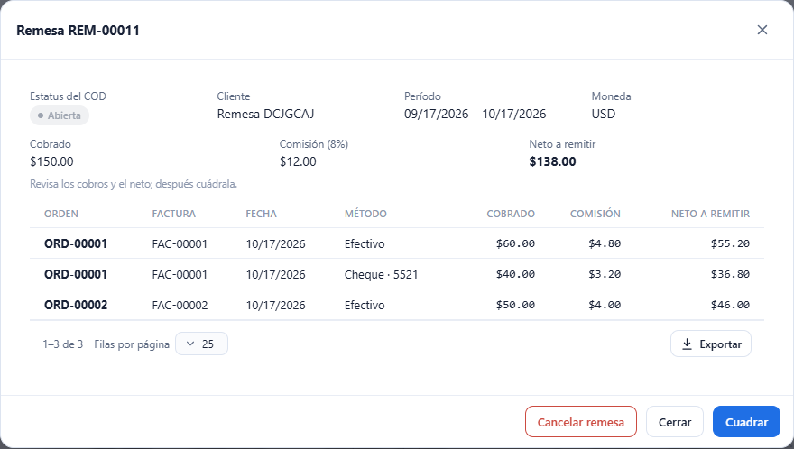
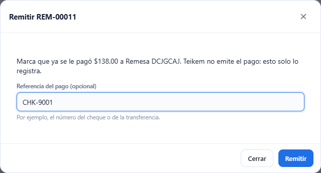
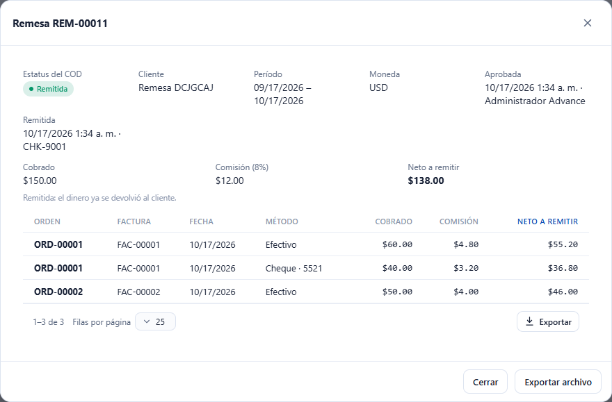

# L87 — COD remittances to the client

**Accounting → Process deliveries (COD) → Remittances** (`/money/cod`). Whoever has `cod.view` (COD module) sees the tab; **creating, reconciling, approving, remitting, cancelling, exporting and changing the default commission** require **`cod.remit`**. The rules and the server messages are in [chapter 21 §6](../21-cod.md). Teikem **calculates and exports** the remittance; **it does not issue the payment**.

## 1. The list

The **Remittances** tab lists each remittance (**REM-#####**) with the client, the period, how many collections it includes, the **collected** amount, the **commission**, the **net to remit** and its status (Open, Reconciled, Approved, Remitted). It has a search box (number or client), a status filter, sorting by column and export like the other tables. A cancelled remittance does not appear. Below is the **company default commission** (8 % out of the box): a remittance uses it when the client's contract does not bring its own commission; whoever has `cod.remit` changes it (from 0 to 100, up to 2 decimals).

## 2. New remittance

**New remittance**: choose the **client** and the **period** (by default, the last 30 days) and, if you want, a **commission (%)** of its own for this remittance. Without waiting to create it, the screen shows the **collections that would be included** —the client's already **reconciled** ones whose collection date falls within the period and that are not in another remittance— with the collected amount, the commission and the net of each one, the totals and **where the commission comes from**: the one typed, the one in the client's contract or the company's. **Create remittance** is only enabled with collections to include. The screen warns if the client or the period is missing, if the end date is before the start date or if the commission is not valid; if the server finds no collections, it shows its message.

## 3. The record and the flow

The record shows the status, the client, the period, the currency, who approved or remitted and when (with the payment reference), the totals and the collections. The buttons depend on the status:

| Status | Actions |
|---|---|
| Open | **Reconcile**, **Cancel remittance** |
| Reconciled | **Approve** (asks to confirm your identity: the screen opens the re-authentication window by itself and retries), **Cancel remittance** |
| Approved | **Export file**, **Remit** |
| Remitted | **Export file** |

- **Cancel** frees the collections for another remittance. An approved or remitted one can no longer be cancelled.
- **Export file** downloads a file with one row per collection (with the commission and the net). With billing permissions you choose the **template**; without them the standard one is used.
- **Remit** asks, if you want, for the **payment reference** (the check or transfer number) and marks the collections as **Remitted**; when all the collections of an order have been remitted, the **order's COD becomes Remitted**. Teikem does not pay: it only records that payment was made.

## Mobile

From 360 px the tables become cards, the windows take the full width and the period fields stack. There is no horizontal page scroll.
