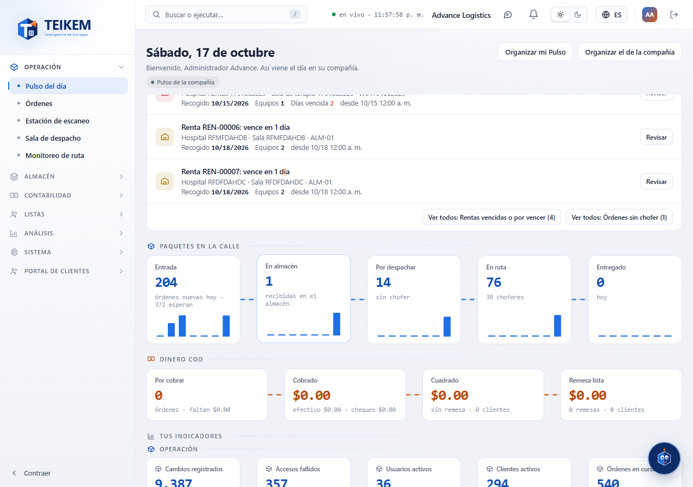
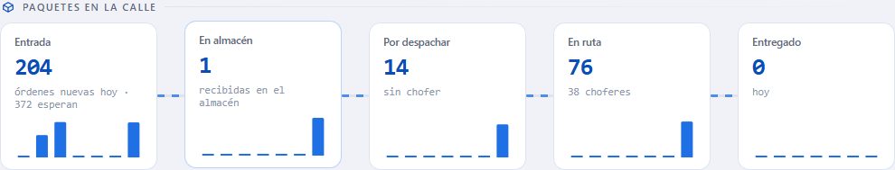
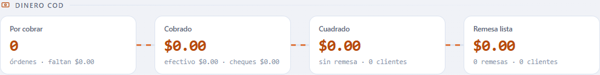

# L88 — The two currents of the Pulse

**Day pulse** (`/`). Below “Needs your attention” appear **Packages on the street** (blue) and **COD money** (orange), each with its permission (`pulse.orders` / `pulse.cod`), its data (`orders.view` / `cod.view`) and its module. What each card counts and the messages are in [chapter 07 §6](../07-pulso-y-actividad.md).

## Packages on the street

Five cards joined by a dotted pipe: **Entry** (new orders today and how many are waiting), **In warehouse**, **To dispatch** (without a driver), **On route** (with the drivers) and **Delivered** (today). **Entry** and **Delivered** carry **7-day mini bars** (the last one is today; the cursor shows the date and the count). One click on the card opens where it is handled: Orders, Dispatch room or Route monitor.

## COD money

Four cards with the orange pipe: **To collect** (orders and what is missing), **Collected** (with the breakdown in cash and checks), **Reconciled** (without a remittance, with how many clients) and **Remittance ready** (the net to remit). One click opens COD on the corresponding tab (Shipments with COD, Reconcile or Remittances).

## Organize

Like any panel, the currents are **sorted and hidden** from “Organize my Pulse” (and the company's with `pulse.organize_company`).

## Mobile

From 360 px the cards go two per row and the pipes are hidden; there is no horizontal page scroll.
