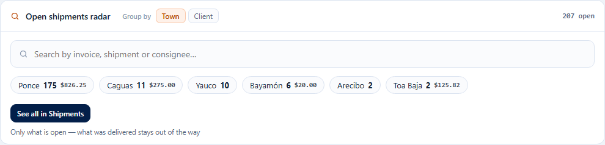
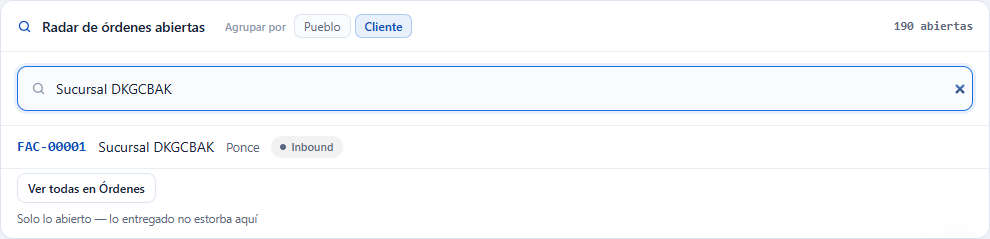
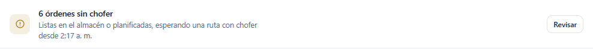

# L89 — Radar of open shipments and operation notices

**Day pulse** (`/`). The Radar is a panel (`RADAR`, order 60; `pulse.orders` + `orders.view` + `LTL_GROUND`) and the new notices appear in “Needs your attention”. What each one counts and the messages are in [chapter 07 §7](../07-pulso-y-actividad.md).

## The Radar

At the top, how many **open** orders there are and the **Group by** selector (Town or Client). Without a search you see the groups with the most orders —with the COD they carry—; one click opens **Orders already filtered** (the town or the client and only what is open). **See all in Shipments** opens the list with only what is open.

With **2 letters or more** the search box replaces the groups with the open orders that match the invoice, the number, the packaging or the consignee (up to 6, with status and COD); one click opens the order. “No results among open shipments” if there are none.

## Notices in “Needs your attention”

**N orders without a driver** (Unassigned or Assigned without a route with a driver; with the oldest one and in red from 2 days) leads to the **Dispatch room**; **$X of COD not reconciled** (with the collections, the orders and the oldest one; in red from 3 days) leads to **COD → Reconcile**. They are summary rows and appear **before** the per-record rows.

## Mobile

From 360 px the selector and the search box take the full width and the groups arrange themselves in several rows. There is no horizontal page scroll.
