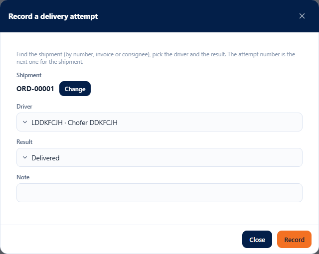
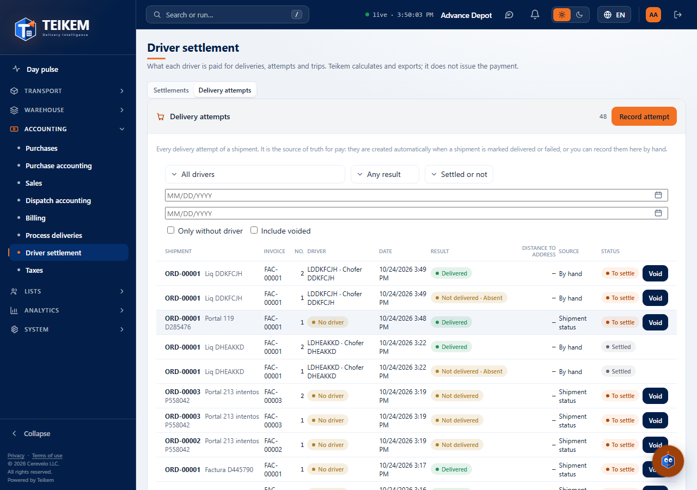
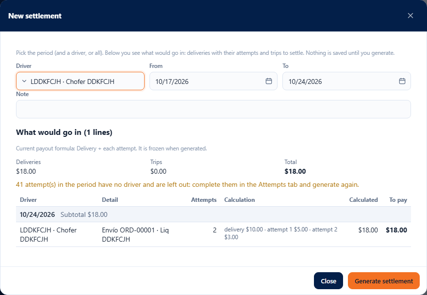
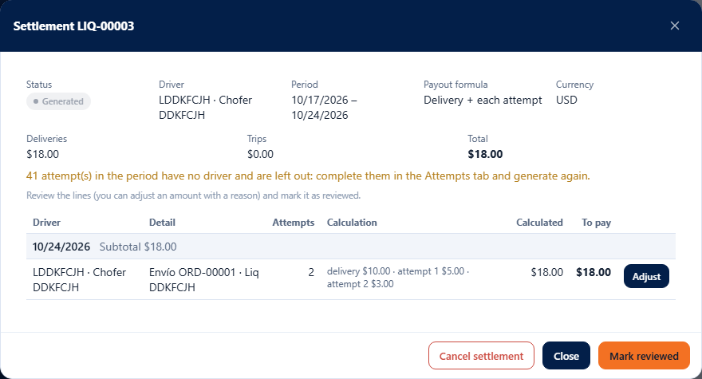
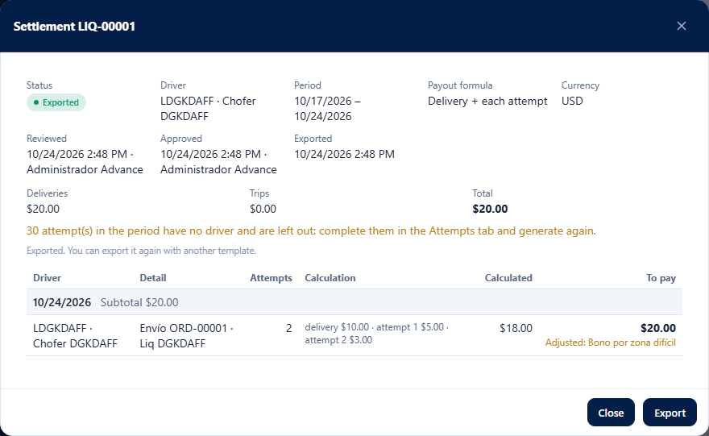
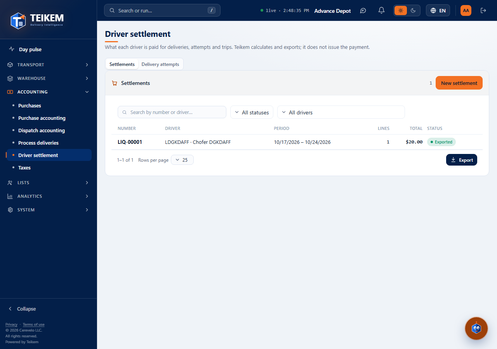

# L96 — Driver settlement (screen)

Where: **Accounting → Driver settlement** (`/money/driver-pay`; permission `driverpay.view`, module `LTL_GROUND`). The rules, the endpoints and the error messages are in [chapter 22](../22-liquidacion-choferes.md); here, how the screen is used. The screen works from 360 px up, with no horizontal page scroll.

The screen has two tabs: **Settlements** and **Delivery attempts**.

## Delivery attempts

The list of all attempts (order with its client, attempt number, driver, date, result, origin and state: to settle, settled or voided). Filters: driver, result, settled or not, date range, “only without driver” and “include voided”. It exports like the other tables.

- **Record attempt** (`driverpay.manage`): search for the order by typing its number, invoice or consignee (3 characters or more) and choose it from the list —the shipment number repeats across clients, which is why each option brings the consignee—; choose the driver and the result (delivered or not delivered, with the failure reason and a note). The attempt number is the order's next one.
- **Void**: asks for the reason; not available for an attempt already settled or voided.

## Settlements

The list brings number, driver (or “All drivers”), period, lines, total and status; you search by number or driver and filter by status and driver.

### New settlement

Choose the period (by default, the last 7 days) and, if you want, a driver. **Before saving** you see what would be included: the deliveries with their breakdown (delivery and attempts) and the trips to settle, with the total, the current payout formula and warnings if there are **attempts without a driver** (they are left out) or **lines without a rate** (they show $0). “Generate settlement” creates it and opens its record.

### The record

Status, driver, period, frozen payout formula, totals (deliveries, trips and total) and the **lines grouped by day** with their subtotal. Each line shows the calculation (delivery and attempts), the calculated amount and what is paid; an adjusted line says so and shows the reason. The buttons change with the status and with the permission:

| Button | When | Permission |
|---|---|---|
| **Adjust** (per line) | generated or reviewed | `driverpay.manage` |
| **Mark reviewed** | generated | `driverpay.manage` |
| **Approve** (asks to re-authenticate) | reviewed | `driverpay.approve` |
| **Cancel settlement** (with confirmation) | generated or reviewed | `driverpay.manage` |
| **Export** (choose the template; downloads the file) | approved or exported | `driverpay.export` |

**Adjust**: change the line's amount to pay; the reason is required if it differs from the calculated amount (going back to the calculated amount removes the adjustment). **Export** downloads the file and, if the settlement was approved, it becomes **Exported**. Without the Billing module no templates can be chosen and the standard one is used.

## Files
`features/driverpay/`: `DriverPayScreen.tsx`, `SettlementParts.tsx`, `AttemptParts.tsx`, `settlementApi.ts`, `settlementRules.ts`, `driverpay.css`; texts in `pay.*` (es/en); walkthrough `e2e/lote96-liquidacion.spec.ts`.
