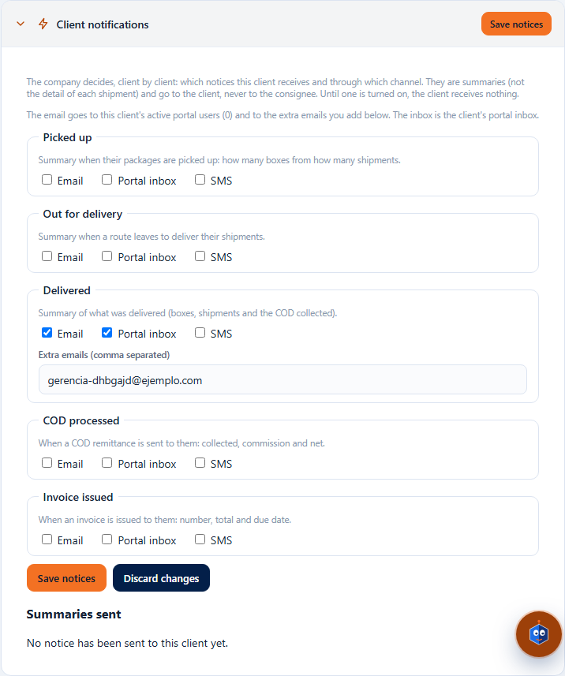
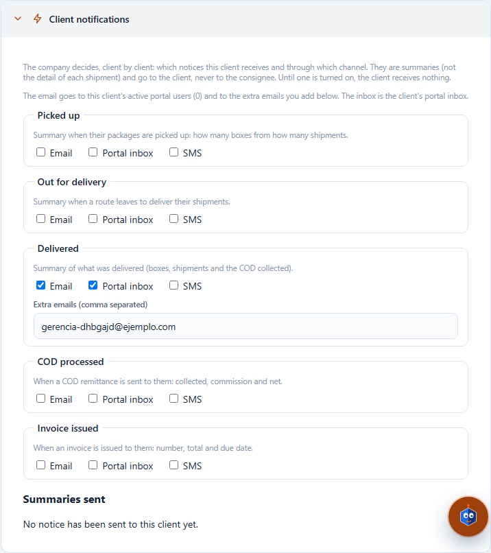

# L98 — Client notices (screen)

Where: **Clients & contracts** (`/catalog/clients`), client record, **“Client notifications”** panel (it starts collapsed; the header summary says how many notices it has turned on). Viewing requires `clients.read`; changing, `clients.update`. The rules and the messages are in [chapter 23](../23-avisos-al-cliente.md).

## What you see
- An explanation (the company decides it, they are summaries, they go to the client and never to the consignee), how many **portal users** would receive the email and, if needed, the notice that email is not configured on the platform.
- **“Daily summary time”** (00:00 to 23:00; 18:00 by default): the client receives a **single** summary a day at that time; if nothing happened that day, nothing is sent. Changing it counts as a change to save.
- **Seven notices** —Picked up, Out for delivery, Delivered, Goods received, Goods dispatched, COD processed, Invoice issued—, each with its explanation and three boxes: **Email**, **Portal inbox** and **SMS**. Everything off by default.
- When you turn on **Email**, **“Extra emails”** appears; when you turn on **SMS**, **“Phones for SMS”** (with the note that SMS does not go out until the provider is contracted).
- A misspelled email or phone is flagged on the spot and **does not let you save**. “Save notices” (and “Discard changes”) only appear if there are changes. Without `clients.update` the boxes are off and there are no buttons.
- At the bottom, **“Summaries sent”**: date, notice, the summary text and the sendings (in the portal, sent, skipped, with error; the detail appears when you hover the cursor).

It works from 360 px up, with no horizontal page scroll.

## Files
`features/clients/`: `ClientNotificationsPanel.tsx`, `notificationsApi.ts`, `notificationRules.ts`; texts in `clients.notif.*` (es/en); tests `ClientNotificationsPanel.test.tsx`, `notificationRules.test.ts` and the walkthrough `e2e/lote98-avisos-cliente.spec.ts`.
