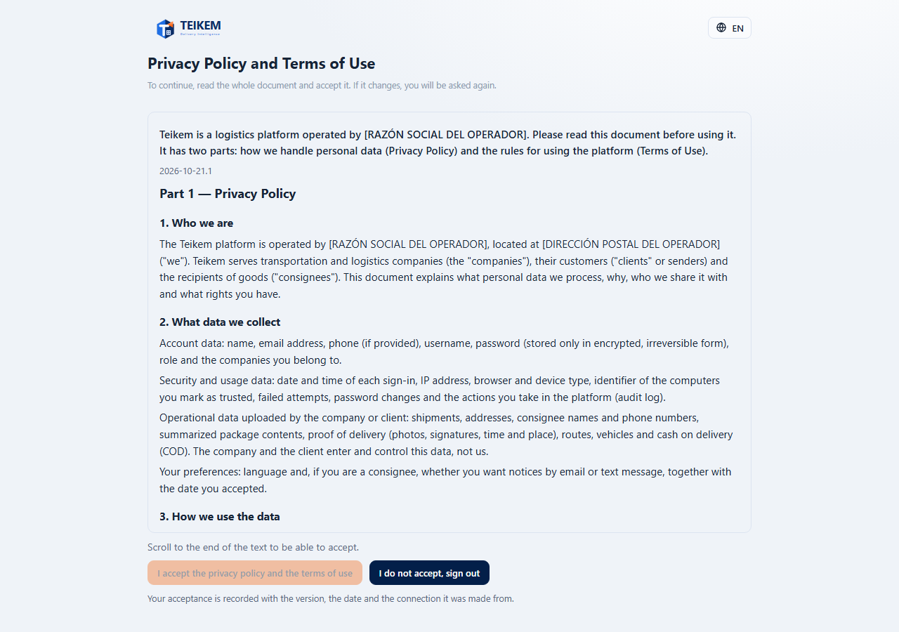
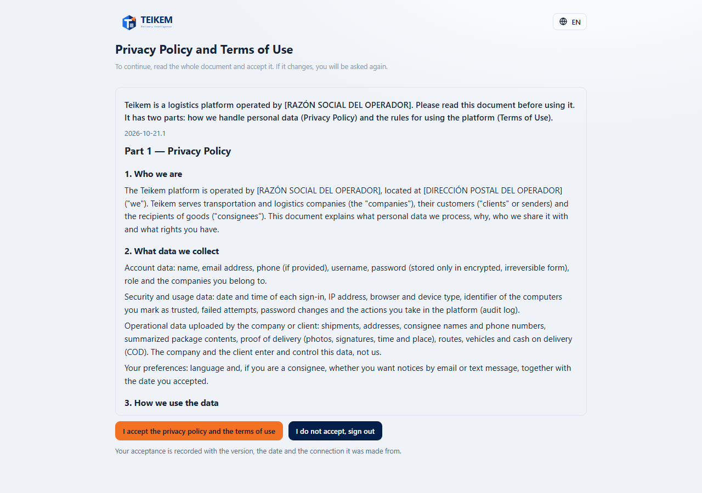
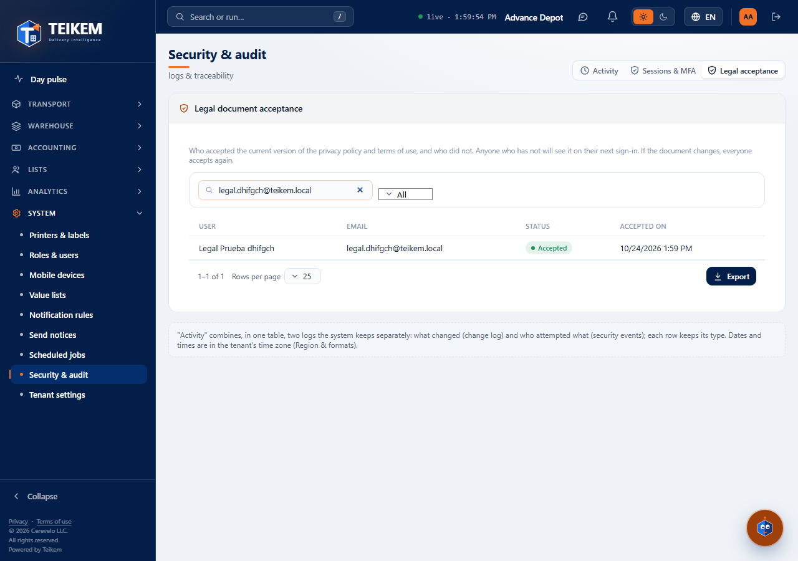

# L99 — Legal document (screens)

Rules and messages: [chapter 24](../24-documento-legal.md).

## First sign-in (or new version)

After signing in with the password, instead of the application you get **“Privacy Policy and Terms of Use”**, a single text read by scrolling: Part 1 (privacy) and Part 2 (terms). The **“I accept the privacy policy and the terms of use”** button is off and below it says “Scroll to the end of the text to be able to accept.”.

When you reach the end the button is enabled. **“I do not accept, sign out”** closes the session. When you accept you enter the application and it is not asked again until the version changes. It works from 360 px up, with no horizontal page scroll; the language selector is at the top.

## Who accepted (administration)

**Security & audit → Legal acceptance** (`admin.audit`): user, email, state (**Accepted**, **Pending**, **Earlier version**) and date; searches by name or email, filters by state, sorts and exports everything filtered.

## Files
`features/legal/`: `LegalAcceptPage.tsx`, `LegalGate.tsx` (mounted in `RequireAuth`), `LegalDocumentView.tsx`, `LegalPage.tsx` (`/legal`, without a session), `LegalAcceptancesTab.tsx`, `legalApi.ts`, `legalRules.ts`, `legal.css`; texts `legal.*` and `system.audit.tabs.legal` (es/en); tests `legal.test.tsx` and the walkthrough `e2e/lote99-documento-legal.spec.ts`.
