# Capturas de las apps (almacén y portal del cliente)

Capturas tomadas el 2026-10-22 con Playwright, sin aparato ni emulador: la app corre como web en el navegador contra un API **simulado** (datos de ejemplo, no son de ninguna compañía real).
Se repiten con `npm run export:visual` y `npm run visual` dentro de `app-almacen/` y de `app-cliente/` (ver `scripts/visual-check.cjs` de cada una). El de almacén usa un teléfono de 390×844.

## App de almacén (aparato)

| Pantalla | Captura |
|---|---|
| Registrar este aparato (primera vez) |  |
| ¿Quién eres? | 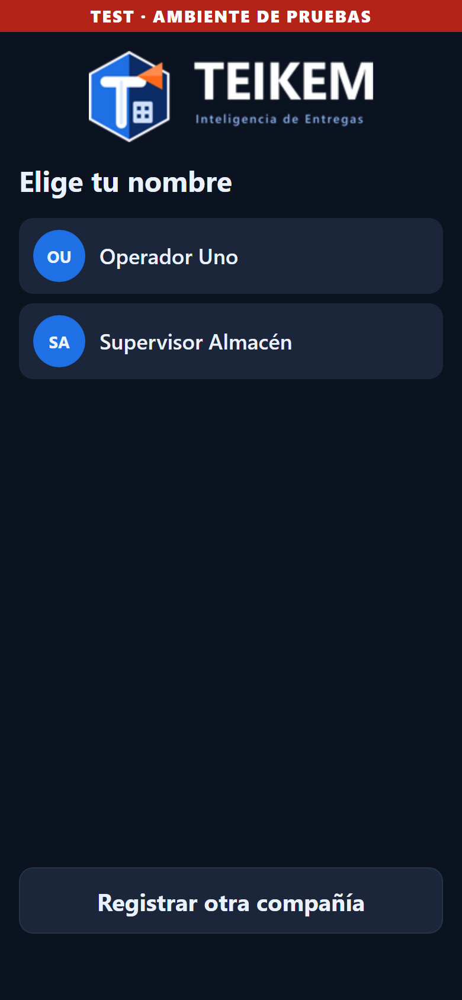 |
| PIN |  |
| Menú principal (los mosaicos en azul tienen algo asignado a la persona) | 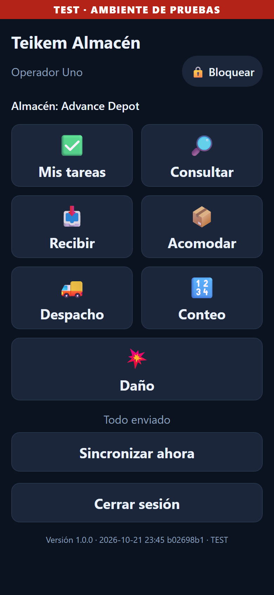 |
| Mis tareas | 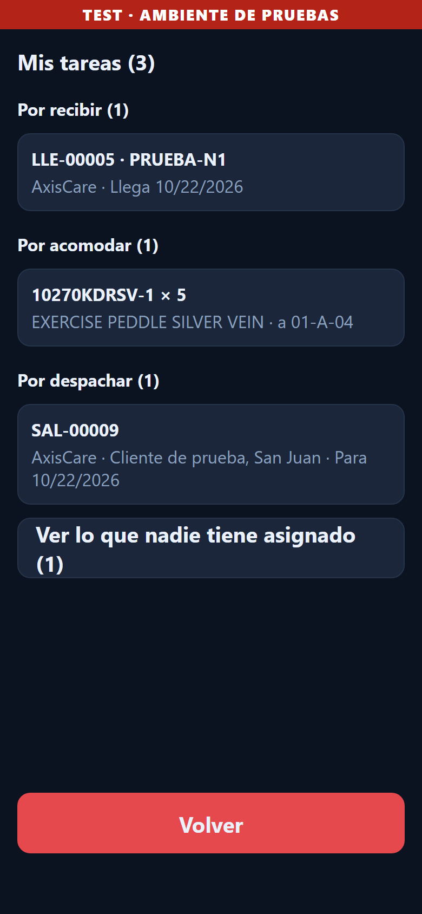 |
| Recibir: avisos y órdenes pendientes | 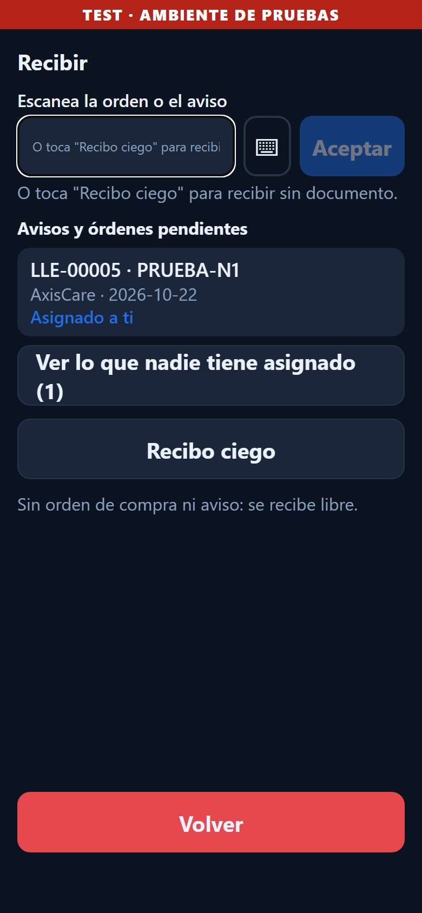 |
| Recibir contra un aviso (lo que dice el documento) |  |
| Recibir una parte: «Recibir una parte», luego «Confirmar recibo» | 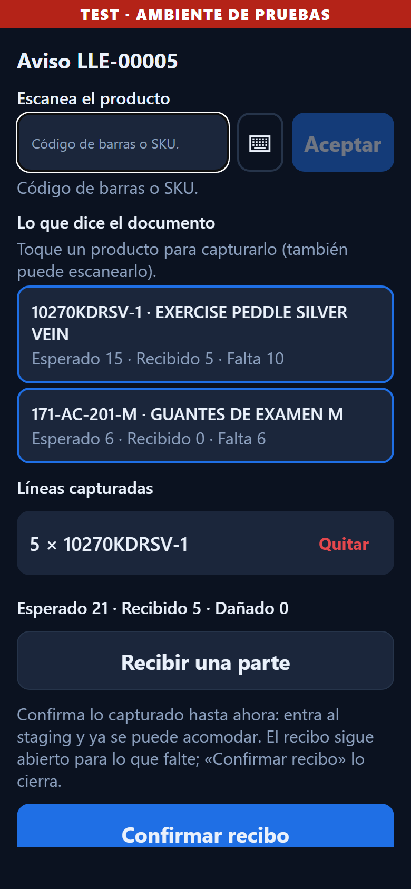 |
| Acomodar |  |
| Despacho de avisos de salida | 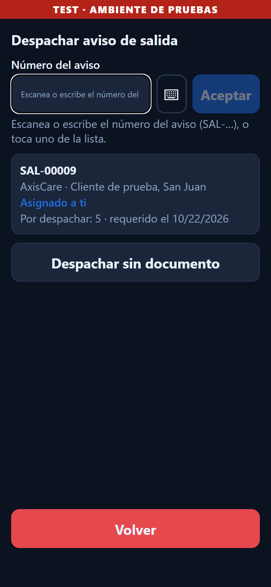 |

## Portal del cliente (web de escritorio y celular)

| Pantalla | Captura |
|---|---|
| Entrada | 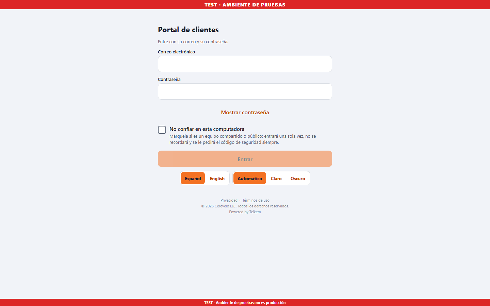 |
| Elegir contraseña (invitación) | 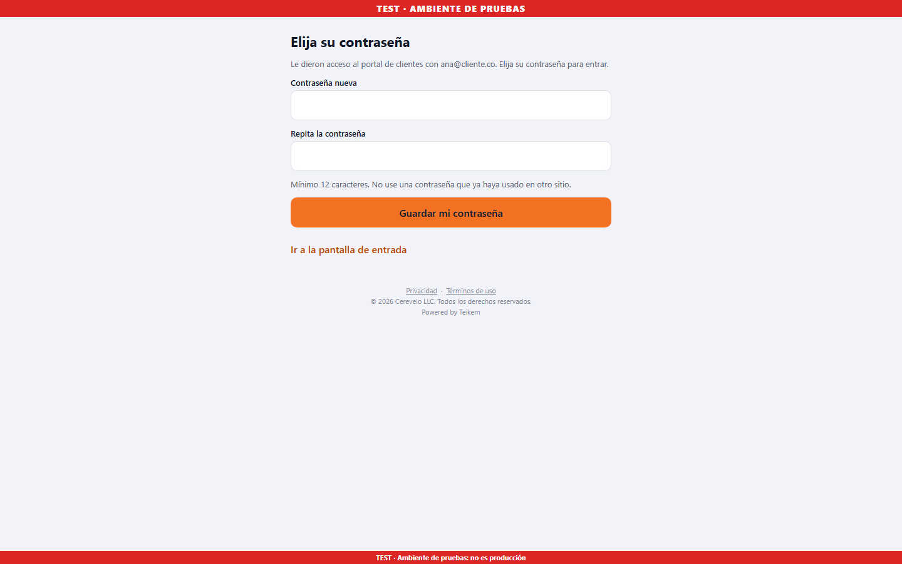 |
| Inicio (tablero) | 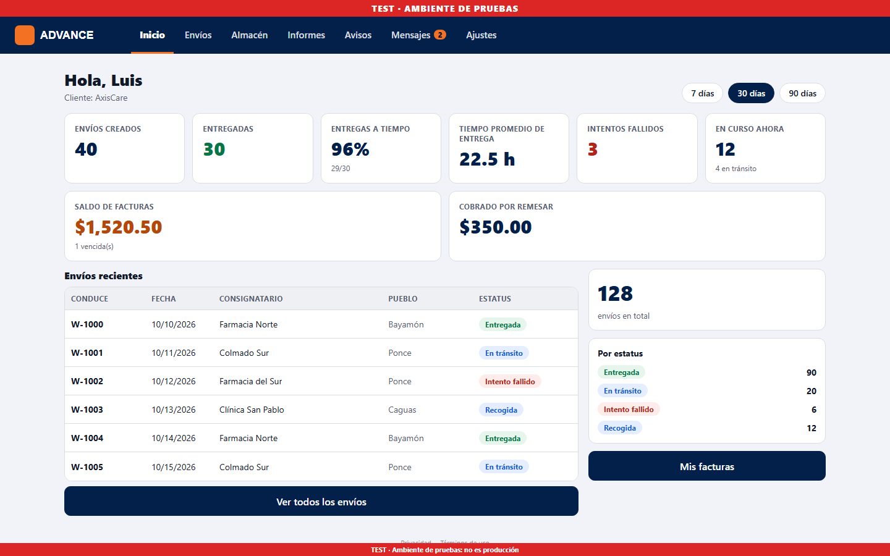 |
| Inicio con otra marca de compañía | 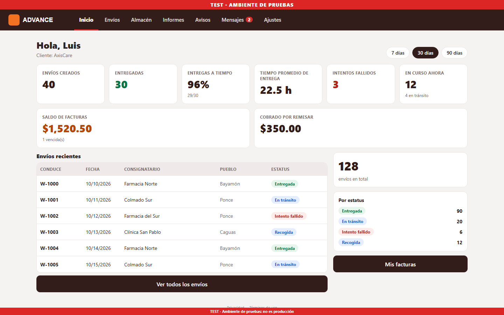 |
| Envíos | 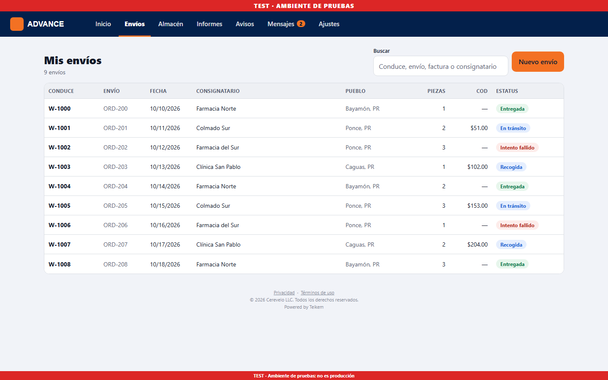 |
| Nuevo envío, captura rápida | 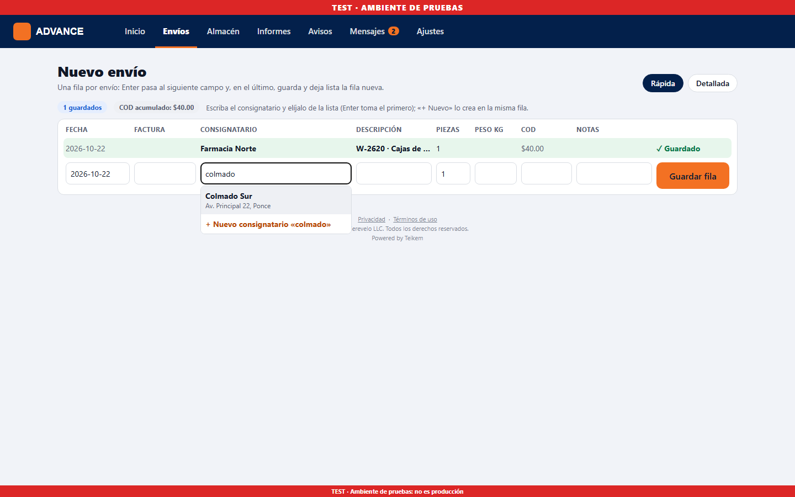 |
| Facturas |  |
| Almacén | 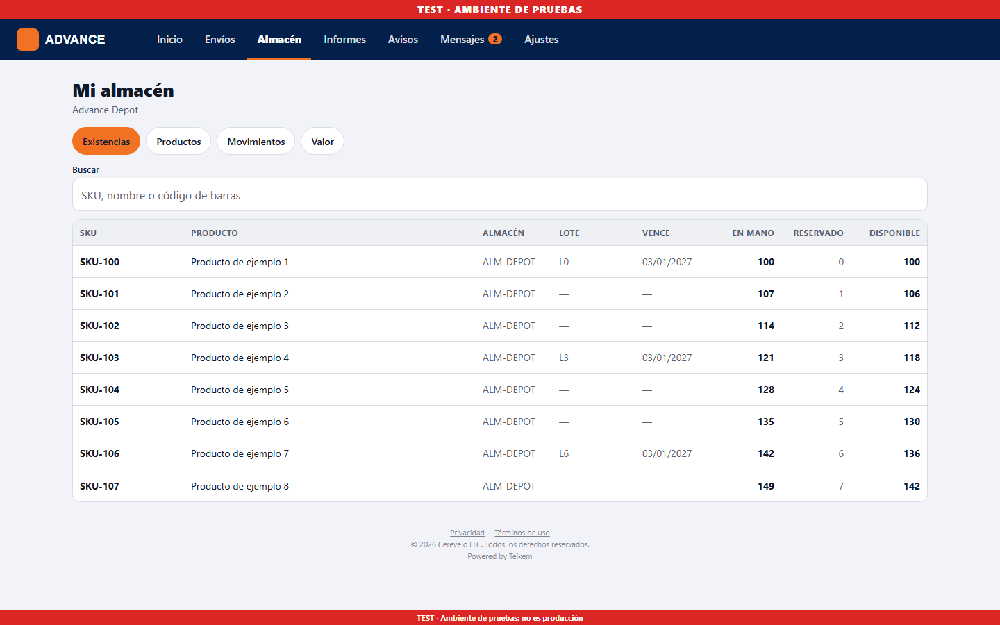 |
| Informes |  |
| Inicio en el celular |  |
| Nuevo envío en el celular | 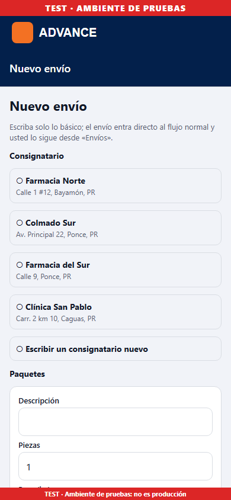 |
