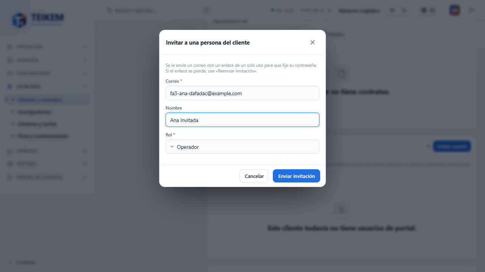
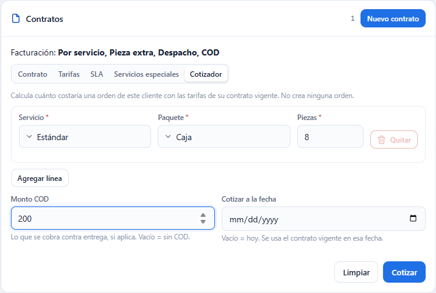
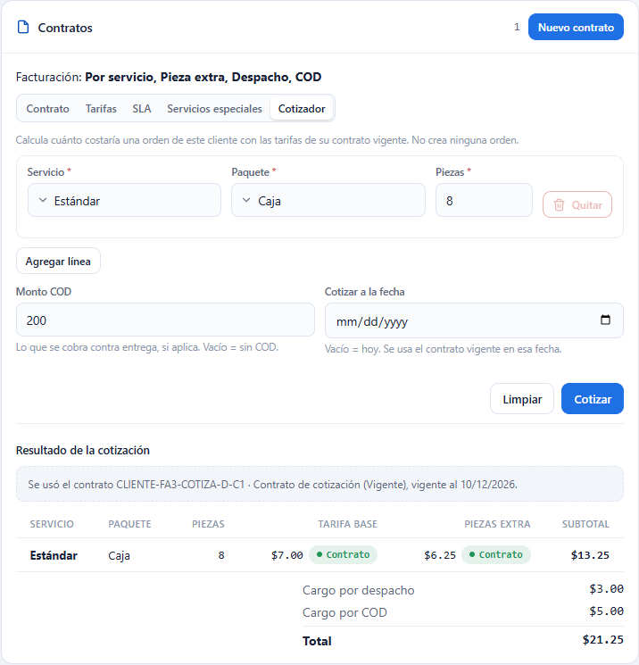
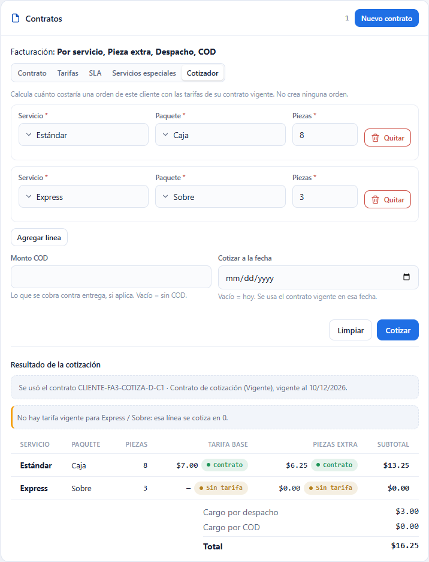

# Usuarios de portal y Cotizador del cliente

En la ficha de cada cliente (**Listas → Clientes y contratos**) hay dos herramientas más, que completan el trabajo con clientes y contratos de [F-A1](fa1-clientes.md) y [F-A2](fa2-contratos.md):

- **Usuarios de portal**: usted **invita** por correo a las personas del cliente que usarán el portal de clientes, reenvía una invitación perdida, **suspende** y **reactiva** su acceso y los **da de baja**.
- **Cotizador**: una pestaña nueva de la sección **Contratos** que calcula **cuánto costaría una orden** de ese cliente con las tarifas de su contrato, **sin crear ninguna orden**.

Esta pantalla es la **administración** que hace su compañía. El portal donde el cliente entra con su cuenta es otra pantalla, que todavía no está construida.

Capturas: `img/fa3-invitar.png`, `img/fa3-portal.png`, `img/fa3-portal-baja.png`, `img/fa3-cotizador.png`, `img/fa3-cotizacion.png`, `img/fa3-sin-tarifa.png`.

## Permisos y módulos

Cada parte aparece solo si usted tiene su permiso y su compañía tiene el módulo encendido. Si falta algo, pídaselo al administrador de su compañía.

| Qué | Permiso | Módulo de la compañía |
|---|---|---|
| Ver el panel **Usuarios de portal** y todos sus botones | `portalusers.manage` | **Portal de clientes** (y Lista, como toda la pantalla) |
| Ver la pestaña **Cotizador** y cotizar | `contracts.read` | **Lista** |

- Sin `portalusers.manage`, o con el módulo **Portal de clientes** apagado, el panel **Usuarios de portal** **no aparece**.
- Sin `contracts.read` toda la sección **Contratos** (también el Cotizador) queda reducida al aviso «Su usuario no puede ver los contratos (permiso contracts.read)».

---

# Usuarios de portal

El panel **Usuarios de portal** está debajo de **Contratos**. Cada fila es una persona del cliente con su **correo**, su **nombre**, su **rol**, su **estatus** y su **último ingreso**.

## Qué significa cada estatus

| Estatus | Qué significa | Qué botones tiene |
|---|---|---|
| **Invitado** | Recibió el correo pero todavía no fijó su contraseña. | **Reenviar invitación**, **Dar de baja** |
| **Activo** | Ya aceptó la invitación y puede entrar al portal. | **Suspender**, **Dar de baja** |
| **Suspendido** | Su acceso está detenido; conserva su contraseña. | **Reactivar**, **Dar de baja** |
| **Inhabilitado** | Dado de baja. Su historial se conserva. | **Volver a invitar** |

Las personas dadas de baja salen al final de la lista, en gris. Si una misma persona está en varios clientes de su compañía, bajo su nombre aparece «También en N cliente(s) más».

## Invitar a una persona

1. En el panel **Usuarios de portal** pulse **Invitar usuario**.
2. Escriba su **Correo** (obligatorio, hasta 150 caracteres).
3. Si quiere, escriba su **Nombre** (hasta 150 caracteres).
4. Elija su **Rol** (obligatorio): **Admin cliente**, **Operador** o **Solo lectura**.
5. Pulse **Enviar invitación**.

El sistema le envía a esa persona un correo con un **enlace de un solo uso** para que **ella misma** fije su contraseña. Usted nunca escribe ni ve la contraseña, y tampoco ve el enlace. El aviso verde le dice hasta cuándo vale: «Invitación enviada a … El enlace vence el …». Mientras no lo use, la persona aparece como **Invitado**.

Si la persona ya tenía una cuenta de portal activa por otro cliente de su compañía, no se envía ningún correo: queda **Activa** en este cliente al instante y el aviso dice «… ya tenía una cuenta de portal activa: quedó activo en este cliente sin enviar invitación.»

## Reenviar una invitación

Úselo cuando la persona dice que el enlace «no funciona» o lo perdió.

1. En la fila de la persona (estatus **Invitado**) pulse **Reenviar invitación**.
2. Confirme con **Reenviar invitación**.

Se envía un enlace **nuevo** y el anterior **deja de valer**. Solo se puede reenviar a quien sigue en **Invitado**.

## Suspender y reactivar

1. En la fila de una persona **Activa** pulse **Suspender** y confirme: no podrá entrar al portal, pero conserva su contraseña. Si la persona está en otros clientes con acceso activo, esos no se afectan.
2. Para devolverle el acceso, en su fila (ahora **Suspendido**) pulse **Reactivar** y confirme: entra con su contraseña de siempre.

## Dar de baja y volver a invitar

1. En la fila pulse **Dar de baja** y confirme. Queda **Inhabilitado**; el historial se conserva.
2. Si más adelante vuelve a trabajar con el cliente, pulse **Volver a invitar**: la ventana trae su correo (no se puede cambiar), nombre y rol ya escritos. Pulse **Enviar invitación**. Vuelve a **Invitado** y fija una contraseña nueva con el enlace.

## Cliente dado de baja

Si el cliente está dado de baja, el panel avisa «El cliente está dado de baja; solo se consulta su historial.», el botón **Invitar usuario** se desactiva y desaparecen **Reenviar invitación** y **Volver a invitar**. La lista se sigue viendo, y **Suspender**, **Reactivar** y **Dar de baja** siguen disponibles.

## Mensajes del panel

Los mensajes del servidor salen tal cual.

| Mensaje | Qué significa | Qué hacer |
|---|---|---|
| `El correo es obligatorio.` | Dejó el correo vacío. | Escríbalo. |
| `Correo inválido.` | Le falta el «@» o el punto del dominio. | Corríjalo. |
| `Máximo 150 caracteres.` | El correo o el nombre es demasiado largo. | Acórtelo. |
| `El rol de portal es obligatorio.` | No eligió un rol. | Elija uno. |
| `Ese correo no está disponible para el portal de esta compañía.` | Ese correo ya está invitado, activo o suspendido **en este cliente**, o pertenece a un usuario interno de su compañía o a otra compañía. Es el mismo mensaje en todos los casos, a propósito, para no revelar dónde está registrado. | Use otro correo. Si la persona ya está en este cliente, búsquela en la lista y use **Reenviar invitación**, **Reactivar** o **Volver a invitar**. |
| `El cliente está dado de baja; solo se consulta su historial.` | El cliente está dado de baja (quizá otra persona lo hizo mientras usted tenía la ficha abierta). | Reactive al cliente en la cabecera de la ficha si necesita invitar. |
| `Solo se puede reenviar la invitación a un usuario que todavía no la ha aceptado (estatus INVITED).` | La persona ya aceptó (o cambió de estatus) y usted tenía la lista vieja. | Cierre el aviso; la lista se actualiza sola al volver a abrir la ficha. |
| `Solo se puede suspender un usuario de portal en estatus ACTIVE.` | La persona ya no está **Activa**. | Revise su estatus actual en la lista. |
| `Solo se puede reactivar un usuario de portal en estatus SUSPENDED.` | La persona ya no está **Suspendida**. | Revise su estatus actual en la lista. |
| `El usuario de portal ya está dado de baja.` | Ya estaba **Inhabilitado**. | Si hace falta, use **Volver a invitar**. |
| `Usuario de portal '<n>' no encontrado.` | Esa fila ya no existe en este cliente. | Vuelva a abrir la ficha. |
| `El módulo 'CLIENT_PORTAL' no está habilitado para esta compañía.` | La compañía no tiene el módulo Portal de clientes. | Pídale a quien administre la plataforma que lo encienda. |

---

# Cotizador

La pestaña **Cotizador** está al final de la sección **Contratos** de la ficha.

## Cómo cotizar

1. En la ficha del cliente abra **Contratos → Cotizador**.
2. En la **Línea 1** elija el **Servicio** y el **Paquete** y escriba las **Piezas** (un número entero de 1 en adelante).
3. Si la orden lleva más de un tipo de paquete, pulse **Agregar línea** y complete la nueva línea. Solo puede haber **una línea por cada pareja servicio/paquete**, con el total de piezas. **Quitar** borra una línea (la última no se puede quitar).
4. Si la orden se cobra contra entrega, escriba el **Monto COD**. Vacío = sin COD.
5. Si quiere cotizar con las tarifas de otro día, elija la fecha en **Cotizar a la fecha**. Vacía = hoy; se usa el contrato vigente en esa fecha.
6. Pulse **Cotizar**. **Limpiar** vuelve la pantalla a su estado inicial.

## Cómo leer el resultado

- **Qué contrato se usó**: «Se usó el contrato … (Vigente), vigente al …». Si el cliente no tenía contrato vigente en esa fecha dice «El cliente no tiene contrato vigente al …: se cotizó con las tarifas genéricas de la compañía y sin cargo de despacho ni de COD.»
- **Una fila por línea**: **Tarifa base**, **Piezas extra** (el cobro por las piezas adicionales a partir de la segunda, por tramos) y **Subtotal** de la línea (base + piezas extra).
- La etiqueta junto a cada monto dice **de dónde salió**: **Contrato** (la tarifa de este cliente), **Genérica** (la tarifa general de la compañía, cuando el contrato no la tiene o ese componente está apagado) o **Sin tarifa**.
- Debajo: **Cargo por despacho** (una vez por orden), **Cargo por COD** y el **Total**. El cargo por despacho y el de COD se cobran **una sola vez por orden**, no por línea.

Ejemplo (el de la captura): base $7.00 + 8 piezas (de la 2 a la 5 a $1.00 y de la 6 en adelante a $0.75 = $6.25) = $13.25; más despacho $3.00 y COD 2.5 % de $200 = $5.00; total **$21.25**.

### Línea sin tarifa

Si el cliente no tiene tarifa para una línea (ni de contrato ni genérica), **no es un error**: la línea se cotiza en **0** y la pantalla lo avisa: «No hay tarifa vigente para X / Y: esa línea se cotiza en 0.» Configure la tarifa en la pestaña **Tarifas**.

## Precios del contrato y quién los ve

El Cotizador muestra precios **del contrato** del cliente. Los ve quien tiene `contracts.read`; el permiso para ver precios de las órdenes (`orders.view_price`) no cambia lo que sale aquí.

## Mensajes del Cotizador

| Mensaje | Qué significa | Qué hacer |
|---|---|---|
| `El tipo de servicio es obligatorio.` / `El tipo de paquete es obligatorio.` | Falta elegir el servicio o el paquete de una línea. | Elíjalo. |
| `La cantidad de piezas debe ser al menos 1.` | Piezas en 0, vacías o negativas. | Escriba 1 o más. |
| `Las piezas deben ser un número entero.` | Escribió decimales. | Use un número entero. |
| `El monto COD no puede ser negativo.` | Escribió un COD menor que 0. | Escriba 0 o más, o déjelo vacío. |
| `El par servicio/tipo de paquete está repetido; envíe una sola línea por (servicio, tipo de paquete) con el total de piezas.` | Dos líneas con el mismo servicio y paquete. | Junte las piezas en una sola línea. |
| `El cliente está dado de baja; solo se consulta su historial.` | El cliente está dado de baja: no admite cotizar. | Reactive al cliente si necesita cotizar. |
| `Cliente no encontrado.` | El cliente ya no existe en su compañía. | Vuelva a la lista de clientes. |

## Preguntas frecuentes

**No veo el panel «Usuarios de portal».**
Falta el permiso `portalusers.manage` o su compañía no tiene el módulo **Portal de clientes**. Pídaselo al administrador.

**La persona dice que no le llegó el correo o que el enlace no sirve.**
Revise que el correo esté bien escrito y pulse **Reenviar invitación**. El enlace vence (el aviso le dice cuándo) y solo sirve una vez; el anterior deja de valer al reenviar.

**¿Puedo ver o cambiar la contraseña de una persona?**
No. Cada persona fija la suya con el enlace. Si perdió la suya, el camino desde esta pantalla es **Dar de baja** y luego **Volver a invitar**: recibe un enlace nuevo y fija una contraseña nueva.

**¿Cuál es la diferencia entre Suspender y Dar de baja?**
Suspender es temporal: conserva la contraseña y se deshace con **Reactivar**. Dar de baja termina el acceso a este cliente; para volver hay que **Volver a invitar** y la persona fija una contraseña nueva.

**Invité a la misma persona desde otro cliente y no me dio error.**
Es lo esperado: una misma persona puede pertenecer a varios clientes de su compañía. Queda **Activa** al instante si ya tenía contraseña y por eso la lista muestra «También en N cliente(s) más».

**El Cotizador me da 0 en una línea.**
No hay tarifa vigente para ese servicio y paquete (ni de contrato ni genérica). Agréguela en **Tarifas**.

**El total no coincide con la suma de los subtotales.**
Al total se suman además el **Cargo por despacho** y el **Cargo por COD**, que se cobran una sola vez por orden.

**¿Cotizar crea una orden o cambia algo?**
No. Solo calcula.

**Cotizo a una fecha pasada y sale sin despacho ni COD.**
En esa fecha el cliente no tenía contrato vigente; se usan las tarifas genéricas de la compañía y no hay cargos de despacho ni de COD.
