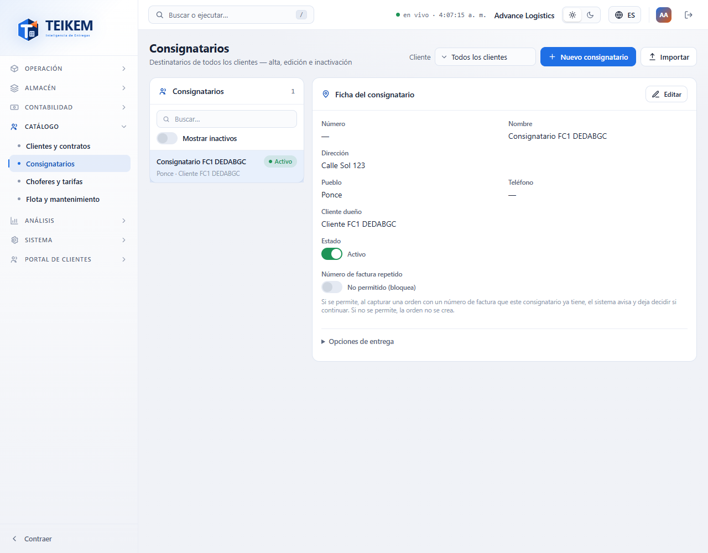
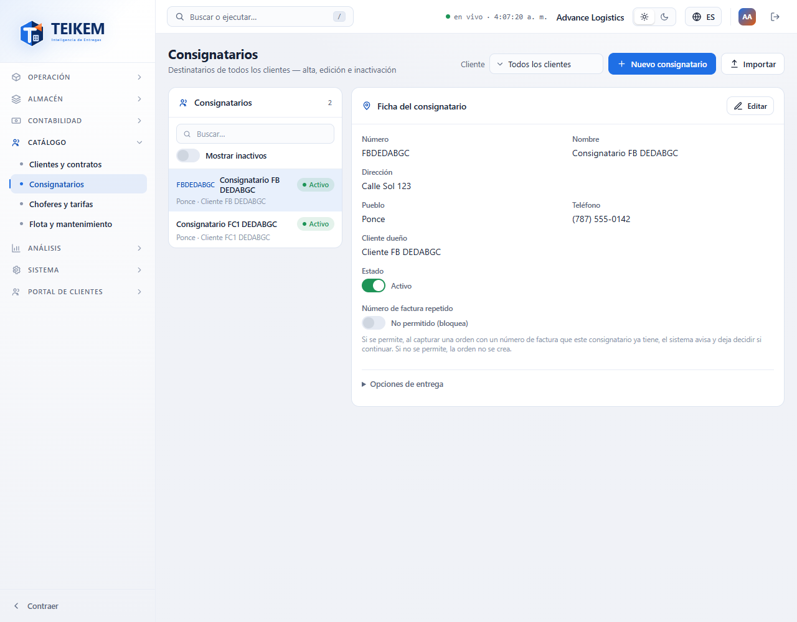
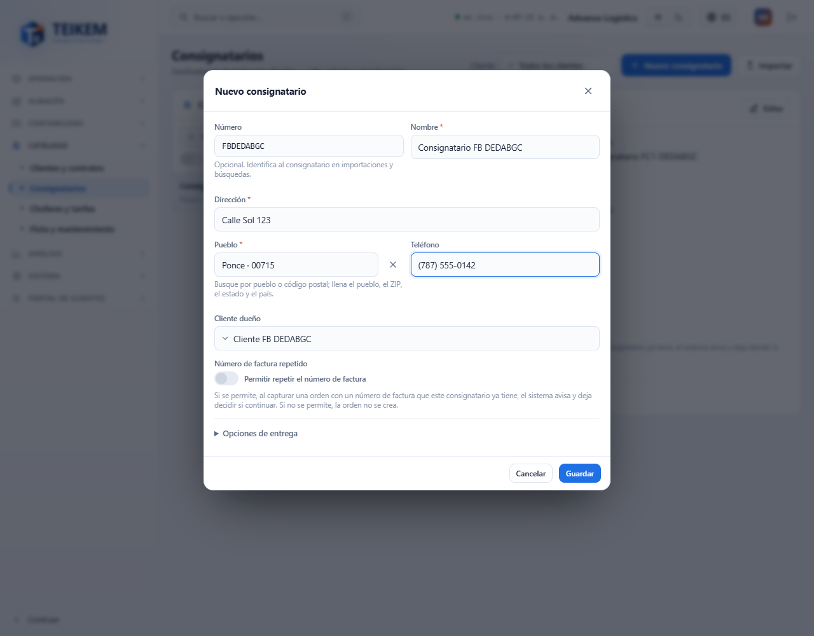
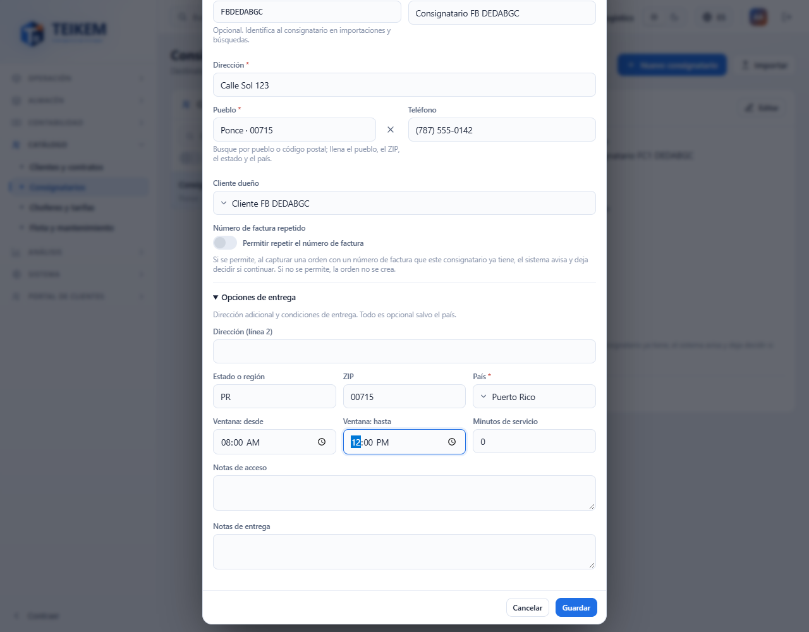
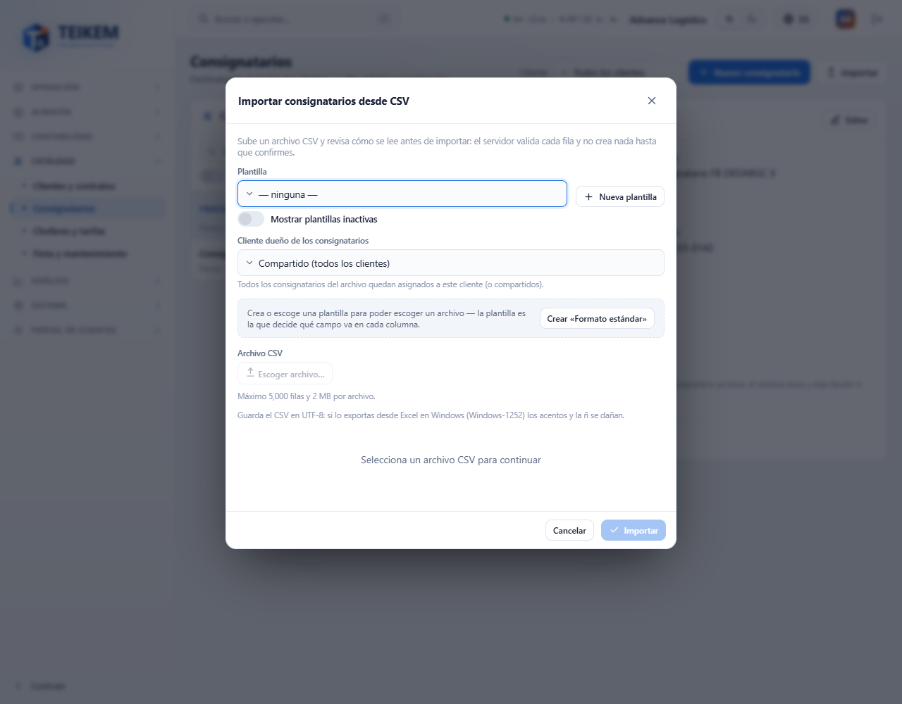
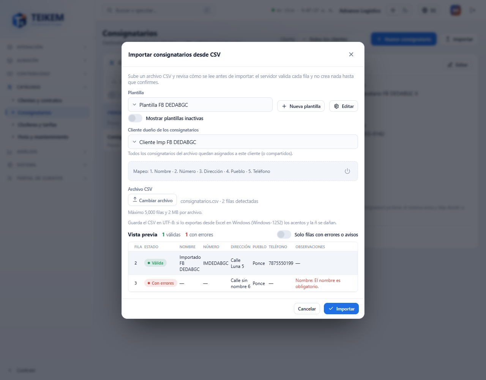
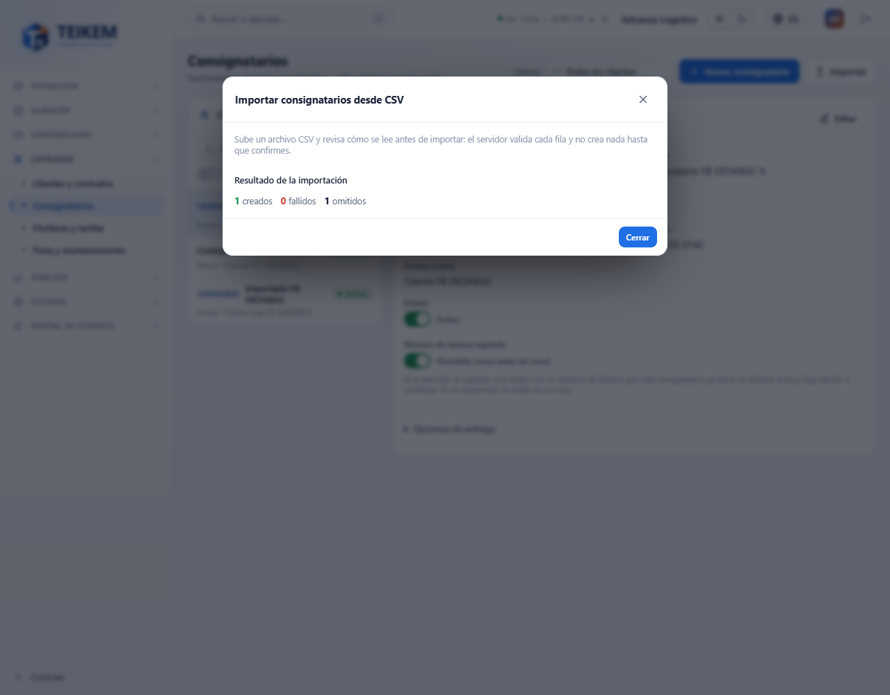
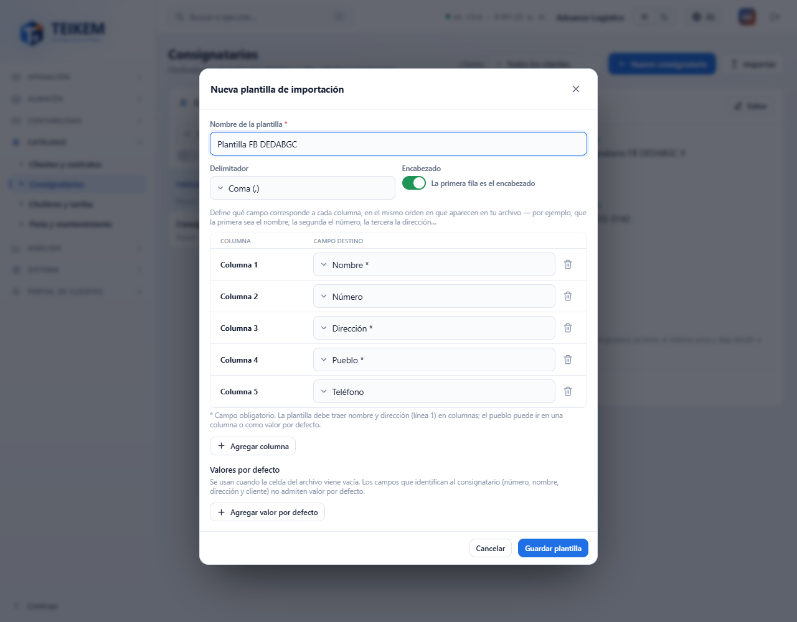

# F-B — Consignatarios: lista, ficha, alta/edición e importación por CSV

Pantalla **Catálogo → Consignatarios** (`/catalog/consignees`). Los consignatarios son los destinatarios de las entregas: cada uno pertenece a un cliente o es **compartido**
(sin dueño, lo pueden usar todos los clientes). Backend: capítulo 02 del manual, §2 (Consignatarios y localizaciones) y la importación del lote 38. Decisiones del frontend:
`docs/frontend/loteFB-decisiones.md`.

**Quién puede.** Ver la pantalla: permiso **`locations.read`** con el módulo **Catálogo** (`CATALOG`) encendido (sin el permiso el menú no la muestra; con el módulo apagado, «Módulo apagado»).
Cada acción pide su permiso y, sin él, el botón no se pinta y los interruptores quedan deshabilitados:

| Acción | Permiso |
|---|---|
| Ver la lista, la ficha, las plantillas de importación y los campos | `locations.read` |
| Nuevo consignatario, Importar, crear/editar/desactivar plantillas | `locations.create` |
| Editar, dar de baja, reactivar, «Número de factura repetido», campos personalizados | `locations.update` |
| Escribir el teléfono (en el modal) | `contacts.manage` **y** `locations.update` |
| Elegir cliente en el filtro y en el dueño | `clients.read` (sin él solo se ofrece «Compartido») |

## 1. La lista (izquierda) y el filtro

- Panel **Consignatarios** con el contador. Cada fila: número (si tiene), nombre, chip **Activo / Inactivo** y «pueblo · cliente dueño» o «pueblo · Compartido (todos los clientes)».
  Solo se listan los de tipo **entrega** (los almacenes y las direcciones de un cliente no salen aquí).
- **Buscador**: filtra lo que ya está cargado por número, nombre, dirección, pueblo, ZIP, dueño y estado (sin distinguir mayúsculas ni acentos).
- **Mostrar inactivos**: por omisión solo se ven los activos; los inactivos salen atenuados.
- **Cliente** (arriba): «Todos los clientes», «Compartidos (sin dueño)» o un cliente (solo los suyos, sin los compartidos). Cambiarlo borra la selección.
- Tocar una fila abre su ficha a la derecha y deja el consignatario en la dirección (`?consignee=…`). En celular (menos de 720 px) la ficha queda debajo de la lista.

## 2. La ficha (derecha)

**Ficha del consignatario**: número, nombre, dirección, pueblo, teléfono, cliente dueño, **Estado** y **Número de factura repetido**. La sección plegada **Opciones de entrega** muestra
la línea 2, estado/región, ZIP, país, ventana horaria, minutos de servicio y las notas de acceso y de entrega. Debajo, los **campos personalizados** de la compañía para consignatarios
(si hay), con su botón Guardar (`locations.update`).

- **Editar** (`locations.update`) abre el mismo modal del alta.
- **Estado**: el interruptor pide confirmación. *Dar de baja*: el consignatario deja de aparecer en los combos de captura de órdenes; se conserva el historial. *Reactivar*: vuelve a aparecer.
  Nunca se borra.
- **Número de factura repetido**: si se permite, al capturar una orden con un número de factura que este consignatario ya tiene, el sistema avisa y deja decidir; si no, la orden no se crea.
  Guarda al instante.
- **Teléfono**: se muestra con el formato de la compañía. Vive en los medios de contacto del consignatario.

## 3. Nuevo consignatario / Editar

Botón **Nuevo consignatario** (`locations.create`). Campos y reglas (los mensajes salen tal cual debajo del campo; los de pantalla se repiten en el servidor):

| Campo | Regla | Mensaje (HTTP) |
|---|---|---|
| Número | opcional, máx. 40 (la importación no admite dos consignatarios con el mismo número y dueño) | `Máximo 40 caracteres.` (400) |
| Nombre | obligatorio, máx. 200 | `El nombre es obligatorio.` · `Máximo 200 caracteres.` (400) |
| Dirección | obligatoria (línea 1), máx. 200 | `La dirección (línea 1) es obligatoria.` (400) |
| Pueblo | obligatorio; se busca por pueblo o código postal y llena también ZIP, estado y país | `La ciudad es obligatoria.` (400) |
| Teléfono | opcional; con la máscara de la compañía | `Teléfono inválido.` (400) |
| Cliente dueño | un cliente o «Compartido (todos los clientes)» | `Cliente no encontrado.` (404) · `Indique un cliente o marque la localización como compartida, no ambos.` (400) |
| Número de factura repetido | permitir o no | — |

**Opciones de entrega** (sección plegada; se abre sola si algo falla ahí):

| Campo | Regla | Mensaje (HTTP) |
|---|---|---|
| Dirección (línea 2), Estado o región, ZIP | opcionales, máx. 200 / 100 / 20 | `Máximo N caracteres.` (400) |
| País | obligatorio; por omisión Puerto Rico | `El país es obligatorio.` · `Catálogo Country 'X' no encontrado.` (404) |
| Ventana: desde / hasta | ambas o ninguna; el fin posterior al inicio | `La ventana horaria requiere hora de inicio y hora de fin.` · `La hora de fin de la ventana debe ser posterior a la de inicio.` (400) |
| Minutos de servicio | entero, no negativo | `Los minutos de servicio deben ser un número entero.` · `Los minutos de servicio no pueden ser negativos.` (400) |
| Notas de acceso / de entrega | opcionales, máx. 500 | `Máximo 500 caracteres.` (400) |

El tipo de localización es siempre **entrega** (no se muestra). Al editar, solo se envía lo que cambió, junto con la versión del registro: si otra persona guardó antes, el servidor responde
**409** `La localización fue modificada por otro usuario; recargue e intente de nuevo.`, el mensaje queda en el modal y hay que volver a abrir la ficha y repetir el cambio.

**Teléfono.** Se guarda aparte, como medio de contacto del consignatario, y exige `contacts.manage` además de `locations.update`; sin esos permisos el campo se ve de solo lectura. Si el
consignatario se guarda y el teléfono falla, el aviso lo dice y el consignatario queda guardado (el teléfono se puede corregir con **Editar**). Dejar el teléfono vacío lo quita.

## 4. Importar consignatarios desde CSV

Botón **Importar** (`locations.create`). La importación es de dos pasos: el servidor **valida** el archivo fila por fila sin crear nada, y solo al pulsar **Importar** crea las filas válidas.

1. **Plantilla.** La plantilla dice qué campo va en cada columna del archivo, **por posición** (1.ª columna, 2.ª, 3.ª…). Sin una plantilla activa, el selector de archivo queda deshabilitado.
   Si la compañía no tiene ninguna, **Crear «Formato estándar»** crea una con las columnas `name, code, line1, city, contactPhone`. **Nueva plantilla** y **Editar** abren el editor.
2. **Cliente dueño de los consignatarios.** Todos los del archivo quedan asignados a ese cliente (o compartidos). Si la plantilla trae una columna de cliente (`clientCode` o `clientName`),
   cada fila que traiga un cliente válido se asigna a ese; las demás caen en el elegido aquí.
3. **Archivo CSV.** Máximo **5.000 filas y 2 MB**. **Guárdelo en UTF-8**: un CSV exportado desde Excel en Windows (Windows-1252) daña los acentos y la ñ. Al elegirlo se valida solo; si cambia
   la plantilla o el cliente dueño, se valida otra vez (el lote anterior se descarta).
4. **Vista previa** (la hace el servidor): «N filas detectadas», cuántas son **válidas** y cuántas **con errores**, y una tabla con, por fila, el estado, los valores leídos y las
   **observaciones** (errores con su campo y avisos). **Solo filas con errores o avisos** deja únicamente las que necesitan atención. Se muestran hasta 200 filas; **Importar** crea todas las válidas.
5. **Importar** crea las filas válidas (una a una) y muestra el **resultado**: creados, fallidos y omitidos, con el motivo de cada fallida. La lista se actualiza sola. **Cancelar** (o ✕) descarta
   el lote ya validado y no crea nada.

Avisos que no bloquean la fila (se importa): `El nombre 'X' ya lo usa otro consignatario de este dueño; se creará como sucursal distinta.`, `Hay un consignatario inactivo con el mismo nombre y dirección; considere reactivarlo.`
y `El código X también lo usa un consignatario de un cliente; para ese cliente seguirá resolviendo al suyo.` Errores que bloquean la fila: ver el FAQ.

### El editor de plantillas

- **Nombre de la plantilla** (obligatorio, máx. 120, único), **Delimitador** (coma, punto y coma, tabulador o barra vertical) y **La primera fila es el encabezado**.
- Tabla **Columna N → Campo destino**: elija el campo de cada columna del archivo en el mismo orden en que aparecen; **— no importar —** ignora la columna. **Agregar columna** / el bote de basura quitan filas.
  Los campos con `*` son obligatorios en la fila: la plantilla debe traer **name** y **line1**, y la ciudad (**city**) en una columna o como valor por defecto. `clientCode` y `clientName` no pueden estar los dos.
- **Valores por defecto**: se usan cuando la celda del archivo viene vacía (país, ciudad, minutos de servicio, teléfono…). Número, nombre, dirección y cliente no admiten valor por defecto.
- Las plantillas **no se eliminan**: **Desactivar esta plantilla** (con confirmación) la saca del selector; **Mostrar plantillas inactivas** + **Reactivar esta plantilla** la devuelve. Los lotes ya validados conservan la referencia.

Mensajes de la plantilla (400 salvo que se indique): `El nombre de la plantilla es obligatorio.` · `Indique al menos una columna.` · `La plantilla debe incluir las columnas name y line1.` ·
`La plantilla debe indicar la ciudad (city) en una columna o en defaults.` · `Use clientCode o clientName, no ambos.` · `El campo X está repetido.` · `El campo X no admite valor por defecto.` ·
`Campo desconocido: X.` · `Ya existe una plantilla de importación con ese nombre.` (409).

## 5. Casos frecuentes

- **Un consignatario no aparece en la lista**: revise el filtro de **Cliente**, **Mostrar inactivos** y el buscador; los de tipo almacén no se listan aquí.
- **Los acentos salen mal en la vista previa**: el archivo no está en UTF-8; vuelva a guardarlo así (en Excel: «CSV UTF-8») y súbalo otra vez.
- **El botón Importar está apagado**: no hay filas válidas en el archivo, o todavía se está validando. Corrija el archivo y vuelva a elegirlo.
- **«El lote ya fue confirmado…»**: el lote ya se importó (otra pestaña o un doble clic): elija el archivo otra vez si necesita importar más.
- **No puedo editar el teléfono**: falta `contacts.manage` o `locations.update`.
- **Sin teléfono tras importar**: la plantilla no trae una columna `contactPhone` (ni valor por defecto).
