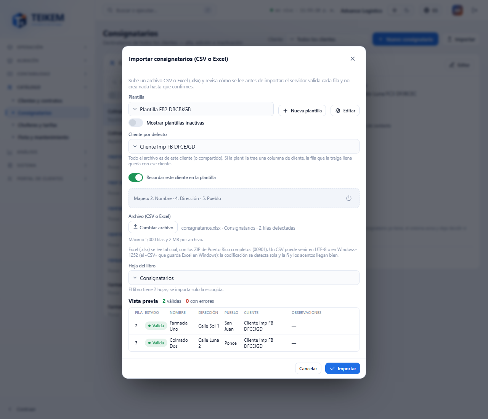
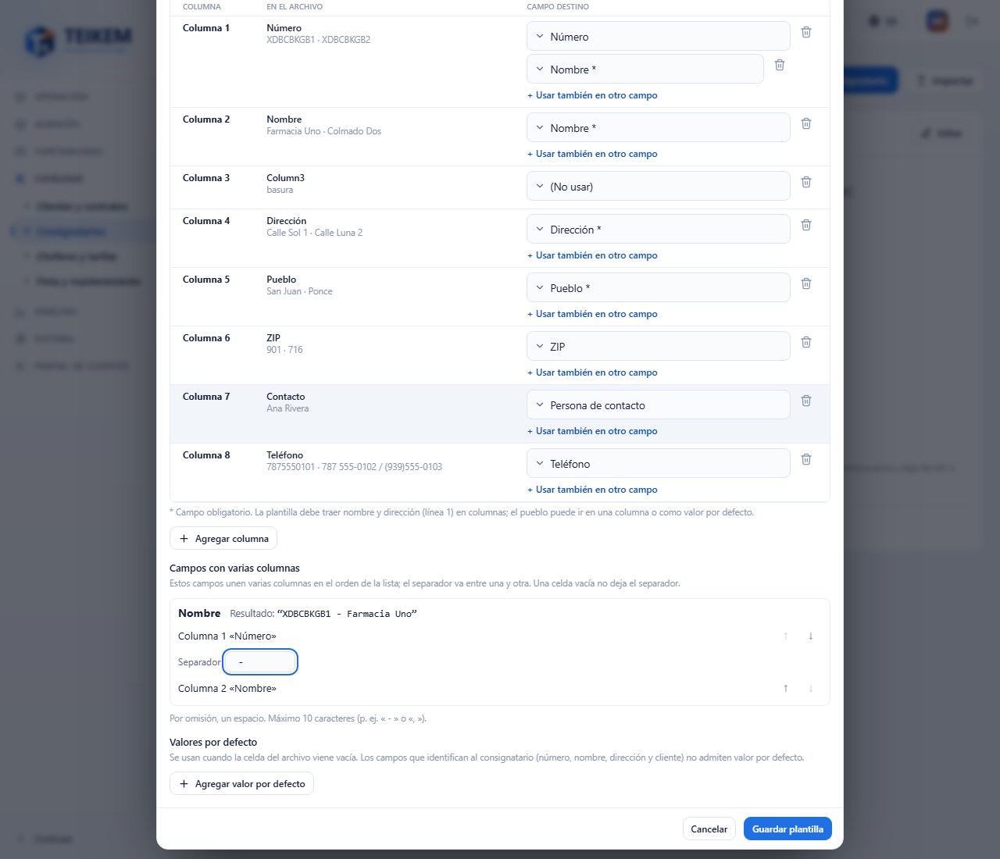
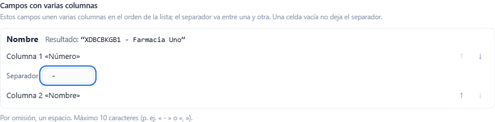
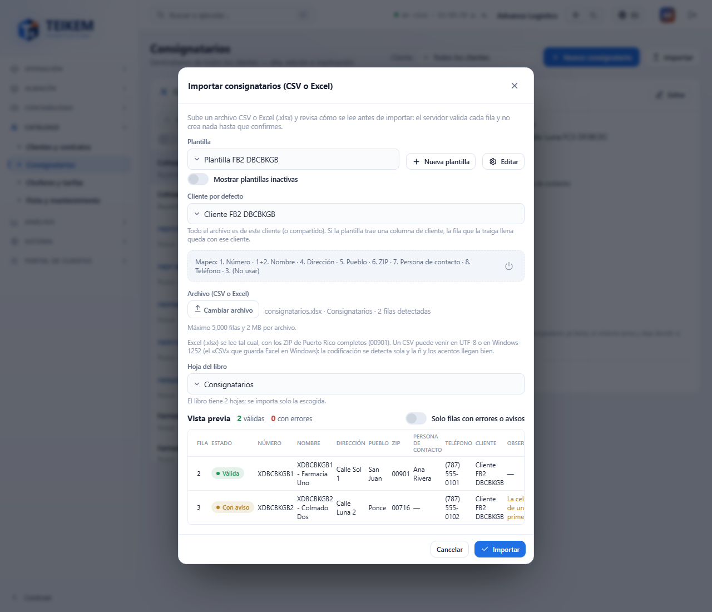
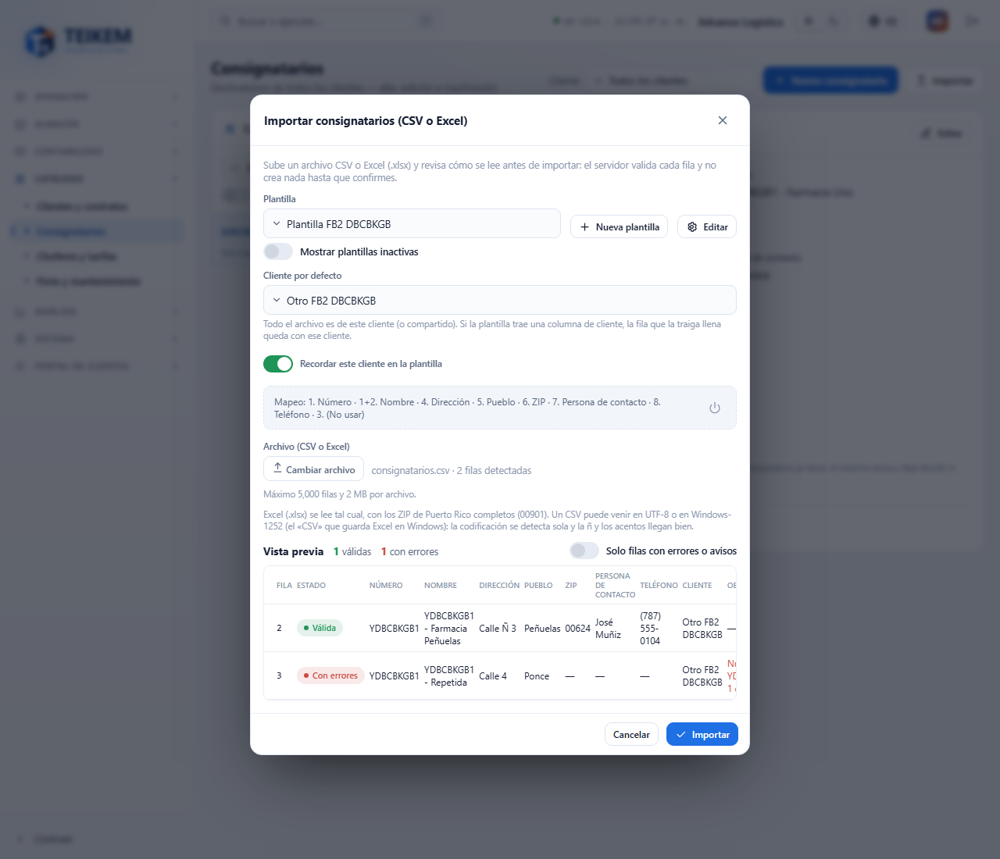
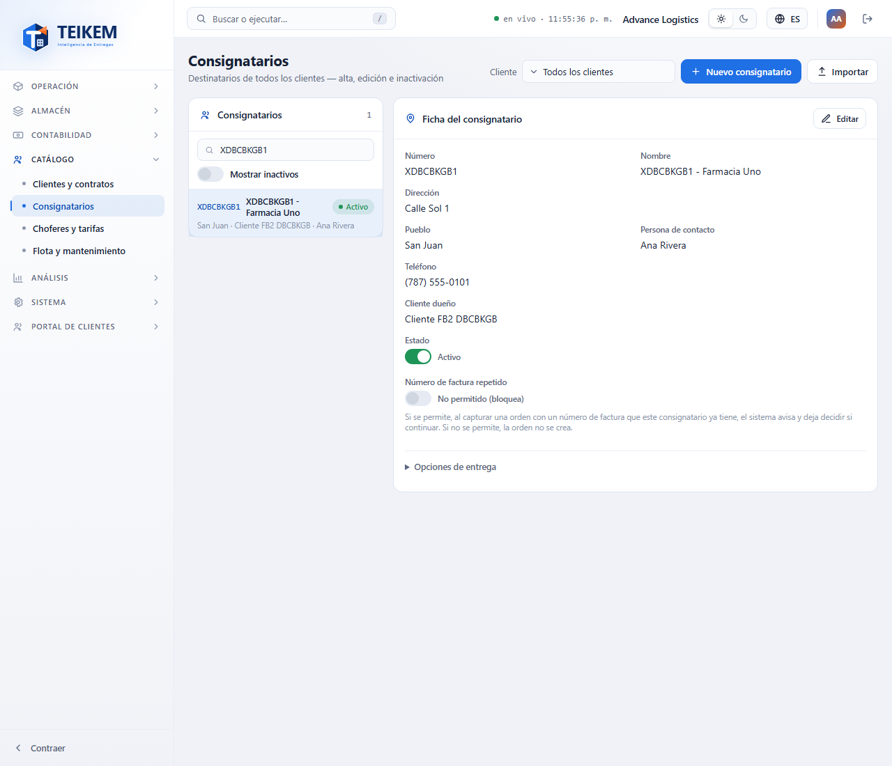

# F-B2 — Importar consignatarios: Excel, «(No usar)», columnas unidas, cliente por defecto y persona de contacto

Mejoras a **Listas → Consignatarios → Importar** (lote 45 / F-B2, 2026-10-13). Lo básico de la pantalla (plantilla, vista previa, Importar, Cancelar,
resultado, desactivar plantillas) sigue como en [fb-consignatarios.md](fb-consignatarios.md) §4. Detalle técnico y mensajes del servidor: capítulo 02, §2.2.
Decisiones: [loteFB2-decisiones.md](../../frontend/loteFB2-decisiones.md) y [lote45-decisiones.md](../../lote45-decisiones.md).

**Quién puede.** Igual que antes: el botón **Importar**, el editor de plantillas, **Revisar el archivo** e **Importar** piden `locations.create` con el módulo **Listas**. Ver la
persona de contacto en la ficha pide `locations.read`; cambiarla en **Editar**, `locations.update`. No hay permisos nuevos.

## 1. Archivo CSV o Excel

- El botón **Escoger archivo…** acepta **CSV** y **Excel (.xlsx)**. El archivo lo lee el servidor; no hace falta convertirlo.
- **Excel con varias hojas**: aparece **Hoja del libro** con las hojas del archivo («El libro tiene N hojas; se importa solo la escogida.»). Al principio se lee la
  primera; si los datos están en otra, escójala y el archivo se valida otra vez con esa hoja.
- **Ceros de los ZIP**: Excel guarda 00901 como el número 901. Teikem lo devuelve a **00901** (Puerto Rico y Estados Unidos, ZIP de 3 o 4 dígitos). Un ZIP con formato de
  ceros en Excel se lee tal cual. Un ZIP vacío no es error.
- **Fechas y horas de Excel**: una celda con hora (08:00) llega como `08:00`, lista para la ventana horaria; una fecha como `2026-10-13`.
- **CSV en UTF-8 o Windows-1252**: el «CSV» que guarda Excel en Windows ya no daña la ñ ni los acentos; la codificación se detecta sola.
- El archivo **.xls** viejo (Excel 97-2003) no se admite: guárdelo como **.xlsx** o **CSV**.
- Límites de siempre: 5.000 filas y 2 MB por archivo.

## 2. Cliente por defecto

- **Cliente por defecto** (antes «Cliente dueño de los consignatarios»): todo el archivo es de ese cliente (o compartido). Si la plantilla trae una columna de cliente
  (`Cliente (código)` o `Cliente (nombre)`) y la fila la trae **llena**, la fila queda con **ese** cliente aunque sea otro; antes eso era un error. Un archivo puede traer
  consignatarios de varios clientes.
- La vista previa tiene la columna **Cliente**: de quién queda cada fila.
- La plantilla **guarda su cliente por defecto**: al escoger la plantilla, el selector se pone solo en ese cliente.
- Si escoge otro cliente distinto del de la plantilla, aparece **Recordar este cliente en la plantilla** (encendido): al **Importar**, la plantilla se queda con ese
  cliente para la próxima vez. Apáguelo si es solo por esta vez.

## 3. El editor de plantillas

Escoja el archivo **antes** de abrir **Editar** o **Nueva plantilla**: el editor muestra entonces una fila por **cada columna del archivo**, con su encabezado y hasta
3 valores de muestra (**En el archivo**). Sin archivo, el editor funciona igual pero sin muestras.

- **Campo destino** de cada columna, o **(No usar)**: la columna se ignora por completo y **la fila se importa igual**. Las columnas «(No usar)» se guardan en la
  plantilla: al volver a abrirla, el editor muestra todas las columnas del archivo como las dejó (útil con archivos que traen columnas vacías o «Column2…Column11»).
- **Usar también en otro campo**: una misma columna puede llenar dos campos. Ejemplo: la columna «Número» va al **Número** del consignatario y también forma parte
  del **Nombre**. Si la columna pasa a «(No usar)», se le quitan los demás campos.
- **Cliente por defecto** de la plantilla (o «Sin cliente por defecto (compartidos)»).
- **Persona de contacto** es un campo nuevo del mapeo (admite valor por defecto, p. ej. «Recepción»). **Teléfono** se sigue guardando como el teléfono principal del
  consignatario.

### Campos con varias columnas

Cuando un campo de texto se escoge en **dos o más columnas** (por ejemplo Nombre en la columna 1 y en la 2, o una dirección partida en dos columnas), aparece esta
sección. Por cada campo:

- La lista de columnas **en el orden en que se unen**; **↑** y **↓** cambian el orden.
- **Separador** entre una columna y la siguiente (por omisión un espacio; hasta 10 caracteres, p. ej. « - » o «, »).
- **Resultado**: cómo queda la primera fila del archivo (sin archivo, «[Columna 1] - [Columna 2]»). Una celda vacía no deja el separador colgando.
- Se pueden unir hasta 5 columnas. País, cliente, minutos de servicio, horas de la ventana y «Permitir factura repetida» toman una sola columna.

## 4. La vista previa

- Las columnas de la vista previa son los **campos** de la plantilla (el nombre ya unido), más **Cliente** y **Observaciones**.
- **Teléfonos**: se aceptan `787-555-0101`, `787 555-0101`, `7875550101`, `(787)555-0101` y `+1 787…`; se guardan los 10 dígitos y se ven con el formato de la compañía.
  Si la celda trae **dos números**, se toma el primero y la fila sale **Con aviso**: «La celda del teléfono trae más de un número; se tomó el primero (…).» La fila se importa.
- **Número repetido en el archivo**: «El código X se repite en la fila N del archivo.» (dice el número y la primera fila donde aparece); esa fila no se importa.

## 5. La persona de contacto en la ficha

**Persona de contacto** se ve en la ficha, en la fila de la lista («pueblo · cliente · persona») y entra en el buscador. En **Nuevo consignatario** / **Editar** es un
campo opcional de hasta 150 caracteres («Máximo 150 caracteres.»); dejarlo vacío la borra.

## 6. Mensajes

| Dónde | Mensaje exacto | Qué hacer |
|---|---|---|
| Al escoger el archivo (400) | `Formato de archivo no admitido: use CSV o Excel (.xlsx).` | Abra el archivo en Excel y guárdelo como «Libro de Excel (.xlsx)» o «CSV». |
| Al escoger el archivo (400) | `No se pudo leer el archivo de Excel; ábralo y guárdelo otra vez como .xlsx.` | El libro está dañado o no es un .xlsx real: ábralo y «Guardar como» .xlsx. |
| Al cambiar la hoja (400) | `El libro no tiene la hoja 'X'.` | Alguien cambió el libro: escójalo otra vez. |
| Al escoger el archivo (400) | `El archivo supera el límite de 5.000 filas o 2 MB.` | Pártalo en archivos más pequeños. |
| Editor | `El campo X admite a lo sumo 5 columnas unidas.` | Una menos columnas en ese campo. |
| Editor | `El campo X está repetido.` | Ese campo (país, cliente, minutos, horas o factura repetida) va en una sola columna. |
| Editor (servidor) | `La columna N está marcada «No usar» y también tiene un campo asignado.` | Deje la columna en «(No usar)» o quítele el «(No usar)». |
| Editor (servidor) | `El separador admite a lo sumo 10 caracteres.` | Acorte el separador. |
| Editor (servidor) | `El cliente por defecto debe ser el mismo cliente de la plantilla.` | Una plantilla de un cliente solo admite ese cliente por defecto (o ninguno). |
| Editor (409) | `El cliente está dado de baja; solo se consulta su historial.` | Escoja otro cliente por defecto o reactive el cliente. |
| Vista previa (aviso) | `La celda del teléfono trae más de un número; se tomó el primero (7875550101).` | Revise en la ficha si el número es el correcto; el segundo no se guardó. |
| Vista previa (error) | `El código X se repite en la fila N del archivo.` | Corrija el número repetido en el archivo. |
| Vista previa / ficha | `Máximo 150 caracteres.` (persona de contacto) | Acorte el nombre de la persona. |

Todos están también en el [FAQ](../faq.md), sección «Lote 45 / F-B2».
