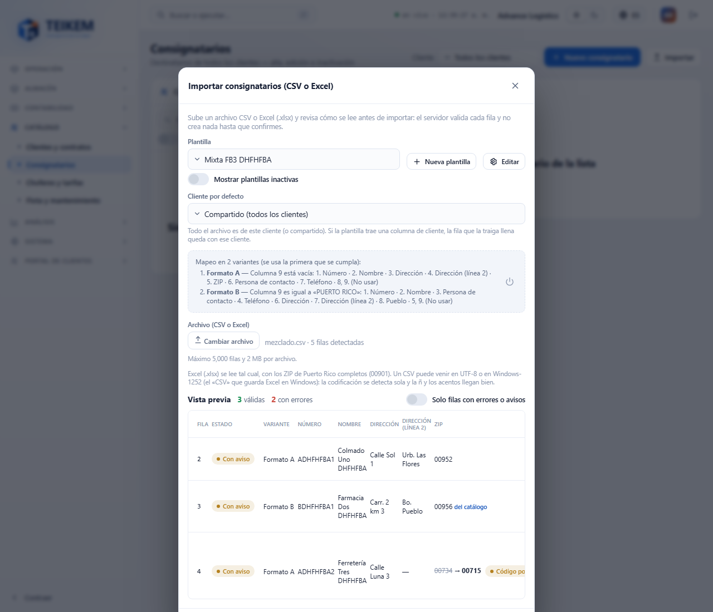
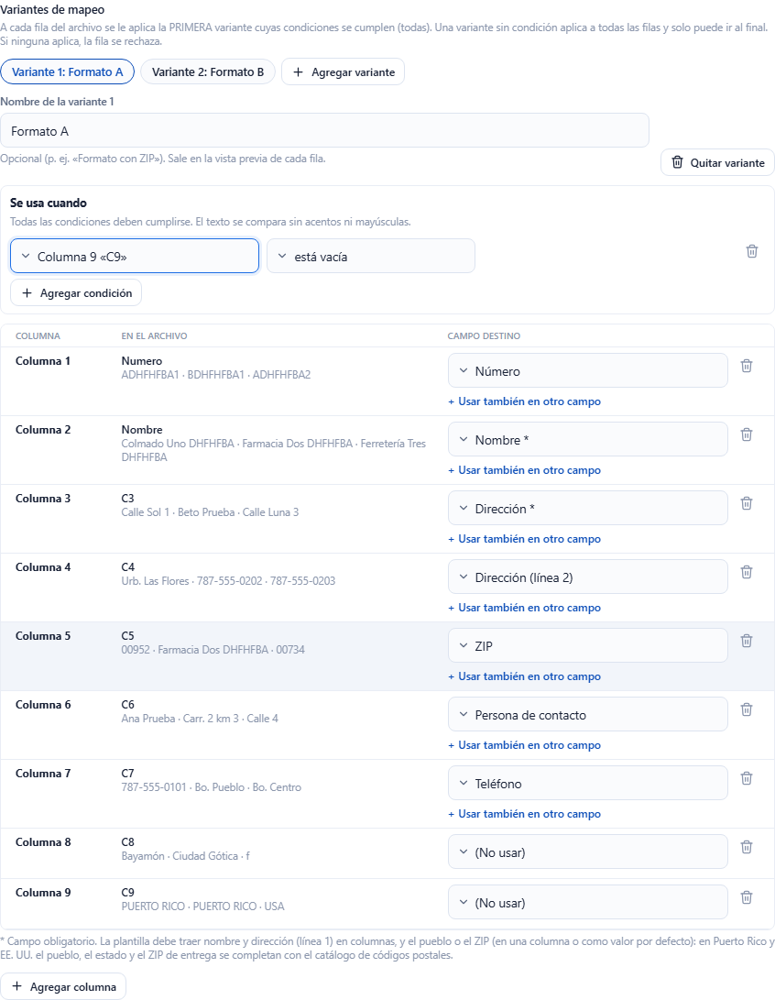
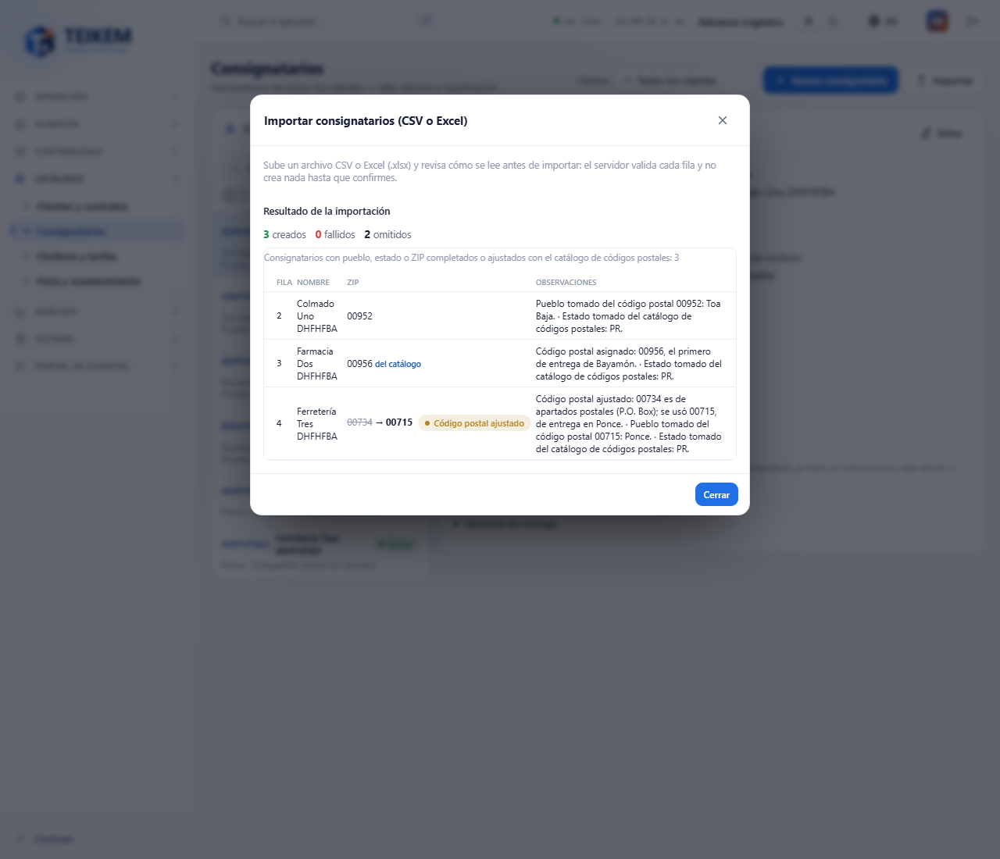
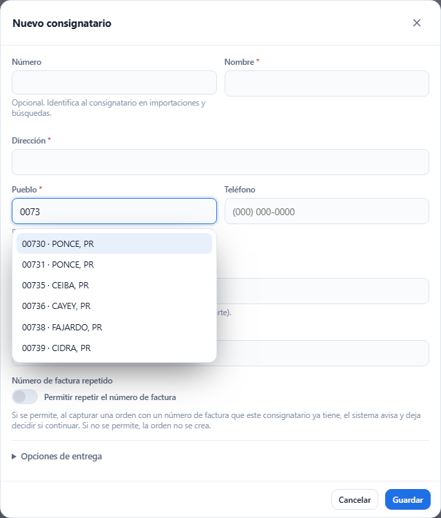

# F-B3 — Importar consignatarios: pueblo, estado y ZIP con la lista de códigos postales, y variantes de mapeo

Mejoras a **Listas → Consignatarios → Importar** (lote 46 / F-B3, 2026-10-14). Lo anterior de la pantalla sigue como en [fb-consignatarios.md](fb-consignatarios.md) §4 y
[fb2-importacion-consignatarios.md](fb2-importacion-consignatarios.md). Detalle técnico y mensajes del servidor: capítulo 02, §2.3. Decisiones:
[loteFB3-decisiones.md](../../frontend/loteFB3-decisiones.md) y [lote46-decisiones.md](../../lote46-decisiones.md).

**Quién puede.** Igual que antes: **Importar**, el editor de plantillas y las variantes piden `locations.create` con el módulo **Listas**. No hay permisos nuevos.

## 1. Pueblo, estado y ZIP de la lista de códigos postales

En Puerto Rico y Estados Unidos, Teikem completa la dirección de cada fila con el **lista de códigos postales** (el mismo del selector de pueblo):

| La fila trae | Qué hace Teikem | Lo que ve en la vista previa |
|---|---|---|
| Solo el **ZIP** | Pone el **pueblo** (en Puerto Rico, el municipio con acentos: 00952 → Toa Baja) y el **estado** (PR). | El pueblo y el estado con la marca **de la lista** y el aviso «Pueblo tomado del código postal 00952: Toa Baja.» |
| Solo el **pueblo** | Asigna el **primer ZIP de entrega** del pueblo (primero los normales, después los únicos; a igual tipo, el menor). Pone el estado. | El ZIP con **de la lista** y «Código postal asignado: 00956, el primero de entrega de Bayamón.» |
| **ZIP y pueblo** | Guarda los dos como vienen. Si no coinciden, solo avisa. | «El código postal 00716 es de Ponce, no de Caguas; se guardan los dos como vienen.» |
| Un ZIP de **apartados postales** (P.O. Box) o **militar** | Lo cambia por un ZIP de **entrega** de la **misma ciudad**. | **Código postal ajustado**: el original tachado → el nuevo, y «Código postal ajustado: 00734 es de apartados postales (P.O. Box); se usó 00715, de entrega en Ponce.» |
| Un ZIP o un pueblo que **no están** en la lista | Rechaza la fila. | La fila **Con errores** y el mensaje (ver §4). |

- Un consignatario es una dirección de **entrega**: usa solo ZIP **normales** (STANDARD) y **únicos** (UNIQUE). Los de apartados postales y los militares son para
  direcciones **postales** (como la dirección postal del cliente), no para entregar.
- El **estado** del archivo nunca se cambia: si no coincide con el del ZIP, solo hay aviso. Si viene vacío, se pone el de la lista.
- Los pueblos se comparan **sin acentos ni mayúsculas** («bayamon» = «Bayamón»; la lista del correo viene en MAYÚSCULAS sin acentos).
- Un ZIP+4 (00901-1234) vale por sus 5 dígitos y se guarda como viene.
- Otros países (que la lista no tiene) no cambian: el pueblo sigue siendo obligatorio.
- Teikem **no inventa nada**: lo que completa sale de la lista y queda dicho en la fila. Las coordenadas de la lista no se copian al consignatario.

## 2. Variantes de mapeo (un archivo con filas en distinto orden)

Algunos archivos mezclan filas con las columnas en distinto orden: por ejemplo, unas filas con **número, nombre, dirección 1, dirección 2, ZIP, contacto, teléfono** y otras
con **número, nombre, contacto, teléfono, nombre repetido, dirección 1, barrio, pueblo, «PUERTO RICO»**. Una plantilla con **variantes** los importa de una vez.

1. En **Editar** (o **Nueva plantilla**), debajo de **Cliente por defecto**, pulse **+ Agregar variante**. Aparecen las pestañas **Variante 1**, **Variante 2**…; la
   nueva copia el mapeo de la que estaba abierta.
2. En cada variante:
   - **Nombre de la variante** (opcional; p. ej. «Formato B»). Sale en la vista previa.
   - **Se usa cuando**: una o más condiciones sobre columnas del archivo — **es igual a**, **contiene**, **no está vacía**, **está vacía**. Todas deben cumplirse. El
     texto se compara sin acentos ni mayúsculas («puerto rico» = «PUERTO RICO»). Hasta 5 condiciones.
   - Su propio mapeo de columnas (con «(No usar)», columnas unidas, etc., como siempre).
3. A cada fila se le aplica la **primera** variante cuyas condiciones se cumplen. Una variante **sin condición** aplica a todas las filas: solo puede ir **al final**.
   **Mover antes** cambia el orden; **Quitar variante** la borra (con una sola variante, la plantilla vuelve a ser como antes).
4. Si **ninguna** variante aplica, la fila se rechaza y la vista previa muestra sus celdas («Celdas de la fila: …»).

Los **valores por defecto** son de toda la plantilla (valen para todas las variantes). Hasta 10 variantes.

En la ventana de importar, el resumen dice **Mapeo en 2 variantes (se usa la primera que se cumpla)** con la condición y las columnas de cada una. La vista previa trae la
columna **Variante** (cuál usó cada fila).

## 3. Resultado

Después de **Importar**, además de creados / fallidos / omitidos, una tabla lista los consignatarios **creados con pueblo, estado o ZIP completados o ajustados con el
lista**, con el ZIP (y el original tachado, si se ajustó) y sus avisos.

**Alta manual.** En **Nuevo consignatario** / **Editar**, el selector **Pueblo** ofrece solo ZIP de entrega (no salen los de apartados postales ni los militares).

## 4. Mensajes

| Mensaje | Dónde | Qué hacer |
|---|---|---|
| `El código postal 00999 no está en la lista de códigos postales; corríjalo, o déjelo vacío e indique el pueblo.` | fila (ZIP) | Corrija el ZIP o bórrelo y ponga el pueblo. |
| `El código postal 9A1 no es válido: use 5 dígitos (o ZIP+4, como 00901-1234).` | fila (ZIP) | Corrija el ZIP. |
| `El pueblo 'Ciudad Gótica' no está en la lista de códigos postales; corríjalo o indique el código postal.` | fila (Pueblo) | Corrija el nombre o ponga el ZIP. |
| `El pueblo 'X' no tiene un código postal de entrega (solo de apartados postales o militares); indique el código postal de la dirección física.` | fila (Pueblo) | Ponga el ZIP de la dirección física. |
| `El pueblo 'Springfield' existe en varios estados (IL, MA); indique el estado o el código postal.` | fila (Pueblo, EE. UU.) | Llene el estado o el ZIP. |
| `El código postal 09001 es de correo militar (APO/FPO) y APO no tiene un código postal de entrega con que sustituirlo; indique el código postal de la dirección física.` | fila (ZIP) | Ponga el ZIP de la dirección física. |
| `Ninguna variante de la plantilla aplica a esta fila; revise las condiciones de las variantes.` | fila (Variante) | Revise las condiciones o agregue una variante para ese formato. |
| `La variante 1 no tiene condición y deja sin uso a las que le siguen; póngala al final o agréguele una condición.` | editor | Use **Mover antes** en la otra o póngale una condición. |
| `Escoja la columna de la condición.` | editor | Escoja la columna en **Se usa cuando**. |
| `La condición «igual a» o «contiene» necesita un valor.` | editor | Escriba el valor. |
| `La plantilla debe indicar la ciudad (city) o el código postal (postalCode), en una columna o en defaults.` | editor | Mapee el pueblo o el ZIP (o déles valor por defecto). |

Avisos (la fila se importa): «Pueblo tomado del código postal…», «Estado tomado de la lista…», «Código postal asignado…», «Código postal ajustado…», «El código postal X
es de Y, no de Z; se guardan los dos como vienen.», «El estado X no coincide con el del código postal (PR); se guarda como viene.».

## 5. Fuentes de la lista

El tipo de cada ZIP (normal, apartados, único, militar), el distrito postal y la geolocalización se cargan con el script de datos `Diseño/logistica-db-zip-catalog.sql`:

- **USPS «Zip Locale Detail»**: tipo de ZIP, tipo de oficina, distrito y nombre postal.
- **GeoNames** (www.geonames.org): latitud, longitud y precisión de cada ZIP, con licencia **Creative Commons Atribución 4.0 (CC BY 4.0)**. Datos de geolocalización ©
  GeoNames, usados bajo esa licencia. Los ZIP que GeoNames no trae (militares y algunos de territorios) quedan sin coordenadas.

Sin ese script los ZIP quedan **sin clasificar**: se aceptan como de entrega y no hay «Código postal ajustado».
